Содержание

| Раздел | Стр. |
| --- | --- |
| Введение | 4 |
| 1 Описание предметной области | 6 |
| 1.1 Видение проекта | 6 |
| 1.2 Математические (вербальные) модели | 7 |
| 2 Проектирование программного модуля | 17 |
| 2.1 Перечень функциональности (User Stories) | 17 |
| 2.2 Сценарии взаимодействия (краткий и подробный) | 19 |
| 2.3 Прототипирование интерфейса взаимодействия с пользователем (графического интерфейса) | 20 |
| 2.4 Составление плана работы | 27 |
| 3 Разработка документации программного модуля | 30 |
| 3.1 Диаграмма классов | 30 |
| 3.2 Диаграмма вариантов использования | 36 |
| 3.3 Диаграммы последовательностей | 40 |
| 4 Разработка программного модуля | 41 |
| 4.1 Выбор и обоснование технологий, используемых в программном модуле | 41 |
| 4.2 Описание используемых структур данных | 42 |
| 5 Тестирование программного модуля | 50 |
| 5.1 План функционального тестирования | 50 |
| 5.2 Средства и порядок запуска автоматических тестов | 51 |
| 5.3 Соответствие объектов проверки файлам автоматических тестов | 51 |
| 5.4 Ручное тестирование веток с обращением к внешнему API | 52 |
| 5.5 Ограничения и выводы | 52 |
| 5.6 Наглядное представление результатов тестирования (таблицы и приложения со скриншотами) | 52 |
| 5.7 План нефункционального тестирования | 53 |
| 5.8 Сводная таблица критериев приёмки нефункционального тестирования | 53 |
| Заключение | 54 |
| Список использованных источников | 55 |

 
Введение

Современное продвижение IT-проектов в социальных сетях опирается на большие объёмы пользовательского контента и на сопоставление собственной стратегии с практикой конкурентов. Платформы вроде VK задают разные модели вовлечённости и доступные сигналы о реакции аудитории; при этом сырые выгрузки постов сами по себе плохо пригодны для аналитики и для последующего автоматического планирования: не хватает единой семантической разметки, компактных описаний темы и тона, согласованных с бизнес-целями публикации. Ручная разметка и составление черновиков планов не масштабируются и плохо увязаны с дальнейшими алгоритмами оптимизации. Это формирует потребность в программной подсистеме, которая подключает большие языковые модели (БЯМ) как промышленный сервис: с ограничениями по размеру запроса, с проверкой структуры ответа и с возможностью восстановления после частичных сбоев.
Целью курсовой работы в рассматриваемой части проекта является разработка подсистемы работы с большими языковыми моделями в составе системы проекта по автоматизации продвижения IT-проектов. В ходе работы предстоит:
	Провести анализ предметной области и места БЯМ в контуре «данные конкурентов → обогащение → прецеденты и планирование»;
	Спроектировать архитектуру обращения к внешнему API (единый клиент чат-дополнений, отдельный клиент эмбеддингов, конфигурация через переменные окружения);
	Реализовать конвейер семантического обогащения постов конкурентов с батчированием и валидацией JSON;
	Реализовать двухэтапную генерацию черновика контент-плана (скелет плана и помесячное заполнение публикаций) с режимом строгого JSON-ответа модели;
	Интегрировать векторные представления текстов для модуля прецедентов (поиск и сопоставление по смыслу);
	Обеспечить связку с пользовательским интерфейсом при запуске обогащения и отображении статуса (в том числе при частичном успехе батчей);
	Провести тестирование доступных без обращения к внешнему API компонентов и зафиксировать подход к проверке LLM-веток.
В результате работы создаётся программная подсистема, позволяющая:
	Обогащать структурированные данные о постах конкурентов, аудиторией и кратким резюме в формате;
	Формировать черновой контент-план через последовательные вызовы БЯМ с раздельной настройкой «жёсткости» генерации (температура и лимиты токенов на этапах скелета и месячных батчей);
	При необходимости выполнять постобработку текстов плана средствами БЯМ;
	Получать эмбеддинги текстов через тот же провайдер ключей, с пакетной отправкой запросов;
	Работать в условиях сетевых и модельных ошибок за счёт повторов, разбиения на батчи и частичного слияния успешных ответов там, где это предусмотрено кодом.

Настоящая пояснительная записка описывает подсистему работы с большими языковыми моделями, RAG по корпусу прецедентов и семантическое обогащение данных о постах конкурентов. Иные возможности состава продукта (в частности эволюционная оптимизация уже сформированного плана, просмотр агрегированной онтологии корпуса прецедентов, прогнозирование метрик отдельным ML-модулем) при необходимости упоминаются как смежный контекст и не рассматриваются как предмет разработки в рамках данной части работы.

Рисунок В.1 — Границы объёма пояснительной записки и смежные возможности продукта (схема Mermaid)

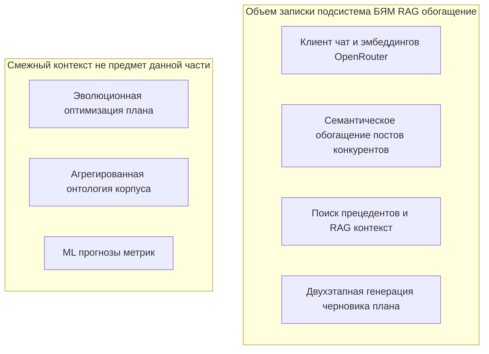

 
1 Описание предметной области

1.1 Видение проекта

Разрабатываемая подсистема — это набор программных модулей в системе проекта по автоматизации продвижения IT-проектов, которые обращаются к внешним большим языковым моделям через HTTP API агрегатора OpenRouter: отдельно для чат-дополнений и для вычисления эмбеддингов. Подсистема не обучает модели и не реализует генетическую оптимизацию; она формирует структурированные ответы в JSON (семантическое обогащение постов конкурентов, скелет и помесячные фрагменты черновика контент-плана) и вычисляет векторные представления текстов для дальнейшей работы репозитория прецедентов.
Основной целью подсистемы является надёжная интеграция БЯМ в прикладной контур: единый клиент запросов с авторизацией по ключу из окружения, таймаутами, логированием размера промпта и расхода токенов, ограничениями на размер батча и на длину текста поста при обогащении, а также устойчивостью к частичным отказам. Пользователь или интегратор получает возможность задавать модель и лимиты через переменные окружения.
Для достижения этих целей подсистема в репозитории решает следующие задачи: нормализация и нарезка входных данных конкурентов на батчи; вызов и разбор ответов модели с валидацией обязательных полей и соответствия множеству source_post_id; экспорт HTTP-маршрутов парсинга и обогащения; двухшаговая генерация черновика плана с разными температурами на этапах скелета и месячного батча; переписывание текстов плана с сохранением publication_id; пакетное получение эмбеддингов и их использование; информирование пользователя о ходе обогащения и частичных ошибках на стороне веб-клиента.
Пользователями подсистемы в смысле кода выступают как минимум две категории. Пользователь веб-приложения инициирует обогащение загруженного JSON с конкурентами, получает уведомления и автоматическую выгрузку результата или диагностического файла при сбоях. Клиент HTTP API (внешний сценарий или другой сервис) обращается к операциям parse, parse-and-enrich и enrich REST-сервера обогащения и к цепочкам планирования, внутри которых вызывается тот же клиент OpenRouter; для эмбеддингов потребителем является серверная логика сохранения и поиска прецедентов.
К основным возможностям подсистемы по факту реализации относятся: централизованный вызов чат-модели на уровне каждого сценария; режим ответа строгим JSON-объектом для обогащения, черновика плана; автоматическое батчирование обогащения с настраиваемыми порогами и запретом «слишком крупного» запроса при выключенном авто-батчинге; слияние семантики из нескольких успешных батчей и пометка `partial_enrichment` в метаданных при отвале отдельных батчей; отдельный контур эмбеддингов с разбиением длинных списков текстов на подзапросы; мягкий отказ при отсутствии ключа или при ошибке разбора JSON.
Внедрение подсистемы в состав системы проекта по автоматизации продвижения IT-проектов позволяет перевести разметку конкурентного контента и генерацию черновиков плана из ручного/разрозненного режима в контролируемый программный контур с проверкой схемы данных, уменьшить риск «немого» падения всего обогащения за счёт частичного успеха батчей там, где это поддержано кодом, и единообразно конфигурировать провайдера и модели через окружение без пересборки описания сценариев в коде.

1.2 Математические (вербальные) модели 

Смысл работы контура семантического обогащения заключается в следующем. На вход поступает структурированный набор конкурентов и их публикаций. Для каждой публикации до обращения к БЯМ детерминированно вычисляются числовая оценка вовлечённости и метка качества исходных метрик (по наличию просмотров или только суммы реакций). Затем каждая публикация сжимается до «облегчённого» представления: ограничивается длина текста, сохраняются идентификатор источника, платформа из допустимого перечня, метрики и вложения. Далее публикации одного конкурента последовательно наращивают текущий батч: пока не превышены верхние границы на число постов в батче и на размер UTF-8 представления JSON, пост добавляется; иначе текущий батч фиксируется и начинается новый. Для каждого батча формируется пользовательский промпт с жёстко заданной целевой схемой JSON и списком входных постов. Модель должна вернуть ровно один объект на каждый входной пост; поле цели публикации выбирается из фиксированного конечного множества допустимых значений. Ответ разбирается как JSON: сначала целиком, при неудаче — извлечением первого объекта в фигурных скобках. Программная проверка сопоставляет множество идентификаторов постов в ответе с ожидаемым множеством. Успешные батчи превращаются в отображения «идентификатор поста → семантические поля»; эти отображения объединяются поверх копии исходных данных. Если часть батчей так и не прошла проверку, итоговая структура может быть помечена как частично обогащённая, а ошибки фиксируются в метаданных. После слияния выполняются детерминированные постобработка и нормализация к целевой контент-модели с отдельной проверкой числовых диапазонов.
Смысл работы контура чат-генерации черновика плана — в двух последовательных решениях «запросить у модели JSON и принять только разобранный объект». Сначала по системному промпту скелета и контексту формируется скелет плана. Затем для каждого логического месяца по другому системному промпту запрашивается набор публикаций с несколько более высокой температурой; дальнейшая нормализация полей, дедупликация и эвристики текста выполняются уже без новых вызовов БЯМ в описанных точках кода.
Смысл контура эмбеддингов: список строк режется на подсписки ограниченной длины; для каждого подсписка выполняется один HTTP-запрос к сервису векторизации; пустые строки перед вызовом заменяются минимально допустимым содержимым, чтобы не получить отказ API. Векторы возвращаются в том же порядке, что и входные строки; дальнейшее использование (в том числе косинусное сходство) определяется кодом репозитория прецедентов.
Смысл работы контура формирования контент-плана конкурентов по итогам извлечения данных — в детерминированной сборке наблюдаемого плана из уже полученных семантических характеристик публикаций без повторных вызовов БЯМ. На вход для каждого конкурента j поступает множество публикаций p, для которых этап извлечения и семантического обогащения заранее заполнил поля, не выводимые чистыми алгоритмами над сырыми метриками и текстом: тему, тон, сегменты аудитории, цель публикации, краткое резюме и ключевые сущности, а также нормализованные оценки SPCJ и KPI-потенциала в publication_model. Для каждой публикации сначала выполняется приведение к целевой модели публикации с фиксированным идентификатором и проверкой числовых компонент на диапазон [0,1]; затем по совокупности постов конкурента программно восстанавливается объект content_plan_model типа observed_competitor_content_plan: горизонт планирования вычисляется по календарному размаху дат публикаций, недельная частота — по числу датированных слотов на длину наблюдаемого интервала (с нижней границей окна в одну неделю), сводные сегменты аудитории и платформа берутся из агрегирования полей публикаций, а publication_schedule формируется как упорядоченный набор слотов с привязкой planned_at к исходным датам и переносом семантических topic, format и objective из обогащённых моделей; quality_score слота определяется по приоритету из оценок ясности SPCJ, ожидаемой вовлечённости или локально рассчитанного engagement_rate. Параллельно строится content_strategy конкурента — доминирующий тон, лучшая тема по наблюдаемым метрикам, частые форматы и основные цели — как компактное описание стратегии поверх того же набора постов. Блок принимает только разобранные и слитые после извлечения данные; на выходе для каждого конкурента получается формализованный контент-план, пригодный для сохранения в корпус прецедентов и для последующего retrieval при генерации собственного черновика.
Знаковая (условно-формальная) модель тех же идей задаётся в коде через именованные сущности и правила: множество допустимых целей обогащения; множество платформ; функции измерения размера JSON и усечения текста; предикаты «батч допустим / превышен лимит»; правило слияния частичных ответов; флаги включения JSON-режима у провайдера и включения опционального переписывания плана.
Обозначения. Пусть j — индекс конкурента во входной структуре, p — индекс публикации внутри списка постов этого конкурента, b — порядковый номер батча обогащения (от нуля), t — индекс строки во входном списке при пакетном эмбеддинге. Пусть идентификатор поста для связывания запроса и ответа формируется детерминированно из идентификатора конкурента и индексов (как в конвейере обогащения). Пусть M_b — множество таких идентификаторов в батче b, а R_b — множество идентификаторов, фактически вернувшихся в ответе модели для этого батча; корректный ответ характеризуется равенством M_b = R_b и выполнением ограничений на значения полей.
Общая цепочка: источник данных конкурентов → локальный расчёт вовлечённости → нарезка на батчи → запрос к БЯМ → разбор и проверка JSON → слияние и нормализация; отдельной веткой — чат-генерация скелета и месячных публикаций плана; ещё веткой — эмбеддинги текстов для прецедентов. Рисунок 1.1
 
Таблица 1 – Формулы математической модели разрабатываемой подсистемы

| № | Формула | Где используется | Пояснение переменных |
| --- | --- | --- | --- |
| 1 | I(j,p) = L(j,p) + C(j,p) + S(j,p) | Расчёт суммарного сигнала реакции поста до обращения к модели | I(j,p) — суммарные взаимодействия; L(j,p) — лайки; C(j,p) — комментарии; S(j,p) — репосты; j — конкурент; p — пост |
| 2 | εj,p = round4(Ij,p/Vj,p) при Vj,p > 0; round4(Ij,p/(Ij,p+50)) при Vj,p = 0 и Ij,p > 0; 0 при Vj,p = 0 и Ij,p = 0 | Расчёт показателя вовлечённости поста (engagement_rate) | ε(j,p) — вовлечённость; V(j,p) — просмотры; round4 — округление до 4 знаков; при отсутствии просмотров используется прокси-оценка |
| 3 | mj,p = clip(trim(xj,p), Cmax) | Подготовка текста поста перед отправкой в модель | x(j,p) — исходный текст; trim — удаление лишних пробелов по краям; clip — обрезка до лимита; Cmax — предельная длина текста |
| 4 | \|M(j,b)\| ≤ Nmax, UTF8(P(j,b)) ≤ Bmax | Ограничения на один пакет запроса к модели | Mj,b — множество идентификаторов постов в пакете; \|Mj,b\| — число постов; Pj,b — полезная нагрузка пакета; UTF8(...) — размер в байтах; Nmax — лимит по числу постов; Bmax — лимит по размеру |
| 5 | maxb UTF8(P(j,b)) ≤ Rmax | Контроль верхнего ограничения размера запроса | maxb — максимум по всем пакетам b; Rmax — предельный размер запроса |
| 6 | V(j,b) = 1[M(j,b) = R(j,b)] · 1[D(j,b) = ∅] · 1[∀u∈R(j,b): o(u)∈Ω] | Проверка корректности ответа модели по пакету | Vj,b — признак валидности ответа; Rj,b — множество идентификаторов в ответе; Dj,b — дубликаты; o(u) — цель публикации; Ω — множество допустимых целей |
| 7 | Aj = ⋃b∈Bjok fj,b(σj,p) | Объединение успешных результатов по пакетам | Aj — итог обогащения для конкурента j; Bjok — множество корректно обработанных пакетов; fj,b — отображение «идентификатор → семантические поля»; σj,p — идентификатор поста |
| 8 | partialj = 1[\|Bjok\| < Bj] | Фиксация частичного результата обогащения | partialj — признак частичного обогащения; Bj — общее число пакетов; Bjok — множество успешных пакетов; \|Bjok\| — число успешных пакетов; 1[·] — индикаторная функция |
| 9 | sim(q, ek) = (qTek) / (\|q\|2 \|ek\|2) | Оценка смысловой близости запроса и прецедента | q — вектор запроса; ek — вектор k-го прецедента; qTek — скалярное произведение; \|\|·\|\|2 — евклидова норма |
| 10 | ŝk = clip[0,1]((sim(q, ek) + 1) / 2) | Приведение косинусной меры к диапазону [0,1] | ŝk — нормированная близость; clip[0,1] — ограничение в интервале от 0 до 1 |
| 11 | φk = 0.65·sk + 0.35·ρk | Итоговый вес прецедента при ранжировании | φk — общий вес; sk — оценка смысловой близости; ρk — оценка надёжности источника; коэффициенты 0.65 и 0.35 — веса вклада |
| 12 | π = TopKk(φk) | Отбор лучших прецедентов для контекста | π — упорядоченный список лучших элементов; TopK — выбор K наибольших значений φk |
| 13 | Sctx = Σr=1K wr φπr, Σr=1K wr = 1 | Расчёт сводной оценки качества контекста | Sctx — итоговая оценка контекста; wr — вес позиции r; φπr — вес прецедента на позиции r; сумма весов равна 1 |
| 14 | κ̄m = (Σi ωi κi,m) / (Σi ωi), ωi = max(0.2, ρi) | Взвешенное среднее целевых показателей по прецедентам | κ̄m — усреднённый показатель типа m; κi,m — значение показателя m у прецедента i; ωi — вес прецедента; ρi — его надёжность |
| 15 | Gdraft = Gskeleton ∘ Gmonth | Двухшаговая генерация чернового плана | Gskeleton — построение каркаса плана; Gmonth — заполнение публикаций по месяцам; ∘ — последовательная композиция |
| 16 | σj,p = idj ⊕ "_post_" ⊕ Dec(p) | Построение устойчивого идентификатора поста | σj,p — идентификатор поста; idj — идентификатор конкурента; ⊕ — сцепление строк; Dec(p) — номер поста в десятичной записи |
| 17 | ∀z ∈ (dimensions ∪ vector ∪ kpi_estimate): z ∈ [0, 1] | Проверка диапазонов после нормализации результата | z — любой элемент из наборов dimensions, vector, kpi_estimate; условие требует попадания в отрезок [0,1] |
| 18 | \|embeddings_response\| = \|input_batch\| | Проверка полноты ответа сервиса векторизации после пакетного запроса эмбеддингов | input_batch — число входных строк в одном пакете запроса; embeddings_response — число возвращённых векторов; вертикальные черты — количество элементов; равенство означает, что каждой входной строке соответствует ровно один вектор |

	Формула задаёт суммарный сигнал реакции на пост конкурента до любого обращения к языковой модели. Она просто складывает три типа взаимодействий: лайки, комментарии и репосты. Индекс j относится к конкуренту, индекс p — к конкретному посту этого конкурента. Такой агрегат удобен тем, что он отражает «живую активность» аудитории даже тогда, когда просмотры недоступны или ненадёжны.
	Расчёт показателя вовлечённости ε(j,p) (engagement_rate). Логика стандартная: если есть просмотры, то вовлечённость — это отношение суммарных реакций к просмотрам (с округлением до четырёх знаков). Если просмотров нет, но реакции есть, используется прокси-оценка, которая насыщается при росте суммы реакций (это нужно, чтобы не делить на неизвестный охват). Если нет ни просмотров, ни реакций, показатель равен нулю
	Это шаг подготовки текста поста к отправке в модель: сначала строка очищается от лишних пробелов по краям (trim), затем при необходимости обрезается до максимально допустимой длины (clip до Cmax. Это важно, потому что длинные тексты увеличивают размер запроса, ухудшают устойчивость JSON-ответа и повышают риск отказа по лимитам.
	Формула про ограничения на один пакет запроса к модели. Она требует одновременно двух условий: число постов в пакете не превышает верхний предел, а размер JSON-представления пакета в байтах UTF‑8 не превышает байтовый лимит. Практический смысл — модель получает управляемый по размеру вход, а сервер не отправляет «гигантские» запросы.
	Это глобальная проверка на случай, когда даже оптимальное разбиение на пакеты всё равно даёт слишком тяжёлый максимальный пакет относительно верхней границы размера запроса. Формула берёт максимум байтов среди пакетов и сравнивает его с Rmax. Если условие нарушено, корректнее остановить обработку до массовых вызовов модели и вернуть понятную диагностическую ошибку.
	Это формальная проверка приёмки ответа модели для конкретного пакета. Произведение индикаторов означает, что все условия должны выполниться одновременно: множество идентификаторов постов в ответе должно совпасть с ожидаемым, не должно быть дубликатов, и для каждой записи цель публикации должна принадлежать допустимому конечному набору. Если хотя бы один множитель равен нулю, пакет считается невалидным и дальше обычно включается повтор/компактный режим либо фиксируется частичный отказ.
	Здесь описывается слияние результатов по всем пакетам, которые прошли проверку. Для каждого успешного пакета есть отображение «идентификатор поста → семантические поля», и итог для конкурента получается объединением таких отображений по всем успешным пакетам. Смысл в том, что большой набор постов обрабатывается кусками, но на выходе пользователь должен получить цельную структуру данных, как если бы всё обработалось одним запросом.
	Это индикатор частичного обогащения: он становится равен 1, если число успешных пакетов меньше общего числа пакетов. То есть даже при наличии части хороших ответов система честно фиксирует, что результат неполный, и это должно отражаться в метаданных/ошибке разбора, чтобы не выдавать «полный успех» при потере части пакетов.
	Это классическая косинусная мера близости между вектором запроса и вектором кандидата (прецедента) в одном и том же пространстве признаков. Числитель — скалярное произведение, знаменатель — произведение евклидовых норм, что убирает влияние «длины» вектора и оставляет смысловую близость направлений. В реализации обычно отдельно обрабатывается случай нулевой нормы, чтобы не делить на ноль.
	Косинусная близость по природе лежит в диапазоне [-1,1], а для удобства интерпретации и смешивания с другими оценками её часто линейно переносят в [0,1] формулой «плюс один пополам», после чего результат жёстко ограничивают отрезком. Получается число, которое можно трактовать как «нормированную близость» в шкале от нуля до единицы.
	Здесь задаётся итоговый вес прецедента как выпуклая комбинация двух сигналов: смысловой близости и надёжности источника. Коэффициенты 0.65 и 0.35 задают, что при ранжировании чуть больше доверяют оценке близости, но надёжность всё равно заметно влияет — это снижает риск поднять наверх «похожий, но сомнительный» прецедент.
	Оператор TopK формирует список из Kпрецедентов с наибольшими итоговыми весами φk. Это и есть практическая реализация идеи retrieval: из большой базы выбирается небольшой, но наиболее релевантный контекст, который затем подаётся генератору плана.
	Формула задаёт агрегированную оценку качества выбранного контекста как взвешенную сумму весов прецедентов на позициях рейтинга. Ограничение ∑wr=1 делает величину сопоставимой между разными запусками: это не «сумма штрафов», а именно выпуклая комбинация, похожая на среднее с явными весами позиций.
	Это взвешенное среднее целевых показателей по прецедентам, где вес каждого прецедента зависит от его надёжности, но не опускается ниже порога 0.2. Смысл — даже слабонадёжные примеры могут чуть влиять на оценку, но не «обнуляют» вклад полностью; при этом сильно надёжные прецеденты доминируют сильнее.
	Запись через композицию ∘ означает двухэтапный генеративный процесс: сначала строится каркас плана (структура слотов и ограничений), затем отдельно выполняется помесячное заполнение публикаций. Это разделение снижает риск одновременной ошибки сразу по всему горизонту и позволяет на втором этапе учитывать уже зафиксированную структуру.
	Это правило детерминированного идентификатора поста, который связывает вход модели и ответ модели. Он собирается из идентификатора конкурента, фиксированного литерала _post_ и порядкового номера поста. Такой идентификатор устойчив к «съезду» индексов при пакетировании и позволяет автоматически проверить полноту ответа.
	Это набор ограничений допустимости для числовых полей после нормализации: любые компоненты, которые должны быть «долями/интенсивностями», принудительно лежат в отрезке от 0 до 1. Смысл — отсечь выход за пределы содержательной шкалы и не допустить противоречивых значений в итоговой контент‑модели.
	Это простая, но критичная проверка согласованности размеров ответа сервиса эмбеддингов: сколько строк отправили в пакете, столько векторов должно вернуться. Нарушение равенства почти всегда означает ошибку API, неверный разбор ответа или рассинхронизацию пакетов, и дальше использовать такие векторы для поиска прецедентов нельзя.
На рисунке 1.1 представлен алгоритм подготовки данных и формирования батчей в контуре семантического обогащения. На рисунке 1.2, соответственно, изображен алгоритм обработки батчей, включающий запрос к большой языковой модели (БЯМ), валидацию полученного ответа, а также последующее слияние и нормализацию результатов.

 

Рисунок 1.1 — Алгоритм подготовки данных и формирования батчей в контуре семантического обогащения
 

Рисунок 1.2 — Алгоритм обработки батчей: запрос к БЯМ, валидация ответа, слияние и нормализация результатов
 
2 Проектирование программного модуля 

2.1 Перечень функциональности (User Stories) 

В таблице 2.1 приведён перечень функциональности подсистемы работы с большими языковыми моделями, корпусом прецедентов (RAG) и семантическим обогащением постов конкурентов. Сценарии привязаны к объектам предметной области: посты конкурентов, публикации и слоты чернового контент-плана, запросы и результаты retrieval.

Таблица 2.1 – Перечень функциональности подсистемы работы с БЯМ

| Роль | Действие | Тип объекта | Объект | Дополнительные возможности |
| --- | --- | --- | --- | --- |
| | | | | *1. Семантическое обогащение данных конкурентов (LLM)* |
| Маркетолог / аналитик | Загружает | файл или JSON | структура конкурентов и постов для обогащения | экран формы проекта |
| Маркетолог / аналитик | Запускает | операция | семантическое обогащение полей каждой публикации конкурента | уведомления, автоматическая выгрузка JSON результата или диагностики |
| Система | Вызывает | HTTP-операция | POST /api/enrich с телом competitors_data | проверка лимитов запроса до вызова БЯМ |
| Система | Вычисляет локально | показатель | engagement_rate и качество метрик каждой публикации конкурента | до любого вызова БЯМ (enrichWithEngagementRate) |
| Система | Нарезает на батчи | агрегат | посты конкурентов для запросов к БЯМ | лимиты числа постов и размера полезной нагрузки UTF-8, ENRICH_AUTO_BATCH |
| Система | Запрашивает у БЯМ | батч | усечённые тексты и идентификаторы публикаций (source_post_id) | режим ответа JSON-объектом |
| Система | Сливает и нормализует | результат | полный набор постов после успешных батчей | частичное слияние при ошибках отдельных батчей |
| | | | | *2. Корпус прецедентов и RAG* |
| Маркетолог / аналитик | Инициирует | поиск | прецеденты (публикации и контент-планы конкурентов) по текстовому запросу | POST /api/precedents/search: query, limit, platform, audience_segments |
| Система | Выполняет | retrieval | searchPrecedents по запросу и фильтрам | ленивое вычисление и сохранение эмбеддингов документов при поиске; комбинация близости по эмбеддингу и пересечения по токенам |
| Система | Запрашивает | эмбеддинги | текстовые строки, связанные с постами и планами | разбиение списка на подпакеты по EMBEDDING_MAX_BATCH |
| | | | | *3. Генерация черновика контент-плана (LLM + RAG)* |
| Маркетолог / аналитик | Инициирует | генерация | черновой контент-план и публикации по слотам | POST /api/plan/generate или /generate-batched |
| Система | Формирует или принимает | запрос RAG | текст rag_query | при отсутствии текста в теле — buildRagQueryFromForm(form_input) |
| Система | Фильтрует | контекст retrieval | прецеденты для запроса | rag_limit (по умолчанию 8), platforms и audience_segments из формы |
| Система | Сжимает | контекст | результаты RAG для промпта | buildCompactRagContext(ragResults) |
| Система | Запрашивает у БЯМ | артефакт | JSON-скелет чернового контент-плана | системный промпт скелета, пониженная температура (~0.2), режим JSON |
| Система | Запрашивает у БЯМ | набор публикаций | публикации контент-плана за календарный месяц | RAG query, компактный RAG-контекст, skeleton, слоты месяца, контекст предыдущих месяцев |
| Система | Получает | ответ HTTP | черновик после этапов БЯМ+RAG | поля success, rag, draft, usage, generation_metadata |
| | | | | *4. Конфигурация и отказоустойчивость* |
| Система | Задаёт через окружение | конфигурация | ключ и модели OpenRouter, лимиты батчей и таймауты | OPENROUTER_API_KEY, AI_MODEL, EMBEDDING_MODEL, лимиты enrichment и эмбеддингов |
| Система | Обрабатывает | отказ | отсутствие ключа, ошибка HTTP API, невалидный JSON от БЯМ | логирование расхода токенов и размера промпта там, где предусмотрено клиентом |

Рисунок 2.0 — Логические блоки функциональности по таблице 2.1 (схема Mermaid)

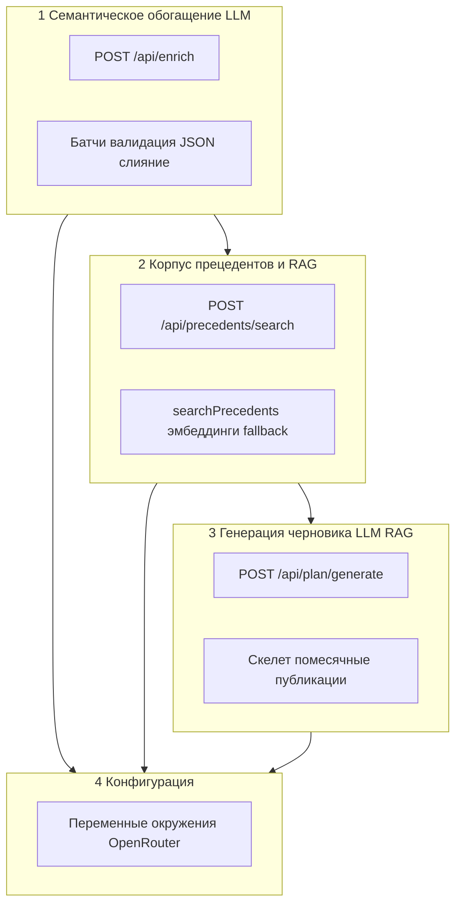

 
2.2 Сценарии взаимодействия (краткий и подробный) 

Краткий сценарий. На шаге с конкурентами пользователь (аналитик или маркетолог) получает посты конкурентов парсингом, которые затем проходят процесс семантического обогащения публикаций конкурентов через чат-БЯМ. Пользователь заполняет мастер проекта (данные IT-проекта, форматы, горизонт и частота контент-плана — поля валидируются перед генерацией). Для подбора похожих публикаций и планов конкурентов выполняется поиск прецедентов (на сервере используются эмбеддинги текстов). Для получения чернового контент-плана с заполненными публикациями по слотам клиент вызывает генерацию: сервер выполняет RAG-поиск и двухэтапную чат-генерацию скелета и помесячных публикаций плана. При необходимости после сборки черновика смежный модуль системы может дополнить публикации прогнозами метрик (это выходит за рамки описываемой подсистемы БЯМ). Просмотр итогового контент-плана и экспорт в Excel или PDF выполняются на странице контент-плана.

Рисунок 2.0а — Краткий сквозной сценарий подсистемы БЯМ и RAG (схема Mermaid)

Подробные сценарии.
1. Работа с постами конкурентов. Пользователь запускает парсинг данных конкурентов, а затем обогащение данных конкурентов в JSON: для каждой публикации конкурента на сервере вызывается чат-БЯМ батчами, возвращаются дополнительные поля, полученные с помощью обработки данных конкурентов LLM. Клиент показывает ход операции и при частичном успехе предупреждает о сбойных батчах; при необходимости автоматически скачивается JSON результата или диагностики.
2. Заполнение формы проекта и переходы мастера. Пользователь вводит описание проекта, аудиторию, форматы публикаций, даты и параметры расписания контент-плана. Перед генерацией черновика клиент проверяет обязательные поля; при ошибках показываются сообщения и подсветка полей.
3. Отдельный поиск прецедентов в интерфейсе. Пользователь нажимает действие подбора прецедентов: клиент формирует текстовый запрос из полей формы и отправляет POST на маршрут precedents/search с ограничением числа результатов, списком платформ и сегментами аудитории. Сервер выполняет поиск по базе прецедентов с использованием векторных представлений текстов (эмбеддинги — часть подсистемы доступа к OpenRouter). Ответ отображается списком карточек; при необходимости открывается модальное окно деталей публикации или плана конкурента. После успешного поиска клиент дополнительно запрашивает сводку по базе прецедентов.
4. Объединённое действие «прецеденты и черновик» в упрощённом потоке. В конфигурации интерфейса, где объединены поиск и генерация, одна кнопка последовательно вызывает сначала поиск прецедентов, затем генерацию черновика (тот же программный порядок, что и при ручном нажатии двух шагов подряд).
5. Генерация чернового контент-плана и публикаций по слотам. Пользователь запускает генерацию; клиент отправляет POST на маршрут plan/generate с безопасным подмножеством полей формы. На сервере, если пользователь ещё не искал прецеденты вручную, выполняется RAG-поиск по автоматически собранному запросу, затем пайплайн чат-БЯМ формирует скелет плана и помесячно наполняет публикации контент-плана. Клиент сохраняет черновик контент-плана в локальное хранилище снимков и показывает сводку.
6. Просмотр, история и экспорт контент-плана. На странице контент-плана пользователь видит выбранный снимок плана с публикациями. Доступны выгрузка в Excel и в PDF на стороне браузера по данным текущего плана. История снимков чернового контент-плана хранится в локальном хранилище браузера и позволяет вернуться к предыдущей версии.
Альтернативные и пограничные сценарии.
Сервер обогащения недоступен. Клиент проверяет маршрут health; кнопки, завязанные на обогащение и на генерацию черновика, остаются заблокированными до восстановления связи, пользователь видит предупреждение.
Частичное обогащение постов конкурентов. Часть батчей к БЯМ завершилась ошибкой валидации или API; сервер возвращает частично заполненные семантические поля публикаций и признак partial в метаданных; клиент показывает предупреждение и всё равно может сохранить результат для разбора.

2.3 Прототипирование интерфейса взаимодействия с пользователем (графического интерфейса)

На рисунке 2.1 изображен прототип блока заполнения сведений о производителе. В данном блоке расположены два обязательных поля: «Наименование производителя» и «Специфика деятельности». Оба поля участвуют в формировании прикладного контекста для последующего подбора прецедентов и генерации чернового контент-плана.

 

Рисунок 2.1 — Прототип блока заполнения сведений о производителе.

На рисунке 2.2 изображен прототип блока заполнения сведений об IT-проекте. Блок содержит поля «Наименование IT-проекта», «Описание IT-проекта», «Цели проекта», «Особенности проекта» и «Преимущества проекта». В совокупности эти данные образуют содержательную часть запроса для retrieval и определяют тематические рамки генерации чернового плана на стороне LLM.

 

Рисунок 2.2 — Прототип блока заполнения сведений об IT-проекте.

На рисунке 2.3 изображен прототип блока заполнения данных о профиле потребителя. В блок входят поле выбора «Категория потребителя» и текстовые поля для социально-демографических характеристик, цели приобретения и особенностей стиля жизни аудитории. Указанные параметры используются при построении аудиторных сегментов и повышают релевантность поиска прецедентов по базе публикаций и контент-планов.

 

Рисунок 2.3 — Прототип блока заполнения данных о профиле потребителя.

На рисунке 2.4 изображен прототип блока заполнения сведений о будущем контент-плане. В нём задаются даты начала и окончания, частота публикаций, режим дат публикации («Разные дни» или «Общие дни»), ключевые даты, форматы публикаций, требования к ролику (при выборе видеоформата) и целевые платформы. Эти параметры выступают входными ограничениями для формирования структуры чернового плана в LLM/RAG-контуре.
 

Рисунок 2.4 — Прототип блока заполнения сведений о будущем контент-плане.

На рисунке 2.5 изображен прототип блока проверки готовности к генерации контент-плана. Блок показывает сводные карточки «Данные» и «Статус», индикатор доступности backend, чек-лист готовности входных данных (описание проекта, аудитория, платформы, форматы, наличие данных конкурентов/прецедентов), а также сводку рисков. Данный этап предназначен для контроля полноты входа перед запуском retrieval и генерации.
 

Рисунок 2.5 — Прототип блока проверки готовности к генерации контент-плана.

На рисунке 2.6 изображен прототип блока подбора прецедентов у роли аналитика. В блоке реализованы действие «Подобрать прецеденты» и служебная загрузка демо-прецедентов для проверки сценария. Отдельно выводится источник поискового запроса, сформированный по данным формы проекта.

 

Рисунок 2.6 — Прототип блока подбора прецедентов у роли аналитика.

Рисунок 2.6а — Действия в блоке подбора прецедентов аналитика (схема Mermaid)

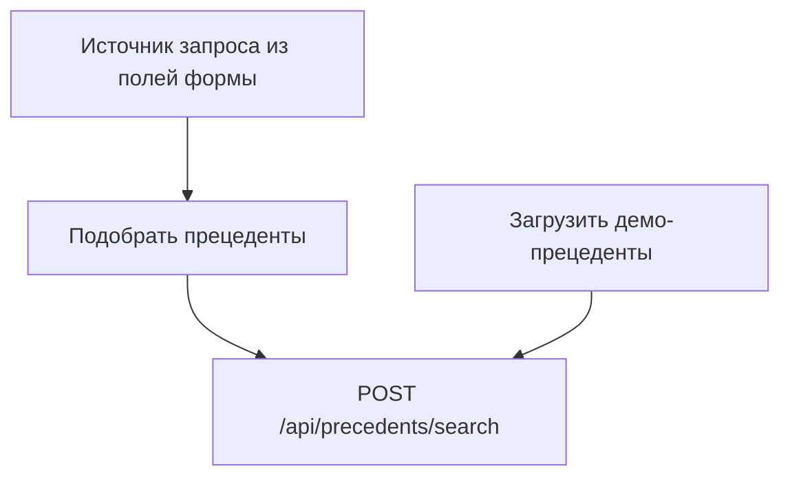

На рисунке 2.7 изображен прототип блока с результатами подобранных прецедентов у роли аналитика. Интерфейс отображает число найденных публикаций и контент-планов, карточки прецедентов с метаданными (конкурент, платформа, формат, аудитория), показатель надёжности/релевантности и пояснение «почему найдено». Дополнительно показывается тип retrieval-режима: семантический поиск по эмбеддингам либо fallback по пересечению токенов.

 

Рисунок 2.7 — Прототип блока с результатами подобранных прецедентов у роли аналитика.

На рисунке 2.8 изображен прототип блока, предназначенного для начала генерации чернового контент-плана с помощью LLM у роли аналитика. Блок содержит действия «Сформировать черновой план» и «Перейти к готовому плану». Для контура LLM/RAG ключевым является запуск формирования черновика и отображение его сводки (период, число публикаций, режим дат, целевой engagement).
 

Рисунок 2.8 — Прототип блока, предназначенного для начала генерации чернового контент-плана с помощью LLM у роли аналитика.

Рисунок 2.8а — Действия генерации черновика и перехода к плану аналитика (схема Mermaid)

На рисунке 2.9 изображен прототип блока, предназначенного для начала генерации чернового и подбора прецедентов у роли маркетолога. Для этой роли сценарий упрощён: в едином пользовательском потоке объединены шаги поиска прецедентов и генерации черновика, при этом технические детали скрыты, а интерфейс ориентирован на быстрый запуск операции по кнопке.

 

Рисунок 2.9 — Прототип блока, предназначенного для начала генерации чернового и подбора прецедентов у роли маркетолога.
 
2.4 Составление плана работы 

Данная курсовая работа отвечает за разработку подсистемы работы с большими языковыми моделями, включающей семантическое обогащение данных конкурентов, RAG по базе прецедентов и двухэтапную генерацию черновика контент-плана через API OpenRouter.

Индивидуальный календарный план работы по курсовой части был подготовлен с привлечением нейросетевой языковой модели DeepSeek. Модель использовалась на начальном этапе планирования как интеллектуальный ассистент: по заданному описанию предметной области (подсистема БЯМ, семантическое обогащение постов конкурентов, поиск прецедентов, двухэтапная генерация черновика контент-плана) она предложила логическую декомпозицию работы на последовательные этапы, ориентировочные формулировки ожидаемых результатов и распределение сроков в рамках семестрового окна. Полученный автоматически сформированный черновик плана был критически просмотрен и доработан автором: уточнены технические детали (ограничения поставщика OpenRouter, батчирование запросов, сценарии отказа и частичного успеха), согласованы формулировки этапов с фактическим объёмом реализуемой подсистемы и с реальным графиком выполнения. Таким образом, DeepSeek выступала вспомогательным инструментом при структурировании плана, а ответственность за итоговое содержание этапов и календарные границы несёт исполнитель курсовой работы.

Индивидуальный план работы включал следующие этапы.
Первый этап — анализ предметной области и постановка задачи. На этапе изучались ограничения поставщика OpenRouter, требования к формату JSON для постов конкурентов и для публикаций контент-плана, ограничения на размер батча и длину текста поста, а также сценарии отказа и частичного успеха. Были зафиксированы требования к переменным окружения и к взаимодействию с маршрутами приложения. Результатом этапа стало согласованное описание функций подсистемы БЯМ в терминах постов конкурентов, прецедентов и контент-плана. Срок выполнения: 9 февраля – 18 февраля.
Второй этап — проектирование и реализация единого клиента чат-дополнений. Был разработан модуль вызова HTTP API чат-модели с заголовками авторизации, таймаутом, логированием размера промпта и расхода токенов, поддержкой режима строгого JSON-ответа и единообразной обработкой ошибок HTTP. Клиент используется во всех перечисленных сценариях: семантическое обогащение публикаций конкурентов, генерация скелета и помесячных публикаций контент-плана, опциональное переписывание текстовых полей публикаций плана. Срок выполнения: 19 февраля – 28 февраля.
Третий этап — конвейер семантического обогащения постов конкурентов. Была реализована нормализация входных данных, локальный расчёт вовлечённости по метрикам публикации, нарезка постов на батчи по числу записей и размеру UTF-8, формирование пользовательского промпта с жёсткой схемой JSON, разбор и валидация ответа по множеству идентификаторов постов, повтор при невалидном ответе с «компактным» вариантом промпта и слияние успешных батчей в единую структуру данных постов конкурентов с метаданными о частичных сбоях. Срок выполнения: 1 марта – 10 марта.
Четвёртый этап — публикация REST-интерфейса обогащения и связка с парсером. Был обеспечен маршрут парсинга с обогащением, при успешной нормализации после цепочки parse-and-enrich выполняется сохранение прецедентов в базу, чтобы посты конкурентов были доступны для последующего семантического поиска и для генерации контент-плана. Срок выполнения: 11 марта – 20 марта.
Пятый этап — пайплайн генерации черновика контент-плана с участием БЯМ и RAG. Был реализован серверный сценарий: формирование или приём RAG-запроса, поиск релевантных прецедентов (публикации и планы), построение компактного контекста для промпта, последовательный вызов чат-БЯМ для построения JSON-скелета плана и для помесячного наполнения публикаций слотов плана, затем детерминированная нормализация полей публикаций. Срок выполнения: 21 марта – 31 марта.
Шестой этап — клиент эмбеддингов и интеграция в поиск прецедентов. Был реализован отдельный HTTP-клиент к сервису векторизации с батчированием строк, обработкой пустых строк и конфигурируемыми моделью и таймаутом; обеспечены вызовы из репозитория прецедентов при индексации и при семантическом поиске по текстам, связанным с постами и планами; при недоступности эмбеддингов предусмотрен откат к поиску по пересечению токенов. Срок выполнения: 1 апреля – 10 апреля.
Седьмой этап — опциональный LLM-проход разнообразия текстов публикаций контент-плана. Был реализован сбор компактного JSON с публикациями плана, вызов чат-БЯМ с ожиданием ответа-списка публикаций с теми же идентификаторами, слияние полей по publication_id и безопасный отказ без изменения плана при ошибке ключа или разбора JSON; включение сценария задаётся параметрами запроса или окружения, чтобы не вызывать БЯМ без явного намерения. Срок выполнения: 11 апреля – 20 апреля.
Восьмой этап — клиентская часть для операций с постами конкурентов и для мастера плана. Была реализована проверка доступности сервера обогащения, вызовы API обогащения и планирования из формы проекта, отображение статуса и частичных ошибок по батчам, сохранение снимков чернового контент-плана в локальном хранилище браузера, а также переход к странице просмотра контент-плана с экспортом в табличные и PDF-форматы по данным публикаций. Срок выполнения: 21 апреля – 30 апреля.
Девятый этап — тестирование и отладка. Были подготовлены автоматические тесты для детерминированных частей, интеграционные проверки маршрутов планирования без реального вызова внешнего LLM там, где это поддерживается конфигурацией тестов; для сценариев с обращением к OpenRouter использовались ручные прогоны с действующим ключом и анализ логов сервера. Срок выполнения: 1 мая – 10 мая.
Десятый этап — документирование. Результаты работы были оформлены в пояснительной записке по курсовой части; в документе зафиксированы конфигурация и ограничения для последующего сопровождения. Срок выполнения: 11 мая – 20 мая. 
3 Разработка документации программного модуля 

3.1 Диаграмма классов

На рисунке 3.1 изображена диаграмма классов.

 

Рисунок 3.1 – Диаграмма классов

Слой доступа к данным и внешним представлениям текстов
1. PrecedentCorpusRepository отвечает за локальное хранилище прецедентов на диске: коллекции публикаций и контент-планов конкурентов, метаданные, журнал загрузок. Знает корневой каталог данных и пути к JSON-файлам; выполняет запись после обогащения (`persistPrecedents`) и поиск по запросу (`searchPrecedents`).
Атрибуты:
	 precedentsRoot — корень данных прецедентов.
	 publicationsStorePath / contentPlansStorePath — где лежат массивы публикаций и планов.
	 metadataPath — сводная информация о версии схемы и обновлениях.
Что делает:
	 Читает и атомарно обновляет хранилище при сохранении обогащённых данных.
	 Выполняет RAG-поиск: при наличии ключа API доиндексирует отсутствующие эмбеддинги документов, комбинирует близость по эмбеддингу и пересечение по токенам, фильтрует по платформе и сегментам аудитории, возвращает ранжированные списки для генерации и для ответа клиенту.
2. OpenRouterEmbeddingsClient отвечает за обращение к HTTP API эмбеддингов OpenRouter: пакетная отправка текстов, таймаут, модель из окружения.
Атрибуты:
	 embeddingModel — идентификатор модели эмбеддингов.
	 maxBatchSize — максимум строк в одном запросе.
	 timeoutMs — ожидание ответа.
Что делает:
	 Вызывает `embedTexts`, возвращает векторы; предоставляет cosineSimilarity и нормализацию скора для смешивания с лексическим рангом в репозитории прецедентов.
Слой бизнес-логики (LLM и RAG для черновика и обогащение конкурентов)
1. OpenRouterChatGateway — единая точка вызова чат-модели через OpenRouter Chat Completions и высокоуровневая операция семантического обогащения массива конкурентов.
Атрибуты:
	 chatCompletionsUrl — адрес API дополнений.
	 apiKeyRef / chatModel — ключ и имя модели из переменных окружения.
Что делает:
	 callOpenRouterChat — запрос с опциональным режимом JSON-ответа, температура и лимиты токенов задаются по сценарию.
	 enrichCompetitorsData — перед вызовом LLM локально дополняет метриками вовлечённости (enrichWithEngagementRate, computePostEngagementMetrics), нарезает данные на батчи по лимитам, для каждого батча вызывает модель, валидирует и объединяет ответы; при отсутствии батчей возвращает нормализованные данные без LLM.
2. SemanticEnrichmentAssembler — логический компонент: правила нарезки на батчи, оценка размера запроса, слияние успешных батчей и проверка соответствия ответа отправленным идентификаторам постов.
Атрибуты:
	 maxPostsPerBatch, maxPayloadBytes и связанные лимиты из конфигурации.
Что делает:
	 Формирует батчи для enrichCompetitorsData, проверяет лимиты до вызова LLM, нормализует результат батча и итоговый документ.
3. CompetitorContentNormalizer приводит обогащённую структуру к единой доменной модели контента.
Что делает:
	 normalizeCompetitorsContentData после успешного или частичного обогащения.
4. RagAugmentedDraftPlanGenerator реализует генерацию чернового контент-плана с опорой на уже полученный RAG-контекст.
Что делает:
	 buildCompactRagContext — сжимает результаты поиска прецедентов для промпта.
	 Двухэтапная генерация через LLM: скелет плана (generateSkeleton), затем помесячное заполнение публикаций (generateMonthlyPublications); постобработка полей, валидация итогового draft_content_plan.
	 Сам retrieval не выполняет: ожидает ragResults от координатора.
5. PlanDraftGenerationCoordinator — логическая роль обработчика в связывает запрос клиента, RAG и генератор.
Что делает:
	 Проверяет form_input; строит текст запроса или принимает rag_query с клиента.
	 Вызывает searchPrecedents с лимитом и фильтрами, затем generateDraftPlanBatched; нормализует черновик под форму.
Слой пользовательского интерфейса и клиентских адаптеров

1. EnrichmentEndpointController принимает competitors_data, проверяет лимиты и вызывает enrichCompetitorsData; при успешном результате инициирует persistPrecedents.
2. CompetitorEnrichmentWorkbench — логическая роль хука useCompetitorsPipeline и связанных экранов формы проекта: хранит загруженный JSON конкурентов, состояние обогащения, вызывает API обогащения и обрабатывает успех, частичный успех и ошибки JSON.
3. DraftPlanGenerateApiAdapter отправляет POST /api/plan/generate (или /generate-batched) с form_input, опционально rag_query и rag_limit, разбирает ответ с полями rag, draft, usage.

На рисунке 3.2 изображена диаграмма базы данных.

 

Рисунок 3.2 – Диаграмма базы данных
Описание сущностей:
Сущность EmbeddingModelVersion предназначена для учёта версий модели векторного представления текстов (эмбеддинги постов и планов, а также запроса при семантическом поиске). Хранит технический идентификатор версии (id), имя модели у провайдера (model_name), размерность вектора (vector_dimension), сведения о поставщике (provider) и момент регистрации версии (released_at). На стороне «многих» выступают сущности Publication, ContentPlan и RagRetrievalLog: через внешний ключ задаётся, какой именно набор параметров эмбеддингов использован для построения или интерпретации вектора.
Сущность LlmModelVersion фиксирует конфигурацию чат-модели, применяемой при семантическом обогащении постов конкурентов. Содержит id, model_name, provider, ограничение контекста (context_window_max_tokens) и released_at. Связана с множеством записей SemanticEnrichmentSession: каждый сеанс обогащения однозначно относится к одной зарегистрированной версии LLM.
Сущность SemanticEnrichmentSession описывает единичный проход LLM-обогащения входного набора конкурентов (батчи, лимиты, агрегированный расход). Атрибуты: интервал выполнения (started_at, finished_at), итоговый статус (status), сериализованная конфигурация пайплайна (enrichment_config_json), сводка по токенам и вызовам (usage_aggregate_json), число батчей (batches_total). Родительская по отношению к связанному прогону загрузки IngestionRun в успешном сценарии «обогащение → сохранение прецедентов»; дочерняя по отношению к LlmModelVersion.
Сущность IngestionRun представляет журналальную запись о загрузке или обновлении корпуса прецедентов (после обогащения, импорта или слияния). Имеет суррогатный ключ id, уникальный прикладной идентификатор прогона (run_id), время создания (created_at), источник данных (source), агрегированные счётчики по конкурентам и по вставкам/обновлениям публикаций и контент-планов, а также вложенные структуры учёта дедупликации и пересчёта эмбеддингов (dedup_stats_json, embedding_stats_json). Выступает родителем для множества Publication и ContentPlan, отражая, в рамках какого прогона те или иные строки корпуса были внесены или актуализированы. Опционально ссылается на SemanticEnrichmentSession, если загрузка непосредственно следует за сеансом LLM-обогащения.
Сущность Publication хранит прецедент уровня отдельной публикации конкурента: уникальный бизнес-ключ (publication_id), идентификация конкурента и платформы, нормализованная модель контента (publication_model), при необходимости сырой текст и метрики (raw_content, raw_metrics), локально вычисленный engagement_rate, вектор признака для RAG (embedding) и временные метки сбора и векторизации. Связана с EmbeddingModelVersion (модель и размерность эмбеддинга) и с IngestionRun (прогон, которым зафиксировано попадание записи в корпус).
Сущность ContentPlan хранит прецедент уровня агрегированного контент-плана конкурента: ключ (plan_id), принадлежность конкуренту и платформе, структурированное описание плана (content_plan_model), эмбеддинг для семантического поиска и временные метки. Связи с EmbeddingModelVersion и IngestionRun аналогичны сущности Publication.

Рисунок 3.2в — Фрагмент ER сущности ContentPlan после исключения онтологического блока из модели записки (схема Mermaid)

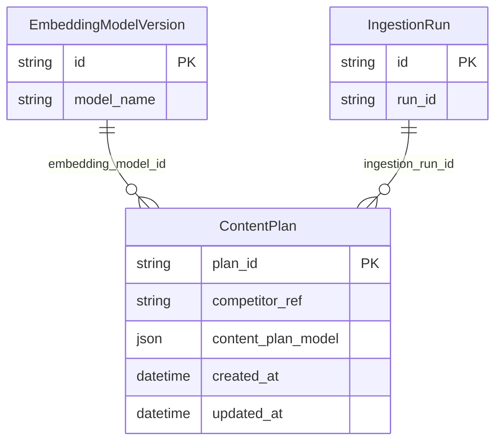

Сущность RagRetrievalLog предназначена для протоколирования обращений к корпусу прецедентов при подготовке RAG-контекста (например, перед генерацией черновика плана). Содержит текст или параметры запроса (rag_query_text), условия отбора (filter_json), ограничение числа кандидатов (top_k), интегральную оценку качества собранного контекста (context_quality_score), компактные ссылки на отобранные публикации и планы (top_publication_refs_json, top_content_plan_refs_json), время события (created_at). Связана с EmbeddingModelVersion, чтобы однозначно зафиксировать модель векторизации запроса.
Описание связей:
Связь LlmModelVersion — SemanticEnrichmentSession — неидентифицирующая, обязательная со стороны дочерней сущности, мощность 1:M. Одна версия чат-модели может участвовать во многих сеансах обогащения; каждый сеанс обязан ссылаться ровно на одну версию LLM. Смысл: воспроизводимость и аудит — по записи сеанса всегда восстанавливается использованная модель.
Связь SemanticEnrichmentSession — IngestionRun — неидентифицирующая, условно обязательная, на уровне предметной области чаще всего интерпретируется как 1:0..1 с двух сторон в общем случае и как 1:1 в типовом успешном сценарии. С семантики сеанса обогащения: при успешном сохранении прецедентов создаётся ровно один логически сопряжённый прогон загрузки; при сбое persist запись IngestionRun может отсутствовать. С другой стороны, IngestionRun без предшествующего LLM (импорт из файла, демо-загрузка) допускает отсутствие ссылки на SemanticEnrichmentSession. В ER по внешнему ключу это выражается как необязательный semantic_enrichment_session_id на стороне загрузки или эквивалентная модель.
Связь IngestionRun — Publication — неидентифицирующая, с точки зрения учёта происхождения данных обязательная для строк, участвующих в данном прогоне, мощность 1:M. Один прогон загрузки охватывает множество публикаций; каждая строка Publication, отнесённая к прогону, ссылается не более чем на один IngestionRun (последняя актуализация через выбранный прогон — по правилам конкретной реализации).
Связь IngestionRun — ContentPlan — неидентифицирующая, мощность 1:M, семантика та же, что для Publication: один журнальный прогон агрегирует множество контент-планов, каждый план в контексте прогона связан с одним идентификатором загрузки.
Связь EmbeddingModelVersion — Publication — неидентифицирующая, для записей с ненулевым эмбеддингом обязательная со стороны интерпретации вектора, мощность 1:M. Много публикаций могут быть векторизованы одной и той же версией модели; каждая публикация с заполненным embedding относится к ровно одной версии (при смене модели выполняется перевекторизация и смена связи).
Связь EmbeddingModelVersion — ContentPlan — неидентифицирующая, мощность 1:M, условия обязательности и смысл совпадают со связью для Publication.
Связь EmbeddingModelVersion — RagRetrievalLog — неидентифицирующая, обязательная при политике полного аудита запросов, мощность 1:M. Одна версия модели запросных эмбеддингов используется во многих зарегистрированных обращениях к поиску; каждая запись лога относится к одной версии, чтобы сопоставлять сопоставимость косинусной близости и размерность вектора.

3.2 Диаграмма вариантов использования 

Маркетолог — заполняет прикладной контекст проекта и аудитории, использует готовые данные конкурентов, запускает упрощённый сценарий подбора прецедентов и генерации AI-черновика, просматривает найденные прецеденты и результат генерации.
Аналитик — контролирует качество корпуса прецедентов: запускает и проверяет LLM-обогащение готового JSON с публикациями конкурентов, отдельно подбирает прецеденты, анализирует сводку корпуса, запускает генерацию черновика с RAG-контекстом.
На рисунке 3.3 изображена диаграмма вариантов использования.

Рисунок 3.3 – Диаграмма вариантов использования (схема Mermaid)

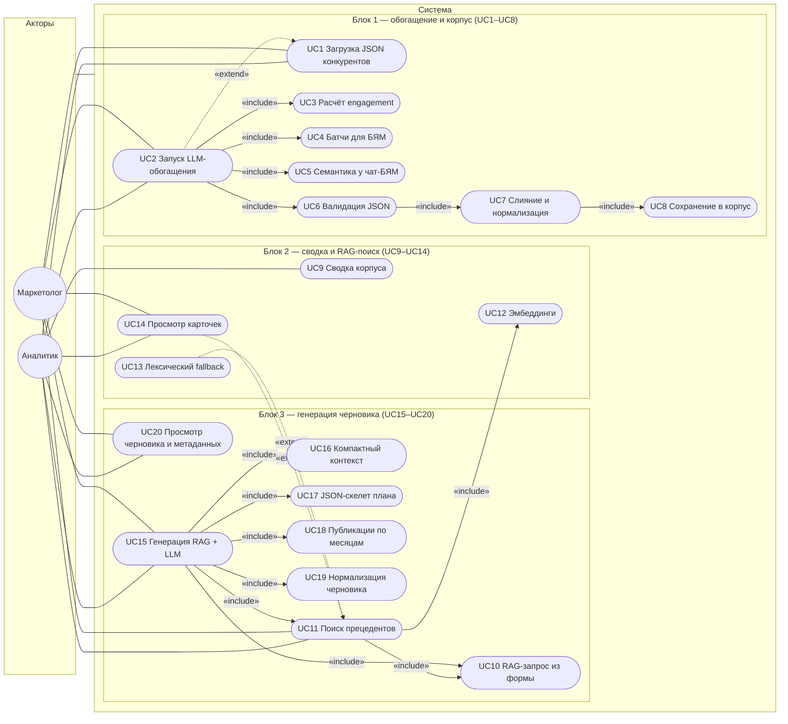

В таблице 3.1 представлено описание диаграммы использования.

Таблица 3.1 – Описание диаграммы использования

| № | Прецедент | Требования (блок из таблицы 2.1) | Описание |
| --- | --- | --- | --- |
| UC1 | Загрузка готовых данных конкурентов для обогащения | 1 | Маркетолог или аналитик передаёт в систему подготовленный JSON с конкурентами и публикациями; данные становятся входом для LLM-обогащения через competitors_data. |
| UC2 | Запуск LLM-обогащения постов конкурентов | 1 | Маркетолог или аналитик инициирует обработку готовых публикаций: сервер проверяет лимиты, вызывает enrichCompetitorsData и возвращает улучшенную структуру с семантическими полями. |
| UC3 | Локальный расчёт engagement_rate и качества метрик | 1 | До обращения к БЯМ сервер вычисляет вовлечённость и признак качества метрик для каждой публикации конкурента (views_based, interaction_proxy, unknown). |
| UC4 | Разбиение постов конкурентов на LLM-батчи | 1 | Публикации разбиваются по числу записей и размеру полезной нагрузки, чтобы каждый запрос к БЯМ укладывался в ограничения конфигурации enrichment. |
| UC5 | Запрос семантических признаков у чат-БЯМ | 1 | Для каждого батча вызывается callOpenRouterChat в режиме строгого JSON; модель возвращает topic, tone, target_audience, objective, summary, key_entities по каждому source_post_id. |
| UC6 | Валидация строгого JSON-ответа БЯМ | 1 | Сервер разбирает JSON-ответ, проверяет наличие ожидаемых идентификаторов, допустимость objective и обязательные семантические поля. |
| UC7 | Слияние результатов батчей и нормализация данных | 1 | Валидные ответы батчей объединяются с исходными публикациями; итоговая структура приводится к единой модели данных конкурентов. |
| UC8 | Сохранение обогащённых публикаций в корпус прецедентов | 2 | После успешного обогащения публикации и связанные контент-планы сохраняются в локальный корпус прецедентов через persistPrecedents. |
| UC9 | Просмотр сводки корпуса прецедентов | 2 | Аналитик получает количество публикаций, контент-планов и информацию о последнем обновлении корпуса через GET /api/precedents/summary. |
| UC10 | Формирование RAG-запроса из данных формы проекта | 2, 3 | Система собирает текст запроса из описания проекта, аудитории, платформ, преимуществ и других полей формы; при явном rag_query использует переданную строку. |
| UC11 | Поиск релевантных прецедентов по смыслу | 2 | Маркетолог или аналитик инициирует поиск публикаций и контент-планов-прецедентов; сервер применяет searchPrecedents с лимитом, платформами и сегментами аудитории. |
| UC12 | Получение эмбеддингов для запроса и документов | 2 | При доступной конфигурации OpenRouter Embeddings система векторизует запрос и недостающие документы, затем ранжирует кандидатов по гибридной оценке. |
| UC13 | Лексический fallback при недоступности эмбеддингов | 2, 4 | Если эмбеддинги недоступны, поиск не прерывает пользовательский сценарий и переходит к оценке по пересечению токенов. |
| UC14 | Просмотр найденных публикаций и контент-планов-прецедентов | 2 | Пользователь видит карточки найденных прецедентов, показатель релевантности или надёжности, причину нахождения и режим retrieval. |
| UC15 | Запуск генерации чернового контент-плана через RAG + LLM | 3 | Маркетолог или аналитик отправляет form_input на маршрут генерации; сервер выполняет RAG-поиск, затем запускает двухшаговую LLM-генерацию черновика. |
| UC16 | Сбор компактного RAG-контекста для промпта | 3 | Система выбирает наиболее релевантные публикации и планы из результатов поиска и сокращает их до компактного контекста для промптов генерации. |
| UC17 | Генерация JSON-скелета контент-плана | 3 | Чат-БЯМ формирует структурный скелет плана: горизонт, платформы, ограничения, KPI-ориентиры и слоты публикаций. |
| UC18 | Помесячная генерация публикаций по слотам | 3 | Чат-БЯМ генерирует публикации по группам месяцев с учётом скелета, RAG-контекста, слотов текущего месяца и ранее созданных публикаций. |
| UC19 | Нормализация и проверка черновика после ответа БЯМ | 3 | Сервер нормализует поля публикаций, выравнивает тональность и CTA, удаляет повторы, проверяет итоговую структуру draft_content_plan. |
| UC20 | Просмотр черновика, RAG-результатов и метаданных генерации | 3 | Маркетолог или аналитик получает черновой план, список использованных прецедентов, usage и generation_metadata, затем переходит к просмотру результата. |

Пояснение связей представлено в таблице 3.2.

Таблица 3.2 – Пояснение связей

| Связь | Тип | Смысл |
| --- | --- | --- |
| UC1 → UC2 | extend | После загрузки готовых данных конкурентов пользователь может запустить LLM-обогащение. |
| UC2 → UC3 | include | Каждый запуск обогащения начинается с локального расчёта вовлечённости по метрикам публикации. |
| UC2 → UC4 | include | Перед вызовом БЯМ публикации разбиваются на батчи согласно лимитам размера и количества постов. |
| UC2 → UC5 | include | Каждый батч отправляется в чат-БЯМ с ожиданием JSON-ответа заданной структуры. |
| UC2 → UC6 | include | Ответы модели проходят проверку полноты и допустимости семантических значений. |
| UC6 → UC7 | include | После успешной проверки результаты батчей сливаются с исходными публикациями и нормализуются. |
| UC7 → UC8 | include | Нормализованные обогащённые публикации сохраняются в корпус прецедентов. |
| UC11 → UC10 | include | Поиск прецедентов использует текстовый RAG-запрос, собранный из формы или переданный явно. |
| UC11 → UC12 | include | Основной режим поиска использует эмбеддинги запроса и документов. |
| UC13 → UC11 | extend | Лексический режим подключается только при недоступности эмбеддингов или ошибке векторного поиска. |
| UC14 → UC11 | extend | Просмотр карточек прецедентов выполняется после успешного поиска. |
| UC15 → UC10 | include | Перед генерацией сервер строит или принимает RAG-запрос по данным формы. |
| UC15 → UC11 | include | Генерация черновика всегда опирается на серверный поиск прецедентов. |
| UC15 → UC16 | include | Найденные прецеденты сжимаются в компактный контекст для промпта. |
| UC15 → UC17 | include | На первом LLM-шаге формируется JSON-скелет будущего плана. |
| UC15 → UC18 | include | На втором LLM-шаге публикации генерируются помесячно по слотам. |
| UC15 → UC19 | include | После ответов БЯМ итоговый черновик нормализуется и валидируется. |

Рисунок 3.2а — Группы вариантов использования UC1–UC20 и актёры (схема Mermaid)

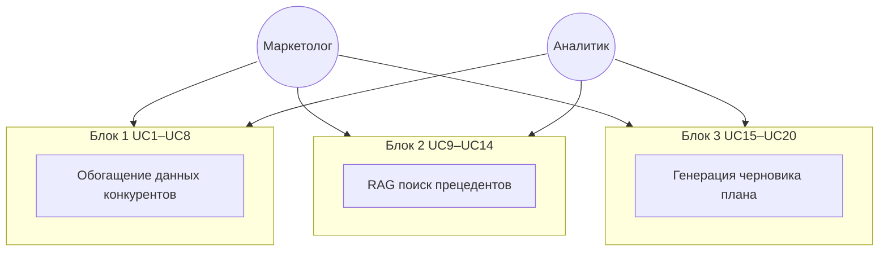

Рисунок 3.2б — Ключевые связи include и extend между прецедентами генерации и RAG (фрагмент таблицы 3.2, Mermaid)

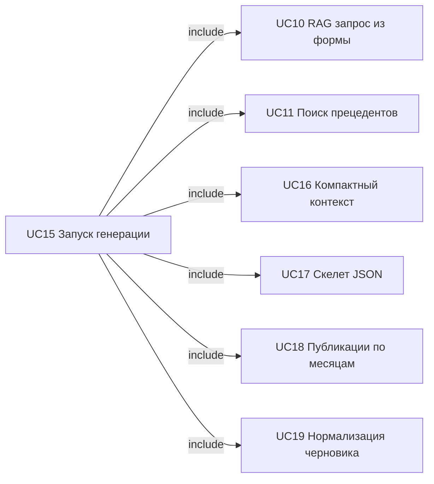

3.3 Диаграммы последовательностей

Для вариантов использования UC1–UC20 разработаны три обобщающие диаграммы последовательности (рис. 3.4–3.6): каждая детализирует сквозную цепочку сообщений, обеспечивающую реализацию соответствующего блока функциональности из табл. 2.1 и группы прецедентов из табл. 3.1 (сводка — табл. 3.3). Отдельный рисунок на каждый UC не выделялся: связанные прецеденты с отношениями include и extend покрываются одной диаграммой. На рисунках используются конкретные элементы UI: мастер проекта ProjectForm.jsx, панель прецедентов PrecedentSearchPanel и панель запуска черновика DraftPlanWorkflowPanel. Сообщения отражают действия пользователя, клиентские функции-обёртки из enrichmentService.js и реальные серверные методы, участвующие в конвейере БЯМ и RAG.

Таблица 3.3 – Соответствие диаграмм последовательности функциональности и вариантам использования

| Рисунок | Блок табл. 2.1 | Реализуемая функциональность (кратко) | Варианты использования | Ключевой HTTP / UI |
| --- | --- | --- | --- | --- |
| 3.4 | 1 | Семантическое обогащение постов конкурентов через БЯМ | UC1–UC8 | POST /api/enrich, ProjectForm.jsx |
| 3.5 | 2 | Поиск прецедентов и сводка корпуса (RAG) | UC9–UC14 | POST /api/precedents/search, GET /api/precedents/summary, PrecedentSearchPanel |
| 3.6 | 3 | Генерация чернового контент-плана (RAG + LLM) | UC15–UC20 (в т.ч. повтор UC10–UC11) | POST /api/plan/generate, DraftPlanWorkflowPanel |

Блок 4 табл. 2.1 (конфигурация и отказоустойчивость) отдельной диаграммой не представлен: он проявляется на всех трёх рисунках в альтернативных ветках — проверка лимитов запроса до вызова БЯМ (рис. 3.4), лексический fallback при недоступности эмбеддингов (рис. 3.5, UC13), обработка частичного успеха батчей.

Последовательность действий на рис. 3.4 обеспечивает реализацию функции семантического обогащения данных конкурентов (блок 1 табл. 2.1) и прецедентов UC1–UC8: от загрузки competitors_data до сохранения обогащённого корпуса.
На рисунке 3.4 показан путь, который начинается с уже подготовленной структуры competitors_data (UC1). Участник «Пользователь» — это маркетолог или аналитик, который работает в мастере ProjectForm.jsx и передаёт в систему JSON с конкурентами и их публикациями. Компонент не вызывает БЯМ напрямую: он обращается к клиентской функции enrichCompetitorsData из enrichmentService.js, а та отправляет тело запроса на маршрут /api/enrich (UC2).
Маршрут /api/enrich сначала проверяет, что в теле есть массив competitors, затем читает конфигурацию enrichment и вычисляет ограничения запроса: число постов, размер полезной нагрузки, число батчей и максимальный размер батча. Если вход выходит за допустимый размер, обработчик возвращает ошибку до обращения к модели (блок 4). Если запрос проходит проверку, управление передаётся в серверную функцию enrichCompetitorsData из openrouter.js.
Внутри серверного участника сначала выполняется детерминированная часть, не связанная с БЯМ: для каждой публикации вызывается расчёт вовлечённости через enrichWithEngagementRate (UC3), а качество метрик фиксируется как views_based, interaction_proxy или unknown. После этого buildSemanticEnrichmentBatches (UC4) разбивает публикации на батчи по числу записей и размеру JSON. Такая нарезка нужна, чтобы не отправлять в чат-БЯМ один слишком большой промпт и не терять всю операцию при ошибке одной группы публикаций.
В цикле по батчам (UC4–UC5) формируется пользовательский промпт buildSemanticUserPrompt, затем вызывается единый клиент callOpenRouterChat с параметром responseFormat=json. Поэтому модель должна вернуть не произвольный текст, а JSON-объект с признаками по каждому source_post_id: topic, tone, target_audience, objective, summary и key_entities. Ответ сразу разбирается и проверяется функцией validateAndNormalizeSemanticBatchResult (UC6): сервер сверяет ожидаемые идентификаторы постов, обязательные поля и допустимые значения objective. Если отдельный батч не проходит проверку, он помечается как сбойный в метаданных частичного результата; успешные батчи продолжают участвовать в сборке.
После завершения цикла mergeSemanticBatchResults (UC7) сливает семантические карты с исходными публикациями, а applyDeterministicPostProcessing приводит дополнительные признаки к устойчивому виду для дальнейшего поиска. Маршрут сохраняет результат в корпус прецедентов через persistPrecedents (UC8) с источником api_enrich. В ответ клиент получает не только enriched_data, но и usage, metadata, `request_guardrails` и сведения о сохранении. На стороне ProjectForm.jsx эти данные становятся базой для последующего RAG-поиска и генерации чернового контент-плана.

 

Рисунок 3.4 – Диаграмма последовательности. Обогащение готовых данных конкурентов через LLM

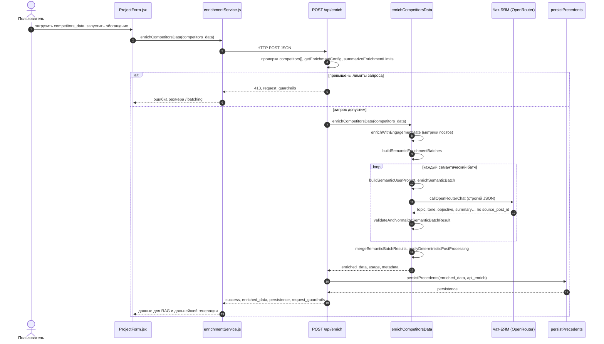

Последовательность на рис. 3.5 реализует функции корпуса прецедентов и RAG-поиска (блок 2 табл. 2.1), прецеденты UC9–UC14 — отдельный интерактивный подбор прецедентов до отображения карточек и сводки.
На рисунке 3.5 показана отдельная работа с корпусом прецедентов до генерации нового плана (UC11). Пользователь находится в блоке PrecedentSearchPanel, но фактическая логика состояния сосредоточена в ProjectForm.jsx: обработчик handleSearchPrecedents собирает текстовый запрос из полей формы через buildSuggestedPrecedentQuery (UC10). В запрос попадают описание проекта, аудитория, платформы и сегменты аудитории; лимит в интерактивном поиске на клиенте равен пяти результатам. Далее enrichmentService.js отправляет JSON на /api/precedents/search.
На сервере маршрут не ранжирует документы сам. Он проверяет наличие строки query и передаёт управление в searchPrecedents из precedentRepository.js. Репозиторий читает локальное хранилище прецедентов, выделяет публикации и контент-планы, применяет фильтры и токенизирует запрос. Основная ветка использует OpenRouter Embeddings (UC12): embedTexts([query]) получает вектор запроса, затем при необходимости лениво достраиваются эмбеддинги для тех публикаций и планов, у которых они ещё не сохранены. После этого для каждого кандидата считается гибридная оценка: косинусная близость эмбеддингов даёт смысловую часть, а пересечение токенов сохраняет чувствительность к точным словам из формы.
На диаграмме отдельно показана ветка alt (UC13): если сервис эмбеддингов недоступен, ключ не задан или векторизация завершилась ошибкой, пользовательский сценарий не обрывается. searchPrecedents переходит к лексическому fallback и ранжирует публикации по token_overlap_fallback. В обоих вариантах результат проходит quality gate, а затем дополняется признаками надёжности через сервис надёжности прецедентов. Поэтому UI получает одинаковую по форме структуру results: массивы publications и content_plans, сведения о режиме retrieval и количестве просмотренных объектов (UC14). Дополнительно клиент запрашивает getPrecedentsSummary (UC9) и отображает сводку корпуса вместе с карточками найденных прецедентов.

Рисунок 3.5 – Диаграмма последовательности. Поиск прецедентов по корпусу (RAG)

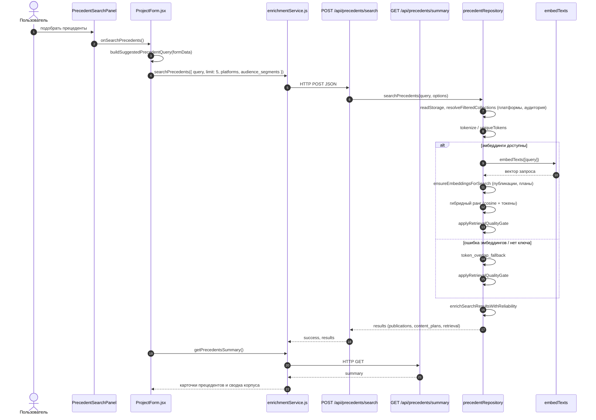

Последовательность на рис. 3.6 обеспечивает генерацию чернового контент-плана (блок 3 табл. 2.1), прецеденты UC15–UC20, включая повторный серверный RAG (UC10–UC11) и двухшаговую LLM-генерацию (UC16–UC19) с передачей результата в UI (UC20).
На рисунке 3.6 показан основной сквозной сценарий подсистемы БЯМ (UC15): пользователь хочет получить не отдельные найденные прецеденты, а готовый черновик контент-плана. Действие начинается в DraftPlanWorkflowPanel, но обработчик находится в ProjectForm.jsx. Сначала клиент проверяет обязательные поля формы: описание проекта, аудиторию, платформы, форматы и горизонт планирования. Затем из состояния формы собирается безопасное подмножество form_input, чтобы на сервер не уходили лишние поля интерфейса.
В коде предусмотрена пограничная ветка: если в базе прецедентов ещё нет данных для рабочего сценария, но в форме есть локальные сырые competitors_data, ProjectForm.jsx может перед генерацией запустить обогащение через уже описанный маршрут /api/enrich (повтор последовательности рис. 3.4, UC1–UC8). Эта ветка не является парсингом URL; она нужна только для того, чтобы RAG имел корпус публикаций, на который можно опереться при построении черновика. После обновления сводки клиент продолжает тот же сценарий генерации.
Клиентская функция generateDraftContentPlan отправляет на /api/plan/generate объект с form_input, опциональным rag_query и лимитом rag_limit. Если явный rag_query уже появился после ручного поиска прецедентов, сервер использует его (UC10). Если строка не передана, buildRagQueryFromForm собирает запрос из данных формы. Затем маршрут всегда выполняет серверный поиск searchPrecedents (UC11): даже если пользователь до этого нажимал отдельную кнопку поиска, генерация повторно получает RAG-контекст с актуальным лимитом и фильтрами по платформам и аудитории.
После RAG начинается собственно LLM-конвейер generateDraftPlanBatched. Сначала buildCompactRagContext (UC16) сжимает найденные публикации и планы до компактного набора фактов для промпта: темы, цели, аудитории, ключевые сообщения, платформы и фрагменты успешных публикаций. Далее выполняется первый вызов чат-БЯМ — generateSkeleton (UC17). Он работает с низкой температурой и строгим JSON-режимом, потому что от модели требуется не текст постов, а структура будущего плана: горизонт, платформы, KPI-ориентиры и слоты публикаций.
Второй LLM-шаг на диаграмме показан циклом по группам месяцев (UC18). Функция generateMonthlyPublications получает скелет, компактный RAG-контекст, слоты текущего месяца и уже созданные публикации, чтобы модель не повторяла одинаковые темы и формулировки. Ответ каждого батча снова ожидается как JSON и проходит нормализацию (UC19): сервер выравнивает формат, цель, тональность, CTA, ключевые сообщения и summary, а также удаляет явные повторы. После сборки всех месячных групп маршрут приводит результат к интерфейсной структуре через normalizeDraftPlanResponse и возвращает клиенту rag, draft, usage и generation_metadata.
На обратном пути ProjectForm.jsx сохраняет draftPlanResult, обновляет отображаемые RAG-результаты ответом сервера и сохраняет draft_content_plan как snapshot для страницы просмотра контент-плана (UC20). Пользователь видит черновой план в интерфейсе, а в техническом блоке может проверить использованные прецеденты, режим retrieval, расход токенов и метаданные генерации.

 

Рисунок 3.6 – Диаграмма последовательности. Генерация чернового контент-плана через RAG + LLM

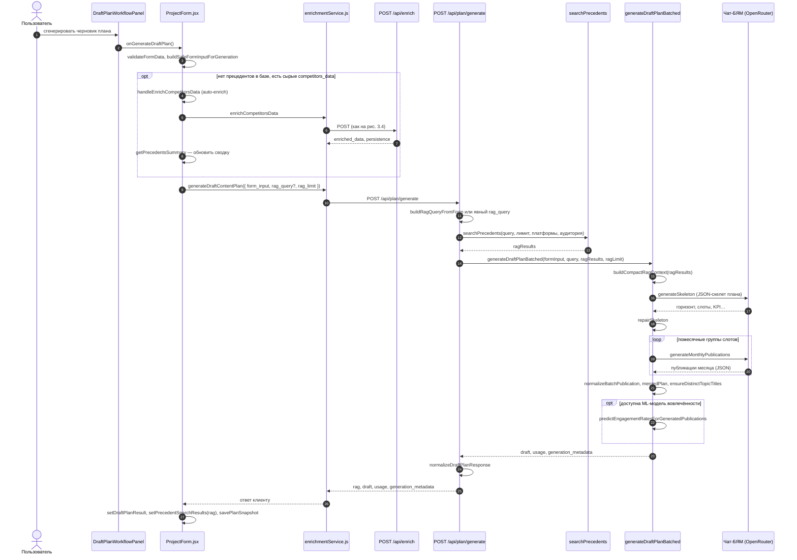

Три диаграммы последовательности покрывают основной сквозной путь подсистемы БЯМ и согласованы с рис. 2.0а и подробными сценариями §2.2. Логический порядок 3.4 → 3.5 → 3.6 соответствует цепочке «обогатить корпус → найти прецеденты → сгенерировать черновик плана»; при этом рис. 3.6 может включать ветку обогащения из рис. 3.4, если корпус прецедентов ещё пуст. Отдельный интерактивный поиск (рис. 3.5) не обязателен перед генерацией: серверный RAG на рис. 3.6 выполняется в любом случае (UC11 как include у UC15).

4 Разработка программного модуля 

4.1 Выбор и обоснование технологий, используемых в программном модуле

Разрабатываемая подсистема должна обеспечивать устойчивые HTTP-вызовы внешнего API и эмбеддингов, контролируемое батчирование запросов и приёмку ответов в виде строгого или ожидаемого JSON, выдачу REST-интерфейсов обогащения и планирования, а также связку с клиентским приложением, откуда пользователь запускает обогащение постов конкурентов и генерацию черновика контент-плана.

При подготовке настоящего подраздела использовалась нейросетевая языковая модель DeepSeek. По краткому описанию реализованной подсистемы (HTTP-интеграция с OpenRouter, REST-маршруты обогащения и планирования, клиентское приложение на React) модель предложила логичную последовательность обоснования выбора технологий и черновые формулировки назначения каждого компонента стека. Автор сверил предложенный перечень с фактической конфигурацией монорепозитория (каталоги apps/api и apps/web, package.json, используемые модули), уточнил имена библиотек и исключил из текста технологии смежных подсистем. Итоговое обоснование отражает реально применяемый стек и не содержит необоснованных утверждений.

В качестве языка серверной части выбран JavaScript на платформе Node.js с типом пакета `module` (нативные ES-модули в `apps/api`). Это даёт единый стек с клиентом на JavaScript, встроенную асинхронную модель ввода-вывода и удобное сосуществование длительных сетевых запросов к LLM с остальной логикой API без выделения отдельного процесса-интерпретатора под каждый запрос.
Для организации HTTP API используется Express. Маршруты обогащения и планирования монтируются в общем приложении `server.js`; это соответствует типовой схемеX REST и упрощает интеграцию с фронтендом по базовому URL.
Для исходящих запросов к провайдеру БЯМ выбрана библиотека axios: ею пользуются модуль `openrouter.js` (чат-дополнения) и `embeddingService.js` (векторизация текстов). Обоснование — единообразная настройка таймаутов, заголовков авторизации и разбора ответов и ошибок HTTP в одном стиле для чата и эмбеддингов. Нативный `fetch` в проекте для этих вызовов не задействован.
Конфигурация секретов и параметров моделей вынесена в dotenv: загрузка `.env` из корня монорепозитория выполняется в `openrouter.js` и в точке старта API. Векторный поиск по смыслу опирается на эмбеддинги из того же контура OpenRouter. Для кросс-доменных запросов с дев-сервера Vite к API используется cors.
Клиентское приложение в каталоге `apps/web` собирается Vite (`vite.config.js`, скрипты в корневом `package.json`: `dev:vite`, `build`). Интерфейс реализован на React 18 с маршрутизацией react-router-dom; базовый URL сервера обогащения задаётся префиксом `VITE_` для подстановки на этапе сборки. Для выгрузки контент-плана пользователем в табличные и PDF-форматы в корневых зависимостях задействованы xlsx и pdfmake.
Автоматическая проверка кода подсистемы опирается на встроенный в Node.js загрузчик тестов `node --test` (см. скрипт `test` в `apps/api/package.json` и корневой объединённый `npm run test`): для детерминированных функций и части интеграционных сценариев не требуется отдельная тяжёлая тестовая инфраструктура.
Таким образом, выбранный стек (Node.js, Express, axios, dotenv, pg, React, Vite) соответствует задаче интеграции внешней БЯМ как сетевого сервиса с управляемыми лимитами и отказоустойчивостью на уровне батчей и повторов, без включения в обоснование средств обучения нейросетей или реализации генетических операторов на стороне рассматриваемого модуля.

4.2 Описание используемых структур данных 

Описание структур данных, переменных окружения, порядка развёртывания и архитектуры компонентов в настоящем подразделе также подготовлено с привлечением нейросетевой модели DeepSeek. Модель помогла сгруппировать шаги настройки проекта, сформулировать перечень переменных окружения по контурам LLM/RAG и описать назначение ключевых HTTP-маршрутов и полей JSON-ответов. Все перечисленные эндпоинты, пути к файлам хранилища data/precedents и параметры конфигурации проверены по исходному коду репозитория; при расхождении с реализацией формулировки были исправлены автором.

1. Системные требования: Node.js 20+ и Python 3.11+ с pip.
2. Установка зависимостей Node: в корне репозитория выполняется `npm install`; при необходимости установку API в `apps/api` можно пропустить через `SKIP_POSTINSTALL=1`.
3. Полный bootstrap: `npm run setup` из корня выполняет `npm install`, `pip install -r requirements.txt` и при отсутствии `.env` копирует `.env.example` в `.env`.
4. Минимальные переменные окружения для LLM/RAG-контура:
	 для LLM и эмбеддингов: `OPENROUTER_API_KEY`, `AI_MODEL`, `EMBEDDING_MODEL`, `EMBEDDING_MAX_BATCH`, `EMBEDDING_TIMEOUT_MS`;
	 для API и клиента: `PORT`, `VITE_ENRICHMENT_API_URL`, `API_BODY_LIMIT`, `CORS_ALLOWED_ORIGINS`;
	 для лимитов обогащения: `MAX_POSTS_PER_ENRICH_REQUEST`, `MAX_ENRICH_PAYLOAD_BYTES`, `MAX_ENRICH_REQUEST_BYTES`, `MAX_ENRICH_POST_CONTENT_CHARS`, `ENRICH_AUTO_BATCH`, `ENRICH_RETRY_ON_INVALID`.
5. Опционально: `SERVER_API_KEY` и `ADMIN_API_KEY` для защиты отдельных операций API.
Как разворачивался проект (запуск и поставка):
1. Локальная разработка: `npm run dev` из корня поднимает одновременно фронтенд (Vite, порт 5173) и API (Express, порт из `PORT`, по умолчанию 3001). Проверка доступности API: `GET http://localhost:3001/health`.
2. Сборка фронтенда: `npm run build`; локальный предпросмотр сборки: `npm run preview`.
3. Запуск API как сервиса: `npm run start` в каталоге `apps/api`.
Основные структуры данных и компоненты подсистемы
Пользовательский сценарий начинается на фронтенде в `ProjectForm` и `useCompetitorsPipeline`, где формируются вызовы к API через `enrichmentService`. На уровне HTTP для рассматриваемой подсистемы используются маршруты:
- `POST /api/enrich` для семантического обогащения `competitors_data`;
- `POST /api/precedents/search` и `GET /api/precedents/summary` для retrieval и контроля состояния корпуса;
- `POST /api/plan/generate` (и `POST /api/plan/generate-batched`) для генерации чернового контент-плана по RAG-контексту.
Для обогащения входная структура `competitors_data` содержит массив `competitors`; далее серверный контур батчирует посты с лимитами и отправляет их в OpenRouter в формате строгого JSON. В ответе ключевыми полями являются `success`, `enriched_data`, `parse_error`, `usage`, `metadata`, а также `request_guardrails` и `persistence` при вызове `/api/enrich`.
Контур RAG работает через `searchPrecedents(...)` в `precedentRepository`: запрос сопоставляется с корпусом прецедентов, при доступном ключе используется эмбеддинг-поиск через `embeddingService`, при недоступном ключе работает лексический fallback. Для генерации черновика `planRoutes` передает результаты retrieval в `draftPlanGenerationPipeline`, где выполняются два вызова LLM: генерация JSON-скелета и помесячная генерация публикаций.
Слой данных подсистемы представлен файловым хранилищем `data/precedents` (`metadata.json`, `ingestion_runs.json`, `publications.json`, `content_plans.json`) и runtime-снимками в `data/runtime/api`. Внешним провайдером для chat-completions и embeddings является OpenRouter.
Архитектура подсистемы представлена двумя диаграммами компонентов: на рисунке 4.1 — фронтенд (`useCompetitorsPipeline`, `enrichmentService`, `ProjectForm` из таблицы 4.2); на рисунке 4.1а — бэкенд, слой данных и внешний провайдер OpenRouter. Граница между рисунками — HTTP API: связи от `enrichmentService` к маршрутам `enrichmentRoutes`, `precedentRoutes` и `planRoutes` (таблица 4.1). Подписи на стрелках соответствуют столбцу «Описание» таблицы 4.1 (на рис. 4.1 — клиентская часть и REST-граница; на рис. 4.1а — внутренние вызовы бэкенда).

Рисунок 4.1 – Диаграмма компонентов (фронтенд)

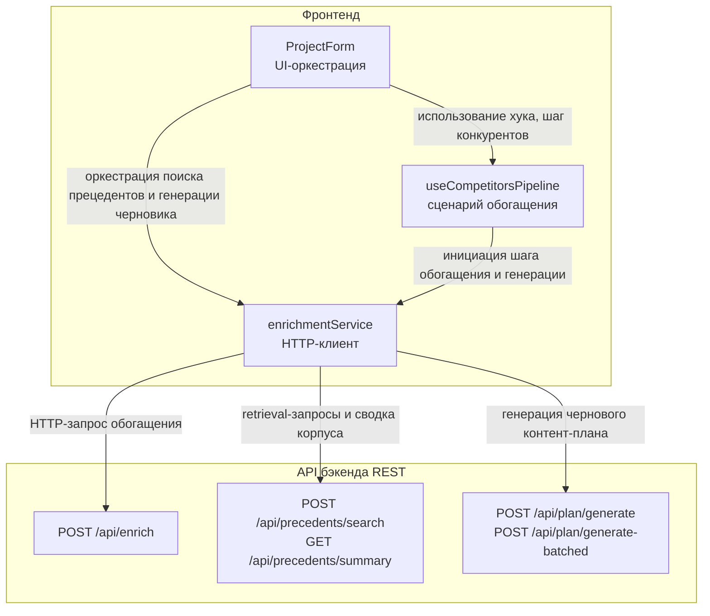

Рисунок 4.1а – Диаграмма компонентов (бэкенд, слой данных, OpenRouter)

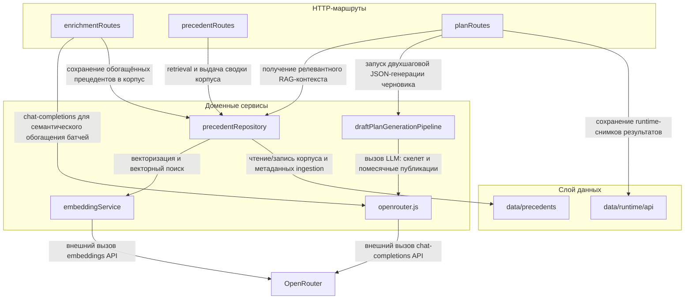

Обоснование подхода к компонентам:
Компонентный подход в подсистеме LLM/RAG и обогащения данных конкурентов применен для явного разделения ответственности между уровнями: пользовательский интерфейс, HTTP-транспорт, бизнес-оркестрация retrieval и генерации, доступ к данным прецедентов, а также внешние вызовы OpenRouter (chat-completions и embeddings). Детализация вынесена в два рисунка (4.1 и 4.1а) для наглядного разделения клиентской и серверной частей; на стрелках указаны назначения связей в соответствии с таблицей 4.1. Такая декомпозиция делает архитектуру прозрачной: каждый компонент выполняет ограниченный набор задач и взаимодействует через стабильные интерфейсы.
На рисунке 4.1 `ProjectForm` выступает точкой входа пользовательского сценария: подключает хук `useCompetitorsPipeline` для шага конкурентов и напрямую вызывает `enrichmentService` для поиска прецедентов и генерации черновика; оба пути сходятся в HTTP-клиенте, который обращается к REST-эндпоинтам бэкенда. На рисунке 4.1а показана серверная цепочка: маршруты `enrichmentRoutes`, `precedentRoutes` и `planRoutes` делегируют работу `precedentRepository`, `draftPlanGenerationPipeline`, `openrouter.js` и `embeddingService`, а также взаимодействуют с `data/precedents`, `data/runtime/api` и внешним OpenRouter.
Такой подход обеспечивает следующие преимущества:
	 Возможность изменять внутреннюю реализацию retrieval и генерации без изменения UI и API-контрактов;
	 Возможность замены или перенастройки внешнего LLM-провайдера при сохранении остальной архитектуры;
	 Четкое разделение ответственности между уровнями и участниками команды при параллельной разработке;
	 Упрощение тестирования за счет изоляции маршрутов, репозитория прецедентов и LLM-клиента;
	 Повышение сопровождаемости и масштабируемости подсистемы при добавлении новых сценариев обогащения и генерации.
В таблице 4.1 сводно перечислены связи компонентов; те же формулировки приведены как подписи на стрелках рисунков 4.1 (строки 1–6, клиент и REST-граница) и 4.1а (строки 7–17, бэкенд и внешние вызовы).

Таблица 4.1 - Связи компонентов

| От | К | Описание |
| --- | --- | --- |
| ProjectForm | useCompetitorsPipeline | Подключение хука и управление шагом конкурентов |
| ProjectForm | enrichmentService | Оркестрация поиска прецедентов и генерации черновика |
| useCompetitorsPipeline | enrichmentService | Инициация клиентского шага обогащения и генерации |
| enrichmentService | enrichmentRoutes | Отправка HTTP-запроса обогащения (POST /api/enrich) |
| enrichmentService | precedentRoutes | Отправка запросов семантического поиска прецедентов (POST /api/precedents/search, GET /api/precedents/summary) |
| enrichmentService | planRoutes | Отправка запроса генерации чернового плана (POST /api/plan/generate, POST /api/plan/generate-batched) |
| enrichmentRoutes | openrouter.js | Вызов дополнения чата для семантического обогащения пакетов публикаций |
| enrichmentRoutes | precedentRepository | Сохранение обогащённых прецедентов в корпус |
| precedentRoutes | precedentRepository | Выполнение семантического поиска и выдача сводки корпуса прецедентов |
| planRoutes | precedentRepository | Получение релевантного контекста прецедентов для генерации плана |
| planRoutes | draftPlanGenerationPipeline | Запуск двухшаговой генерации структурированного чернового контент-плана |
| draftPlanGenerationPipeline | openrouter.js | Обращение к большой языковой модели на этапе построения каркаса и на этапе помесячного наполнения публикаций |
| precedentRepository | embeddingService | Вычисление и дозагрузка векторных представлений, векторный поиск |
| precedentRepository | data/precedents | Чтение и запись корпуса прецедентов и метаданных журнала загрузки |
| planRoutes | data/runtime/api | Сохранение оперативных снимков результатов генерации |
| openrouter.js | OpenRouter | Внешний вызов программного интерфейса дополнения чата |
| embeddingService | OpenRouter | Внешний вызов программного интерфейса векторизации текстов |

Таблица 4.1 и рисунки 4.1–4.1а вместе задают полный маршрут прохождения управления в подсистеме LLM/RAG и обогащения данных конкурентов. На клиенте (рис. 4.1) `ProjectForm` координирует шаг конкурентов через `useCompetitorsPipeline` и операции RAG/генерации через `enrichmentService`; последний по HTTP обращается к `enrichmentRoutes`, `precedentRoutes` и `planRoutes` (на рис. 4.1а — как входные маршруты). Такое разделение важно, потому что пользовательский сценарий, транспорт HTTP и бизнес-логика разведены по разным компонентам: изменение формата UI не требует изменения retrieval/генерации, а изменение внутренней логики репозитория и промптов не затрагивает публичные API-контракты.
На рис. 4.1а и в строках 10–12 таблицы 4.1 видно, что центральной точкой бизнес-цепочки выступает связка `planRoutes` + `precedentRepository` + `draftPlanGenerationPipeline`: сначала извлекается релевантный контекст из корпуса прецедентов (эмбеддинговый поиск с fallback), затем выполняется двухшаговая JSON-генерация чернового контент-плана. Итоговый черновик строится не только на LLM-вызове, но и с учётом retrieval-контекста корпуса конкурентов.
Отдельно на рис. 4.1а зафиксирована ветка обогащения (строки 7–8 таблицы 4.1): `enrichmentRoutes` вызывает `openrouter.js` для семантической нормализации и передаёт данные в `precedentRepository` для пополнения корпуса. Низкоуровневые детали URL-парсинга, ML-прогнозирования и эволюционной оптимизации в эти рисунки не включаются, поскольку относятся к смежным подсистемам.
В таблице 4.2 представлено описание компонентов.
 
Таблица 4.2 – Компоненты

| Уровень | Компонент | Назначение |
| --- | --- | --- |
| Фронтенд | useCompetitorsPipeline | Управление пользовательским процессом семантического обогащения и генерации черновика |
| Фронтенд | enrichmentService | Клиент протокола передачи гипертекста для вызова операций обогащения, семантического поиска прецедентов и генерации черновика |
| Фронтенд | ProjectForm | Оркестрация пользовательского интерфейса сценария проектирования контент-плана и запуска операций |
| Бэкенд | enrichmentRoutes | Приём запросов программного интерфейса семантического обогащения данных конкурентов |
| Бэкенд | precedentRoutes | Приём запросов семантического поиска прецедентов и получения сводки корпуса |
| Бэкенд | planRoutes | Приём запросов генерации чернового контент-плана |
| Бэкенд | precedentRepository | Поиск и хранение прецедентов, формирование контекста для подкрепления генерации из базы знаний |
| Бэкенд | draftPlanGenerationPipeline | Двухэтапная генерация структурированного ответа: каркас плана и помесячные публикации |
| Бэкенд | openrouter.js | Клиент дополнения чата для обогащения данных и генерации черновика |
| Бэкенд | embeddingService | Клиент векторизации текстов для построения векторных представлений и семантического поиска |
| Слой данных | data/precedents | Хранилище прецедентов, метаданных и журнала загрузки |
| Слой данных | data/runtime/api | Хранилище оперативных снимков результатов программного интерфейса |
| Внешний источник | OpenRouter | Внешний провайдер дополнения чата и векторизации текстов |

Таблица 4.2 согласована с рисунками 4.1 и 4.1а: компоненты уровня «Фронтенд» соответствуют узлам рис. 4.1, строки «Бэкенд», «Слой данных» и «Внешний источник» — узлам рис. 4.1а. Так фиксируются границы ответственности подсистемы LLM/RAG: на клиенте — сценарий формы и HTTP-транспорт, на сервере — REST-входы, доменные сервисы retrieval и генерации, файловые хранилища и внешний LLM-провайдер.
Такое разделение позволяет развивать модуль по частям: изменения промптов, стратегий retrieval или ограничений батчирования не требуют переработки UI при сохранении контрактов API. При этом контуры обучения ML-моделей, парсинга URL и эволюционной оптимизации рассматриваются как внешние зависимости и не входят в данный подраздел.
В таблице 4.3 представлено описание передачи данных по эндпоинтам.
 
Таблица 4.3 - Передача данных по эндпоинтам

| Компонент | Метод | Эндпоинт | Тело запроса (для POST) | Ответ |
| --- | --- | --- | --- | --- |
| enrichmentService | POST | /api/enrich | { competitors_data } | { success, enriched_data, parse_error, usage, metadata, request_guardrails, persistence } |
| enrichmentService | POST | /api/precedents/search | { query, limit, platform, audience_segments } | { success, results } |
| enrichmentService | GET | /api/precedents/summary | — | { success, summary } |
| enrichmentService | POST | /api/plan/generate | { form_input, rag_query, rag_limit } | { success, rag, draft, usage, generation_metadata } |
| enrichmentService | POST | /api/plan/generate-batched | { form_input, rag_query, rag_limit } | { success, rag, draft, usage, generation_metadata } |

Таблица 4.3 нужна для практического понимания того, какие данные передаются между клиентской и серверной частями подсистемы LLM/RAG, через какие HTTP-методы и в каком формате. Пользовательский сценарий здесь построен вокруг двух основных операций: пополнение/нормализация корпуса конкурентов и генерация чернового контент-плана на основе retrieval-контекста.
Основная прикладная логика сосредоточена в эндпоинтах `POST /api/enrich`, `POST /api/precedents/search`, `GET /api/precedents/summary`, `POST /api/plan/generate` и `POST /api/plan/generate-batched`. Все прочие взаимодействия между внутренними компонентами (`precedentRepository`, `embeddingService`, `openrouter.js`, `draftPlanGenerationPipeline`) являются внутрисервисными вызовами и не представлены как отдельные HTTP-транзакции, так как они относятся к внутренней реализации бэкенда.
Таким образом, состав API в таблице 4.3 отражает специфику подсистемы как сервиса обогащения и генерации на базе LLM/RAG: внешне он предоставляет компактный набор прикладных точек входа, тогда как внутренняя сложность сосредоточена в retrieval-контуре, батчировании и валидации LLM-ответов, а также в построении структурированного чернового плана.
 

5 Тестирование программного модуля

Тестирование подсистемы работы с большими языковыми моделями, корпусом прецедентов (RAG) и семантическим обогащением организовано в виде плана функционального тестирования (приоритетные сценарии и ожидаемые результаты), автоматических регрессионных тестов на базе `node --test`, ручных прогонов с реальным OpenRouter и плана нефункционального тестирования (нагрузка, стресс, объём данных, стабильность, надёжность). Описание опирается на реализованные HTTP-маршруты подсистемы (`/api/enrich`, `/api/precedents`, `/api/plan`).

5.1 План функционального тестирования

Каждый пункт структурирован по схеме: входные данные — средства проверки — ожидаемый результат. В репозитории используются встроенный `node --test` и HTTP-запросы к поднятому в тесте Express-приложению (интеграционные файлы в `apps/api/tests/*.integration.test.js`). На клиенте применимы тесты React Testing Library там, где они добавлены в проект; для утилит формы используются модульные тесты в `apps/web/tests`.

1. Мастер проекта и сохранение черновика (прогресс заполнения формы)  
Вход: корректный и некорректный набор полей проекта (платформы, аудитория, горизонт планирования и др.), повторное сохранение черновика.  
Автотесты: `apps/web/tests/frontend-formUtils.test.js` — валидация и сбор безопасного `form_input`; интеграционно — `GET`/`PUT /api/plan/draft/current` с проверкой сохранения на диск.  
Ожидаемый результат: черновик сохраняется и отдаётся сервером; ошибки валидации на клиенте не приводят к отправке некорректного `form_input` на генерацию.

2. Модуль генерации черновика контент-плана («уровень» контекста RAG)  
Вход: параметры `rag_limit`, выбор маршрута `POST /api/plan/generate` или `POST /api/plan/generate-batched`, при необходимости явный `rag_query`.  
Автотесты: модульные — нормализация черновика, постобработка полей (`draftPlanGenerationPipeline.test.js`, `contentPlanOutputQuality.test.js`); интеграционные — `planRoutes.integration.test.js` с подстановкой заглушек вместо вызова БЯМ (в ответе ожидаемая структура `draft`, `rag`, отсутствие «пустых» обязательных полей после нормализации). Генерация черновика выполняется одним HTTP-ответом JSON.  
Ожидаемый результат: контракт ответа API соблюдён; объём контекста прецедентов соответствует заданному `rag_limit` и фильтрам платформ/аудитории.

3. Приёмка и нормализация результатов БЯМ (семантическое обогащение и черновик плана)  
Вход: структурированный ответ модели для батча обогащения; при необходимости фикстура «шумного» текста вокруг JSON.  
Автотесты: `semanticEnrichmentPipeline.test.js`, `llmJsonParsing.test.js` — полнота множества `source_post_id`, допустимость целей публикации, разбор JSON из текста LLM.  
Ожидаемый результат: при фиксированных входных данных результат детерминирован; граничные случаи (пустой батч, один пост, частичное несовпадение множеств) обрабатываются по правилам кода.

4. Обратная связь при ошибках и частичном успехе  
Вход: ответ обогащения с признаками частичного выполнения батчей; ошибки сохранения корпуса.  
Автотесты: покрытие полей `metadata`, `partial_enrichment` там, где задано в юнит-тестах пайплайна; интеграционные маршруты обогащения — коды 400/413 без вызова LLM (`enrichmentRoutes.integration.test.js`).  
Ожидаемый результат: пользователь видит связное сообщение и признак частичного результата там, где это предусмотрено метаданными.

5. Хранилище результатов (снимки плана и корпус прецедентов)  
Вход: сохранение плана и загрузка по токену; список прецедентов как snapshot.  
Автотесты: интеграционные — `POST /api/plan/snapshots`, `GET /api/plan/snapshots/:token`, `DELETE ...`; для прецедентов — поиск и сводка (`precedentRoutes.integration.test.js`). Изоляция «чужой записи» в системе без учётных записей пользователей реализуется криптографическим токеном snapshot и разграничением доступа к административным операциям по ключу API где применимо.  
Ожидаемый результат: целостность данных snapshot; неверный токен → 404; удаление snapshot подтверждается повторным GET.

6. Журналирование и трассировка  
Вход: действия обогащения, генерации, сохранения корпуса.  
Проверка: записи в `data/precedents/ingestion_runs.json` при загрузке корпуса; сообщения в stdout процесса API с префиксом `[LLM]` в `openrouter.js`.  
Ожидаемый результат: по журналам можно восстановить последовательность вызовов и размеры промптов для разбора инцидентов.

7. Ограничение времени и ресурса  
Вход: лимиты размера запроса обогащения (`MAX_ENRICH_REQUEST_BYTES`, число постов в батче), таймауты исходящего HTTP к OpenRouter в конфигурации клиента.  
Автотесты: превышение лимита тела → 413 (`enrichmentRoutes.integration.test.js`). Отдельного таймера пользовательской сессии на уровне API подсистема может не задавать — при необходимости указать в записке «не входит в объём».  
Ожидаемый результат: крупный недопустимый запрос отклоняется до массовых вызовов БЯМ; при истечении таймаута сети запрос завершается ошибкой, а не зависанием.

8. Ограничение объёма контекста за счёт параметров retrieval  
Вход: уменьшение `rag_limit`, сужение фильтров платформ и аудитории, отключение части источников при поиске прецедентов.  
Автотесты: функции ранжирования и весов прецедентов в репозитории — по мере наличия тестов; контракт `POST /api/precedents/search` с пустым `query` → 400.  
Ожидаемый результат: сужение контекста предсказуемо снижает размер выдачи retrieval и влияет на промпт генерации согласно логике сервера.

9. Сохранение комментариев и правок к плану  
Вход: повторное сохранение черновика, поле `notes` плана, обновление snapshot.  
Проверка: ручная; отдельного маршрута чата разбора в API может не быть — при необходимости зафиксировать границу объёма работ или перспективу развития.  
Ожидаемый результат: пользовательские правки не теряются между сохранениями snapshot и черновика при штатной работе файлового хранилища.

10. Выявление «узких мест» контента и предупреждений качества  
Вход: результаты постобработки плана, оценки надёжности прецедентов, опционально LLM-проход разнообразия (`planDiversityLlmPass`).  
Автотесты: модульные эвристики качества текста плана; ручной обзор полей `generation_metadata`, предупреждений оптимизации.  
Ожидаемый результат: слабые места отражаются в метаданных или сообщениях проверки ограничений, а не только в свободном тексте без структуры.

5.2 Средства и порядок запуска автоматических тестов

В качестве среды выполнения используется встроенный в Node.js загрузчик `node --test`. Из корня монорепозитория единый список тестов задаётся скриптом `tools/scripts/run-tests.mjs`. Команда `npm run test` даёт вывод в стиле TAP; для человекочитаемого отчёта с именами подтестов используется `npm run test:spec` (репортёр `spec`). Для машинной сводки и заполнения таблиц в редакторе применяется `npm run test:junit` — результат записывается в файл `apps/api/test-results/junit.xml` (каталог создаётся автоматически). Дополнительно для каталога API: `npm run test --prefix apps/api`.

5.3 Соответствие объектов проверки файлам автоматических тестов

В таблице 5.1 сопоставлены основные объекты контроля подсистемы LLM/RAG и файлы автоматических тестов в репозитории.

Таблица 5.1 – Объекты проверки и автоматические тесты подсистемы

| Объект проверки (функциональность / модуль) | Файл теста (относительный путь) | Тип / проверяемые случаи |
| --- | --- | --- |
| Приёмка батча семантического обогащения (`validateAndNormalizeSemanticBatchResult`) | apps/api/tests/semanticEnrichmentPipeline.test.js | модульный |
| Разбор JSON из содержимого ответа LLM (`parseJsonObjectFromLlmContent`) | apps/api/tests/llmJsonParsing.test.js | модульный |
| Постобработка черновика плана, утилиты пайплайна (`DRAFT_PLAN_PIPELINE_TEST_UTILS`, нормализация тем и сообщений) | apps/api/tests/draftPlanGenerationPipeline.test.js | модульный |
| Качество пользовательских текстов плана (обрезка summary, дедупликация формулировок, согласование темы и ключа) | apps/api/tests/contentPlanOutputQuality.test.js | модульный |
| Модели контента и ограничения полей плана | apps/api/tests/contentModels.test.js | модульный |
| Вспомогательные функции планирования и маршрутов | apps/api/tests/planUtils.test.js, apps/api/tests/routeUtils.test.js | модульный |
| Маршруты `/api/plan` с подставными зависимостями (без LLM) | apps/api/tests/planRoutes.integration.test.js | интеграционный |
| HTTP-слой Express (обработка запросов) | apps/api/tests/expressHttp.test.js, apps/api/tests/expressHttp.integration.test.js | интеграционный |
| Валидация полей формы проекта и сбор безопасного `form_input` на клиенте | apps/web/tests/frontend-formUtils.test.js | модульный (клиент) |
| Контракты маршрутов обогащения и прецедентов без вызова LLM | apps/api/tests/enrichmentRoutes.integration.test.js, apps/api/tests/precedentRoutes.integration.test.js | интеграционный |

Таблица 5.1 задаёт прослеживаемость между объектами контроля (функции приёмки JSON, пайплайн черновика, HTTP без LLM) и файлами автотестов в репозитории. Модульные тесты закрепляют детерминированную оркестрацию и разбор структурированных ответов; интеграционные тесты проверяют контракты маршрутов Express при подстановке зависимостей без реального вызова БЯМ.

5.4 Ручное тестирование веток с обращением к внешнему API

Для сценариев с реальной БЯМ рекомендуется следующая методика. Настроить переменные окружения согласно п. 4.2 (в частности `OPENROUTER_API_KEY`, `AI_MODEL`, при необходимости `EMBEDDING_MODEL`). Подать на `POST /api/enrich` компактный файл конкурентов из `apps/data/input/examples/` и убедиться, что в ответе либо получено полное обогащение, либо зафиксированы признаки частичного результата в `metadata` при имитации или наличии отказа отдельных батчей. Для `POST /api/plan/generate` проверить наличие блоков `rag`, `draft`, `generation_metadata` и отсутствие необработанных ошибок разбора JSON на сервере. При работе с поиском прецедентов (`POST /api/precedents/search`) дополнительно контролировать сценарии с недоступным ключом эмбеддингов (лексический fallback), если это требуется по заданию на тестирование. Результаты каждого такого прогона удобно свести в таблицу 5.3 (сценарий, вход, код ответа, признак успеха); дополнительно фиксируются конфигурация модели, имя входного файла и при необходимости выдержки из журнала сервера.

5.5 Ограничения и выводы

В репозитории не реализован отдельный обязательный контур автотестов с подменой сетевого вызова `callOpenRouterChat` моком OpenRouter: воспроизводимая проверка обращений к чат-модели на уровне HTTP не входила в объём автоматизации. Для веток с реальной БЯМ сохраняются ручные прогоны, сводка по таблице 5.3 и иллюстрации по п. 5.6; при разборе сбоев используются журналы процесса API, в том числе сообщения с префиксом `[LLM]` (размер промпта, статус ответа, расход токенов, сведения по батчам семантического обогащения) — см. реализацию в модуле `openrouter.js`.

Полная автоматизация сквозных сценариев «из пользовательского интерфейса до текста модели» без стабилизации ответов или без дорогостоящей инфраструктуры записи фикстур HTTP не входила в объём работ: качество формулировок черновика и семантических полей остаётся проверкой эксперта, а автоматические тесты гарантируют инварианты данных, корректность детерминированной оркестрации и устойчивость разбора структурированных ответов. Такое разделение снижает зависимость регресса от квот, версии модели и недетерминированности температуры генерации.

5.6 Наглядное представление результатов тестирования (таблицы и приложения со скриншотами)

Таблица 5.2 – Сводка результатов автоматического прогона

| Дата прогона | Среда (ОС, версия Node.js npm) | Команда | Число подтестов (pass) | Число подтестов (fail) | Время выполнения (по выводу консоли) |
| --- | --- | --- | --- | --- | --- |
| 2026-05-09 | Windows 10 (build 19045); Node.js v22.22.0; npm 11.10.1 | `npm run test` из корня репозитория | 115 | 0 | 5151 мс |
| 2026-05-09 | Windows 10 (build 19045); Node.js v22.22.0; npm 11.10.1 | `npm run test:spec` (тот же набор файлов, репортёр spec) | 115 | 0 | 5235 мс |
| 2026-05-09 | Windows 10 (build 19045); Node.js v22.22.0; npm 11.10.1 | `npm run test --prefix apps/api` (при необходимости отдельного прогона API) | 109 | 0 | 1644 мс |

Таблица 5.2 фиксирует воспроизводимый регрессионный прогон на указанной дате и среде: одна и та же матрица команд из корня монорепозитория (`npm run test`, `npm run test:spec`) и при необходимости изолированный прогон только API (`npm run test --prefix apps/api`). Вывод подтверждает, что автоматические тесты можно повторить на другой машине при тех же версиях Node.js и npm; машиночитаемый отчёт для редакторов и таблиц формируется командой `npm run test:junit` → `apps/api/test-results/junit.xml`.

Таблица 5.3 – Результаты ручной проверки с обращением к API и БЯМ

| № | Сценарий (HTTP-метод и путь) | Входные данные (кратко) | Код ответа HTTP | Признак успешной проверки | Примечание |
| --- | --- | --- | --- | --- | --- |
| 1 | `POST /api/enrich` | JSON конкурентов из `apps/data/input/examples/` (реальный вызов БЯМ) | — | `success: true` или осмысленный `metadata` при частичном результате | в отчётном цикле 2026-05-09 полный прогон с OpenRouter не фиксировался; контракты ошибок без БЯМ покрыты автотестами (400, 413) |
| 2 | `POST /api/plan/generate` | корректный `form_input`, при необходимости `rag_query` | — | Наличие `draft`, `rag`, `generation_metadata` | то же: интеграционный тест маршрутов с подставными зависимостями выполняется без LLM (`planRoutes.integration.test.js`) |
| 3 | `GET http://localhost:<PORT>/health` | — (порт из `PORT` или 3001 по умолчанию) | 200 | JSON: `"status":"ok"`, имя сервиса, `request_id` | проверено локально 2026-05-09 (`PORT=3099`): ответ 200, тело с полем `status` |
| 4 | `GET /api/precedents/summary` | — | 200 | JSON со сводкой по корпусу прецедентов | автотест `GET /api/precedents/summary returns 200` (~190–200 мс в выводе прогона) |
| 5 | `POST /api/precedents/search` | тело без поля `query` или пустая строка | 400 | JSON с сообщением об ошибке валидации | автотесты: missing query / blank query → 400 |
| 6 | `POST /api/enrich` | отсутствует `competitors_data` или `competitors` не массив | 400 | предсказуемое тело ошибки | автотесты без БЯМ |
| 7 | `POST /api/enrich` | тело превышает лимиты батча / запроса | 413 | сообщение о превышении размера | автотесты без БЯМ |

Таблица 5.3 связывает смоук-сценарии HTTP с фактическими кодами ответа и признаками успеха; строки без полного прогона с реальной БЯМ могут оставаться с прочерком в столбце кода — это согласуется с тем, что регресс контрактов ошибок закрыт автотестами (`400`, `413`), а проверка качества генерации при живом OpenRouter выносится в ручной цикл.

Таблица 5.4 – Сценарии проверки API в коллекции Postman

| Группа коллекции | Сценарий (запрос) | Ожидаемый HTTP | Контроль |
| --- | --- | --- | --- |
| 01 | `GET /health` | 200 | JSON с полем `status` |
| 01 | `GET /api/precedents/summary` | 200 | Success и блок `summary` |
| 01 | `POST /api/precedents/search` — нет `query` | 400 | JSON ошибки, `request_id` |
| 01 | `POST /api/precedents/search` — пустой `query` | 400 | `success: false` |
| 01 | `POST /api/enrich` — нет `competitors_data` | 400 | сообщение об отсутствии поля / структура ошибки |
| 01 | `POST /api/enrich` — `competitors` не массив | 400 | `success: false` |
| 01 | `POST /api/plan/generate` — нет `form_input` | 400 | текст ошибки содержит `form_input` |
| 01 | `POST /api/parse` — нет `url` | 400 | `success: false` |
| 01 | `POST /api/parse-and-enrich` — нет `url` | 400 | `success: false` |
| 02 | `POST /api/precedents/search` — валидный `query` | 200 | структура ответа; при `success: true` есть `results` |
| 02 | `POST /api/enrich` — минимальный конкурент (семантическое обогащение) | 200 | `request_id`, `request_guardrails`; `success` — boolean (допускается `false` при отказе БЯМ) |
| 02 | `POST /api/plan/generate` — черновик (`form_input` + `rag_query`) | 200 | `draft`, `rag`, `generation_metadata`, `request_id` |

Коллекция: [`tools/postman/TKRP-API.postman_collection.json`](../tools/postman/TKRP-API.postman_collection.json), импорт и порядок запросов — [`tools/postman/README.md`](../tools/postman/README.md).

Таблица 5.4 задаёт чек-лист прогона коллекции Postman; совпадение фактических кодов HTTP с ожидаемыми и успешное выполнение скриптов на вкладке **Tests** подтверждает, что ручной клиент проверяет те же контракты, что и интеграционные тесты без LLM.

Итог прогона коллекции. При работающем сервере API все перечисленные выше сценарии выполнены успешно: для каждого запроса фактический код HTTP совпал с ожидаемым, проверки вкладки Tests в Postman пройдены без ошибок. Автоматический прогон `npm run test` из таблицы 5.2 также завершился полным успехом (115 подтестов, 0 сбоев).

Рисунок 5.2 — Результат прогона коллекции TKRP-API в Postman (Collection Runner): сводка по запросам групп 01 и 02, коды ответа и вкладка Tests.

Для переноса в Word: вставьте скриншот под этим абзацем или в приложение к записке; при необходимости замаскируйте ключи и токены. Удобные отдельные снимки: (а) один запрос группы 01 с зелёными проверками Tests — подтверждение валидации без БЯМ; (б) при наличии ключа — успешный ответ `POST /api/plan/generate` с полями `draft`, `rag`, `generation_metadata`.

5.7 План нефункционального тестирования

5.7.1 Нагрузочное тестирование (Load Testing)

Цель — убедиться, что система обрабатывает прогнозируемую нормальную нагрузку в пределах допустимого времени отклика.

Сводка корпуса прецедентов. Тестируемый маршрут: `GET /api/precedents/summary`. Сценарий: до 30 параллельных клиентов в течение 2 минут запрашивают сводку по корпусу (лёгкий ответ без вызова БЯМ). Ожидаемые показатели на типичном стенде: **p95** времени ответа ≤ **800 мс**, **p99** ≤ **1500 мс** (значения совпадают с критерием приёмки в таблице 5.5); для лёгкого JSON это существенно меньше задержки retrieval с эмбеддингами; доля кодов **5xx** при исправной среде — **0 %**.

Семантический поиск прецедентов. Тестируемый маршрут: `POST /api/precedents/search`. Сценарий: 20 виртуальных клиентов одновременно выполняют поиск с типичным телом (`query`, `limit`, при необходимости фильтры); запросы повторяются каждые 5 с в течение 3 минут. Ожидаемые показатели: на испытательной машине при корпусе порядка **1–3 тыс.** записей в `publications.json` ориентир **p95** ≤ **12 с** (доминируют вызов эмбеддингов OpenRouter и объём корпуса); при небольшом корпусе (условно до **~500** публикаций) типичный успешный запрос укладывается примерно в **1–4 с**. При исправном ключе и квотах — **0 %** неожиданных **5xx**. В отчёте фиксируются число записей и размер файла `publications.json` (например **2–35 МБ** в зависимости от наполнения) и выборочное время ответа при файловом хранилище.

Генерация черновика контент-плана. Тестируемые маршруты: `POST /api/plan/generate` или `POST /api/plan/generate-batched`. Сценарий: до **3–5** параллельных клиентов с корректным `form_input` и умеренным `rag_limit` (например **6–12** прецедентов в контексте). Ожидаемые показатели: время ответа определяется задержкой БЯМ и объёмом контекста; на успешный запрос ориентир **≤ 180 с** на один вызов при умеренном `rag_limit` (как в таблице 5.5); процесс Node.js не завершается аварийно; в теле ответа при успехе присутствуют поля `draft`, `rag`, `generation_metadata`.

Быстрая валидация обогащения без полного прохода БЯМ. Тестируемый маршрут: `POST /api/enrich` с телом, заведомо превышающим лимиты. Ожидаемые показатели: код **413**; время до ответа **≤ 150 мс** (локальная проверка лимитов middleware), **без** массовых обращений к OpenRouter (контракт также проверяется автотестами).

5.7.2 Стрессовое тестирование (Stress Testing)

Цель — проверить поведение при резком превышении нормальной нагрузки и при ограниченных ресурсах внешнего API.

Пиковая параллельная генерация и поиск. Долгие запросы `POST /api/plan/generate` создают высокую одновременную нагрузку на БЯМ. Сценарий: до 20 параллельных клиентов одновременно запускают генерацию и/или `POST /api/precedents/search`. Проверяется: процесс не зависает; при лимитах OpenRouter допускаются ожидаемые ошибки провайдера (429/5xx) с телом ответа; при разрыве соединения клиентом (`AbortController`) сервер не накапливает незакрытые задачи бесконечно при корректных таймаутах исходящего HTTP.

Одновременное семантическое обогащение. Тестируемый маршрут: `POST /api/enrich`. Сценарий: **3–6** клиентов параллельно отправляют допустимые по размеру тела обогащения (например **2–4** конкурента по **10–25** постов каждый). Проверяется: отсутствие деградации состояния процесса; при ошибках отдельных батчей возможен частичный результат с метаданными.

Защищённые маршруты администрирования и загрузки корпуса. Тестируемые маршруты: например `POST /api/precedents/seed`, `POST /api/ml/.../train` при включённой защите ключом. Сценарий: серия запросов с намеренно неверным или отсутствующим `SERVER_API_KEY` / `ADMIN_API_KEY`. Проверяется: предсказуемый отказ авторизации без зависания; отсутствие выполнения административной операции.

5.7.3 Объёмное тестирование (Volume Testing)

Цель — проверить поведение при большом объёме данных в файловом хранилище и в полях отдельных запросов.

Большое число публикаций в корпусе прецедентов. Тестируемые маршруты: `POST /api/precedents/search`, при необходимости `GET /api/precedents`. Сценарий: на тестовой копии `data/precedents/` накопить **не менее N = 3000** записей в `publications.json` (конкретное **N** и состав данных фиксируются в протоколе с учётом времени подготовки эмбеддингов). Проверяется: для большого корпуса ориентир **p95** времени ответа поиска **≤ 25 с** на тестовой машине (таблица 5.5); для промежуточных объёмов (например **800–1500** записей) порог подбирается экспериментально и заносится в отчёт.

Большой объём тела `POST /api/enrich`. Сценарий: запрос, приближающийся к лимитам `MAX_ENRICH_REQUEST_BYTES` и батчированию (например суммарно **2–8 МБ** JSON при допустимой конфигурации лимитов). Проверяется: код **413** при превышении; при допустимом теле запрос не обрывается по лимиту middleware.

Крупный план и snapshot. Тестируемые маршруты: `POST /api/plan/snapshots`, `GET /api/plan/snapshots/:token`. Сценарий: план с **60–120** публикаций; суммарный JSON в типичном случае **400–900 КБ**, на верхней границе — до **~2 МБ** в пределах лимита `express.json`. Проверяется: сохранение и загрузка без усечения полей; для снимка до **~2 МБ** ориентир **p95** времени **GET** ≤ **3 с** (таблица 5.5).

Получение полного snapshot корпуса при большом файле. Тестируемый маршрут: `GET /api/precedents`. Проверяется: при объёме тела до **~80 МБ** (ориентир для испытания) **p95** времени ответа **≤ 45 с** при локальном доступе к диску; размер и время адекватны протоколу с учётом клиента и сети.

5.7.4 Тестирование стабильности (Stability Testing)

Цель — стабильная работа процесса Node.js при длительной номинальной нагрузке без роста утечек памяти и без накопления зависших соединений.

Длительная работа под смешанной нагрузкой. Сценарий (**4 ч**): **5** виртуальных пользователей циклически выполняют: `GET`/`PUT /api/plan/draft/current`; `POST /api/precedents/search`; при наличии ключа — `POST /api/plan/generate` или оптимизацию `POST /api/plan/optimize`; пауза **10–30 с**. Мониторинг каждые **10 мин**: RSS и heap процесса `node`; время ответа эталонного запроса — например повторяющегося **`GET /api/precedents/summary`**. Ожидаемый результат: рост **RSS** за **4 ч** ≤ **150 МБ** при отсутствии утечек (ориентир из таблицы 5.5); латентность эталонного лёгкого запроса не растёт монотонно более чем на **20 %** к концу сеанса относительно медианы первого часа. Уточнение на конкретном железе — в протоколе испытаний.

При обрыве долгого `POST` клиентом сервер не должен оставаться в бесконечном ожидании при корректной конфигурации таймаутов исходящих вызовов к OpenRouter.

5.7.5 Тестирование надёжности (Reliability Testing)

Цель — корректная обработка сбоев внешних зависимостей и возврат к штатному режиму.

Недоступность OpenRouter. Сценарий: блокировка исходящего доступа к API провайдера. Выполняются запросы к маршрутам с БЯМ и эмбеддингами (`POST /api/enrich`, `POST /api/plan/generate`, `POST /api/precedents/search` и др.). Проверяется: ответ с кодом ошибки и полем `error` или понятным сообщением; отсутствие бесконечного ожидания. После снятия блокировки следующий успешный запрос выполняется без «осевших» промисов.

Некорректный JSON от LLM. Сценарий: прокси или стенд с подменой ответа. Проверяется: повторные попытки в пределах логики пайплайна; итоговая ошибка с текстом, а не зависание.

Ошибки файлового хранилища. Сценарий: временная недоступность записи в `data/precedents/` или `data/runtime/api/plan-snapshots/`. Проверяется: код 5xx с сообщением; после восстановления каталога запись успешна; атомарная запись JSON не оставляет повреждённых файлов.

Корпус прецедентов в данной подсистеме не размещается в реляционной базе данных; сценарии восстановления после отказа СУБД для файлового хранилища задаются при необходимости отдельно в методике испытаний.

Возврат к норме после пиковой нагрузки. Сценарий: короткий стресс (**~5–10 мин**, много параллельных поисков и генераций), затем серия лёгких запросов: `GET /api/precedents/summary`, `GET /api/plan/draft/current`, `GET /api/plan/snapshots/:token`. Проверяется: латентность лёгких маршрутов относительно базовой **p95** после стресса — не хуже более чем на **25 %** (критерий в таблице 5.5); дополнительный качественный ориентир — не более **~10 %** ухудшения медианы для самого быстрого из запросов (`GET /api/precedents/summary`).

В методике фиксируются: версия Node.js, ОС, ключ `OPENROUTER_API_KEY`, модели, размеры данных.

5.8 Сводная таблица критериев приёмки нефункционального тестирования

Таблица 5.5 – Сводная таблица критериев приёмки

| Вид тестирования | Тестируемый модуль или маршрут | Критерий приёмки |
| --- | --- | --- |
| Нагрузочное | `GET /api/precedents/summary` (до 30 сессий) | Доля ответов с кодом 5xx — 0 % при исправной среде; p95 времени ответа ≤ 800 мс, p99 ≤ 1500 мс |
| Нагрузочное | `POST /api/precedents/search` (20 сессий) | p95 ≤ 12 с (доминирует задержка эмбеддингов OpenRouter и размер корпуса); 0 % неожиданных 5xx; при наличии предвычисленных эмбеддингов в корпусе — без полного перескана всех текстов на каждый запрос (соответствие реализации) |
| Нагрузочное | `POST /api/plan/generate` (3–5 параллельных клиентов) | Время ответа определяется БЯМ и объёмом контекста: типично ≤ 180 с на один успешный запрос при умеренном `rag_limit`; процесс Node.js не завершается аварийно |
| Нагрузочное | `POST /api/plan/optimize` | При теле плана до ~80 публикаций — ≤ 300 с до ответа; код 5xx не из-за «немого» падения без тела ошибки |
| Нагрузочное | `POST /api/enrich` (только превышение лимита) | Код 413; время до ответа ≤ 150 мс (локальная проверка лимитов); нет вызовов OpenRouter |
| Стрессовое | Параллельные `generate` и `search` (до 20 сессий) | Процесс не падает; при 429/5xx от провайдера — JSON с полем ошибки и `request_id` (где применимо); нет бесконечного зависания |
| Стрессовое | Параллельное `POST /api/enrich` | Нет необработанного исключения на уровне процесса; при частичном успехе батчей — признак в `metadata` / частичные данные по коду |
| Стрессовое | Защищённые маршруты с неверным ключом | Код 401 или 403 в течение ≤ 2 с на запрос; серия из ≥ 50 запросов подряд без зависания обработчика |
| Объёмное | `POST /api/precedents/search` при большом корпусе | При N ≥ 3000 публикаций в `publications.json` (ориентир) — p95 времени ответа ≤ 25 с на тестовой машине; число N фиксируется в протоколе |
| Объёмное | `POST /api/enrich` (лимит размера) | Как в нагрузочном сценарии: 413 при превышении; при допустимом теле — обработка без обрыва по `express.json` |
| Объёмное | `GET /api/precedents` | Полный JSON корпуса: размер тела ≤ 80 МБ в испытании (ориентир); p95 времени ответа ≤ 45 с при локальном доступе к диску |
| Объёмное | `GET /api/plan/snapshots/:token` | Тело без усечения полей; p95 ≤ 3 с для снимка до ~2 МБ JSON |
| Стабильность | Смешанный сценарий (4 ч, 5 сессий) | Рост RSS процесса за 4 ч ≤ 150 МБ при отсутствии утечек (ориентир); латентность эталонного `GET /api/precedents/summary` не растёт монотонно более чем на 20 % к концу сеанса относительно медианы первого часа |
| Стабильность | Разрыв долгого `POST` клиентом (повторения) | После 10 принудительных обрывов клиентом подряд — память и число открытых сокетов в норме; обработка не «зависает» дольше таймаута исходящего HTTP к OpenRouter |
| Надёжность | Недоступность OpenRouter | Ответ с кодом 4xx/5xx и телом JSON с сообщением; время ожидания не превышает суммарных таймаутов исходящих вызовов (ориентир ≤ 120 с на один вызов к провайдеру); после восстановления сети следующий запрос обрабатывается |
| Надёжность | Некорректный JSON от LLM | Итоговая ошибка с текстом для клиента; число повторов/переходов по веткам кода — не более 3 полных проходов пайплайна на один пользовательский запрос (по реализации) |
| Надёжность | Сбой записи в `data/` | Код 500 с сообщением; после восстановления прав на каталог — повторная запись успешна; повреждённых файлов из-за некорректной записи нет |
| Надёжность | После стресса | `GET /api/precedents/summary` и аналогичные «лёгкие» маршруты — не медленнее базовой p95 более чем на 25 % |

Таблица 5.5 задаёт ориентировочные пороги приёмки для типичного стенда (один процесс Node.js, файловое хранилище корпуса, доступ к OpenRouter). Конкретные значения уточняются замерами в протоколе испытаний; при отличии железа, размера корпуса или квот провайдера строки пересматриваются. Именно по этой таблице удобно согласовать формулировки в п. 5.7.1–5.7.5 с измеренными p95/p99 и порогами памяти.

Заключение

 

