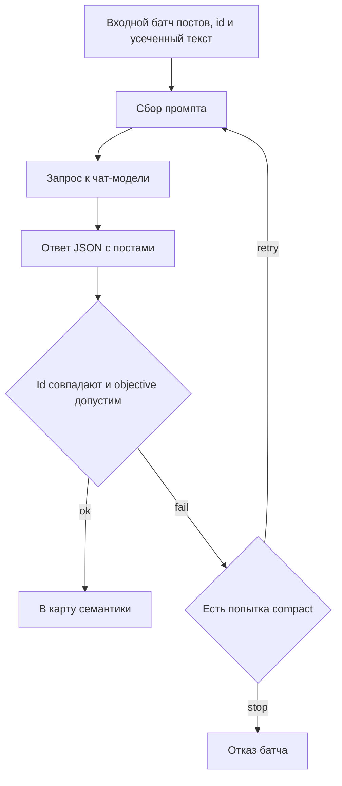
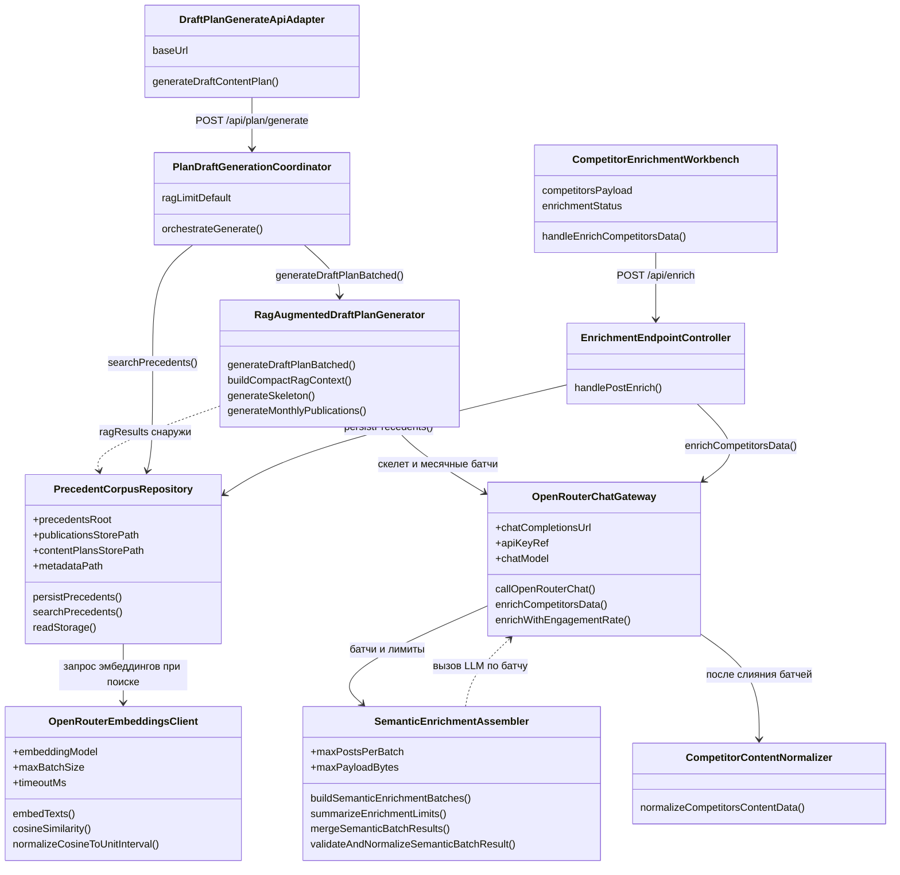
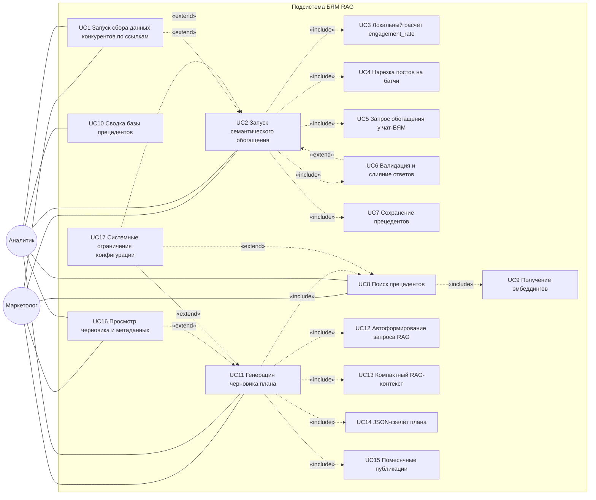
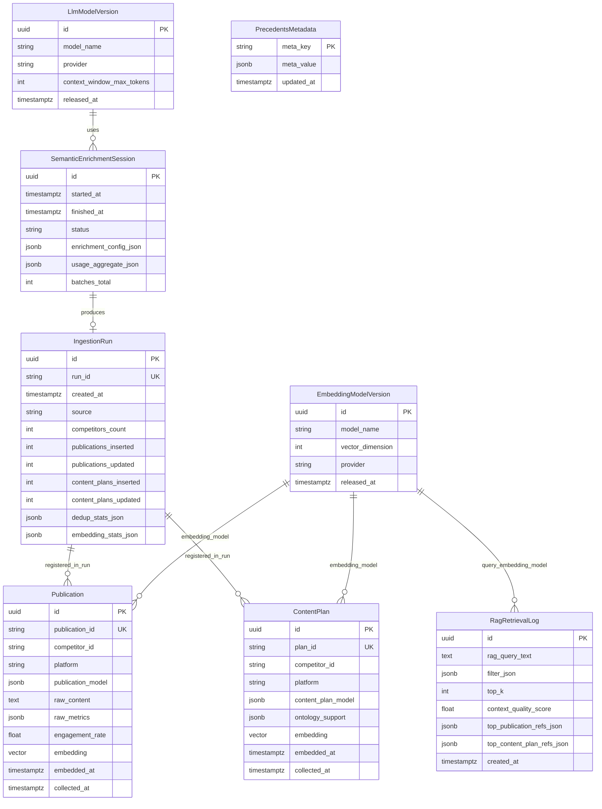
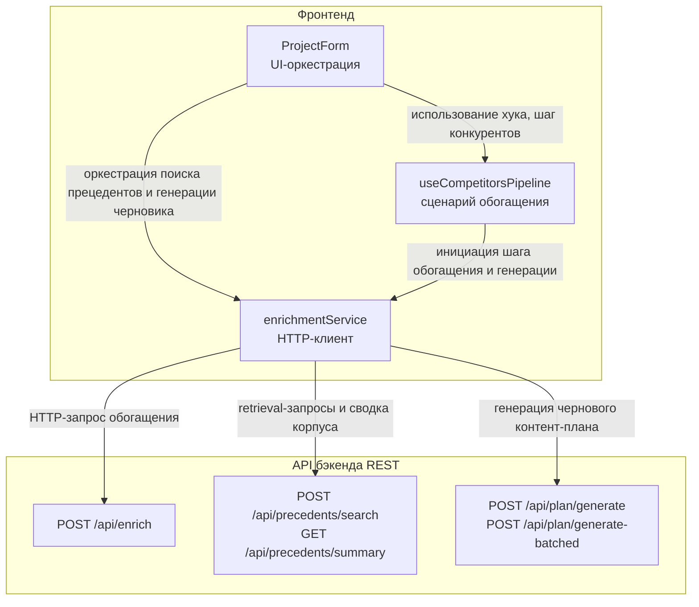
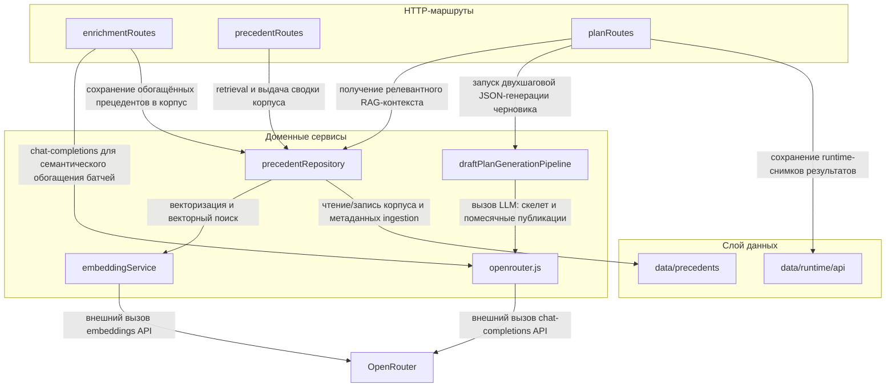

# Пояснительная записка (фрагмент курсовой работы)

## Подсистема работы с большими языковыми моделями в проекте TKRP

Источник сведений: актуальный код репозитория `TKRP` (модули `apps/api`, `apps/web`). Описание не опирается на устаревшие текстовые документы проекта.

Примечание о структуре: оглавление приведено в типовом для курсовой виде. Раздел «Введение» оформлен по той же логике, что и вводная глава по смежной части проекта (контекст → цель → задачи → ожидаемый результат), при этом формулировки проверены по коду. Заголовки и нумерацию при необходимости можно подогнать под требования кафедры.

---

## Содержание

1. [Введение](#1-введение)
2. [Описание предметной области](#2-описание-предметной-области)  
   2.1. [Видение проекта](#21-видение-проекта) · 2.2. [Математические (вербальные) модели](#22-математические-вербальные-модели) · 2.3. [Поток данных в прикладной логике](#23-поток-данных-в-прикладной-логике) · 2.4. [Составление плана работы](#24-составление-плана-работы) · 2.5. [Постановка задачи (в терминах реализации)](#25-постановка-задачи-в-терминах-реализации)
3. [Проектирование программного модуля](#3-проектирование-программного-модуля)  
   3.1. [Диаграмма классов (LLM, RAG, обогащение конкурентов)](#31-диаграмма-классов-llm-rag-обогащение-конкурентов) · 3.2. [Перечень функциональности (User Stories)](#32-перечень-функциональности-user-stories) · 3.3. [Диаграмма вариантов использования](#33-диаграмма-вариантов-использования) · 3.4. [Сценарии взаимодействия (краткий и подробный)](#34-сценарии-взаимодействия-краткий-и-подробный) · 3.5. [Индивидуальный план работ (этапы)](#35-индивидуальный-план-работ-этапы) · 3.6. [Логическая модель данных подсистемы LLM, RAG и корпуса прецедентов](#36-логическая-модель-данных-подсистемы-llm-rag-и-корпуса-прецедентов)
4. [Разработка программного модуля](#4-разработка-программного-модуля)  
   4.1. [Выбор и обоснование технологий](#41-выбор-и-обоснование-технологий) · 4.2. [Описание используемых структур данных](#42-описание-используемых-структур-данных)
5. [Архитектура подсистемы](#5-архитектура-подсистемы)
6. [Конфигурация и переменные окружения](#6-конфигурация-и-переменные-окружения)
7. [Реализация по компонентам](#7-реализация-по-компонентам)
8. [Обработка ошибок, лимиты и устойчивость](#8-обработка-ошибок-лимиты-и-устойчивость)
9. [Клиентская часть (взаимодействие с пользователем)](#9-клиентская-часть-взаимодействие-с-пользователем)
10. [Тестирование](#10-тестирование)
11. [Заключение](#11-заключение)
12. [Справочный перечень файлов](#12-справочный-перечень-файлов)

---

## 1. Введение

Современное продвижение IT-проектов в социальных сетях опирается на большие объёмы пользовательского контента и на сопоставление собственной стратегии с практикой конкурентов. Платформы вроде VK и LinkedIn задают разные модели вовлечённости и доступные сигналы о реакции аудитории; при этом сырые выгрузки постов сами по себе плохо пригодны для аналитики и для последующего автоматического планирования: не хватает единой семантической разметки, компактных описаний темы и тона, согласованных с бизнес-целями публикации. Ручная разметка и составление черновиков планов не масштабируются и плохо увязаны с дальнейшими алгоритмами оптимизации. Это формирует потребность в программной подсистеме, которая подключает большие языковые модели (БЯМ) как промышленный сервис: с ограничениями по размеру запроса, с проверкой структуры ответа и с возможностью восстановления после частичных сбоев.
Целью курсовой работы в рассматриваемой части проекта является разработка подсистемы работы с большими языковыми моделями в составе системы проекта по автоматизации продвижения IT-проектов. В ходе работы предстоит:
-	Провести анализ предметной области и места БЯМ в контуре «данные конкурентов → обогащение → прецеденты и планирование»;
-	Спроектировать архитектуру обращения к внешнему API (единый клиент чат-дополнений, отдельный клиент эмбеддингов, конфигурация через переменные окружения);
-	Реализовать конвейер семантического обогащения постов конкурентов с батчированием, валидацией JSON и учётом локально вычисляемых метрик вовлечённости;
-	Реализовать двухэтапную генерацию черновика контент-плана (скелет плана и помесячное заполнение публикаций) с режимом строгого JSON-ответа модели;
-	Интегрировать векторные представления текстов для модуля прецедентов (поиск и сопоставление по смыслу);
-	Обеспечить связку с пользовательским интерфейсом при запуске обогащения и отображении статуса (в том числе при частичном успехе батчей);
-	Провести тестирование доступных без обращения к внешнему API компонентов и зафиксировать подход к проверке LLM-веток.
В результате работы создаётся программная подсистема, позволяющая:
-	Обогащать структурированные данные о постах конкурентов, аудиторией и кратким резюме в формате;
-	Формировать черновой контент-план через последовательные вызовы БЯМ с раздельной настройкой «жёсткости» генерации (температура и лимиты токенов на этапах скелета и месячных батчей);
-	При необходимости выполнять постобработку текстов плана средствами БЯМ;
-	Получать эмбеддинги текстов через тот же провайдер ключей, с пакетной отправкой запросов;
-	Работать в условиях сетевых и модельных ошибок за счёт повторов, разбиения на батчи и частичного слияния успешных ответов там, где это предусмотрено кодом.


---

## 2. Описание предметной области

### 2.1. Видение проекта

Разрабатываемая подсистема — это набор программных модулей в системе проекта по автоматизации продвижения IT-проектов, которые обращаются к внешним большим языковым моделям через HTTP API агрегатора OpenRouter: отдельно для чат-дополнений и для вычисления эмбеддингов. Подсистема не обучает модели и не реализует генетическую оптимизацию; она формирует структурированные ответы в JSON (семантическое обогащение постов конкурентов, скелет и помесячные фрагменты черновика контент-плана) и вычисляет векторные представления текстов для дальнейшей работы репозитория прецедентов.
Основной целью подсистемы является надёжная интеграция БЯМ в прикладной контур: единый клиент запросов с авторизацией по ключу из окружения, таймаутами, логированием размера промпта и расхода токенов, ограничениями на размер батча и на длину текста поста при обогащении, а также устойчивостью к частичным отказам. Пользователь или интегратор получает возможность задавать модель и лимиты через переменные окружения.
Для достижения этих целей подсистема в репозитории решает следующие задачи: нормализация и нарезка входных данных конкурентов на батчи; вызов и разбор ответов модели с валидацией обязательных полей и соответствия множеству source_post_id; экспорт HTTP-маршрутов парсинга и обогащения; двухшаговая генерация черновика плана с разными температурами на этапах скелета и месячного батча; переписывание текстов плана с сохранением publication_id; пакетное получение эмбеддингов и их использование; информирование пользователя о ходе обогащения и частичных ошибках на стороне веб-клиента.
Пользователями подсистемы в смысле кода выступают как минимум две категории. Пользователь веб-приложения инициирует обогащение загруженного JSON с конкурентами, получает уведомления и автоматическую выгрузку результата или диагностического файла при сбоях. Клиент HTTP API (внешний сценарий или другой сервис) обращается к операциям parse, parse-and-enrich и enrich REST-сервера обогащения и к цепочкам планирования, внутри которых вызывается тот же клиент OpenRouter; для эмбеддингов потребителем является серверная логика сохранения и поиска прецедентов.
К основным возможностям подсистемы по факту реализации относятся: централизованный вызов чат-модели на уровне каждого сценария; режим ответа строгим JSON-объектом для обогащения, черновика плана; автоматическое батчирование обогащения с настраиваемыми порогами и запретом «слишком крупного» запроса при выключенном авто-батчинге; слияние семантики из нескольких успешных батчей и пометка `partial_enrichment` в метаданных при отвале отдельных батчей; отдельный контур эмбеддингов с разбиением длинных списков текстов на подзапросы; мягкий отказ при отсутствии ключа или при ошибке разбора JSON.
Внедрение подсистемы в состав системы проекта по автоматизации продвижения IT-проектов позволяет перевести разметку конкурентного контента и генерацию черновиков плана из ручного/разрозненного режима в контролируемый программный контур с проверкой схемы данных, уменьшить риск «немого» падения всего обогащения за счёт частичного успеха батчей там, где это поддержано кодом, и единообразно конфигурировать провайдера и модели через окружение без пересборки описания сценариев в коде.

### 2.2. Математические (вербальные) модели

В данном разделе формализуется LLM/RAG-подсистема проекта TKRP: от подготовки входных постов до retrieval-контекста и генерации чернового контент-плана. Генетическая оптимизация и обучение отдельных ML-моделей рассматриваются как внешние по отношению к этой математической модели.

### 2.2.1. Полная система обозначений

Индексы и множества:

- \(j \in \{1,\dots,J\}\) — индекс конкурента;
- \(p \in \{1,\dots,P_j\}\) — индекс поста конкурента \(j\);
- \(b \in \{1,\dots,B_j\}\) — индекс батча обогащения для конкурента \(j\);
- \(t \in \{1,\dots,T\}\) — индекс текста в задаче эмбеддинга;
- \(k \in \{1,\dots,N\}\) — индекс кандидата в retrieval-базе;
- \(r \in \{1,\dots,K\}\) — позиция в top-\(K\) RAG-контексте.

Исходные метрики поста:
\[
L_{j,p},\; C_{j,p},\; S_{j,p},\; V_{j,p} \in \mathbb{R}_{\ge 0},
\]
где \(L\) — likes, \(C\) — comments, \(S\) — shares, \(V\) — views.

Служебные функции:

- \(\mathrm{trim}(\cdot)\) — удаление пробелов по краям строки;
- \(\mathrm{round}_4(x)\) — округление до 4 знаков;
- \(\mathrm{UTF8}(x)\) — длина сериализованного JSON в байтах UTF-8;
- \(\oplus_s\) — конкатенация строк.

Лимиты:
\[
N_{\max}=\texttt{MAX\_POSTS\_PER\_ENRICH\_REQUEST},\;
B_{\max}=\texttt{MAX\_ENRICH\_PAYLOAD\_BYTES},\;
R_{\max}=\texttt{MAX\_ENRICH\_REQUEST\_BYTES},\;
K_{\max}=\texttt{EMBEDDING\_MAX\_BATCH}.
\]

Идентификатор поста:
\[
\sigma_{j,p}=\mathrm{id}_j \oplus_s \texttt{\_post\_} \oplus_s \mathrm{Dec}(p),
\]
где \(\mathrm{id}_j\) — нормализованный `competitor_id` (или fallback `competitor_j`).

Для батча \(b\) конкурента \(j\):

- \(M_{j,b}\) — множество `source_post_id`, отправленных в LLM;
- \(R_{j,b}\) — множество `source_post_id`, полученных в JSON-ответе;
- \(D_{j,b}\) — множество дубликатов id в ответе.

Для retrieval:

- \(\mathbf{q}\in\mathbb{R}^d\) — эмбеддинг запроса;
- \(\mathbf{e}_k\in\mathbb{R}^d\) — эмбеддинг \(k\)-го прецедента;
- \(\rho_k\in[0,1]\) — reliability прецедента;
- \(s_k\in[0,1]\) — retrieval-score прецедента.

### 2.2.2. Формулы математической модели LLM/RAG

Таблица 2.1 — Полный набор формул подсистемы LLM/RAG

| № | Формула | Назначение | Пояснение |
|---|---|---|---|
| (1) | \(I_{j,p}=L_{j,p}+C_{j,p}+S_{j,p}\) | Базовый интеракционный сигнал | Сумма реакций без просмотров |
| (2) | \(\varepsilon_{j,p}= \begin{cases}\mathrm{round}_4\!\left(\frac{I_{j,p}}{V_{j,p}}\right),&V_{j,p}>0\\ \mathrm{round}_4\!\left(\frac{I_{j,p}}{I_{j,p}+50}\right),&V_{j,p}=0,\;I_{j,p}>0\\ 0,&V_{j,p}=0,\;I_{j,p}=0\end{cases}\) | `engagement_rate` перед LLM | Views-based или proxy-режим |
| (3) | \(m_{j,p}=\mathrm{clip}\big(\mathrm{trim}(x_{j,p}),C_{\max}\big)\) | Усечение текста поста | \(C_{\max}=\texttt{MAX\_ENRICH\_POST\_CONTENT\_CHARS}\) |
| (4) | \(P_{j,b}=\mathrm{JSON}\big(\{\sigma_{j,p},m_{j,p},\varepsilon_{j,p},\text{meta}_{j,p}\}_{p\in b}\big)\) | Формирование slim payload | Включаются только нужные LLM-поля |
| (5) | \(|M_{j,b}|\le N_{\max},\;\mathrm{UTF8}(P_{j,b})\le B_{\max}\) | Ограничения одного батча | Проверяются при chunking |
| (6) | \(\max\limits_b \mathrm{UTF8}(P_{j,b}) \le R_{\max}\) | Глобальная защита от oversized-запроса | Ошибка до вызова LLM при нарушении |
| (7) | \(\mathcal{V}_{j,b}= \mathbf{1}[M_{j,b}=R_{j,b}] \cdot \mathbf{1}[D_{j,b}=\varnothing] \cdot \mathbf{1}[\forall u\in R_{j,b}:o(u)\in\Omega]\) | Булева валидация LLM-ответа | \(\Omega\) — допустимые objective |
| (8) | \(A_{j}=\bigcup\limits_{b\in \mathcal{B}^{ok}_j} f_{j,b}(\sigma_{j,p})\) | Слияние валидных батчей | \(\mathcal{B}^{ok}_j=\{b\mid \mathcal{V}_{j,b}=1\}\) |
| (9) | \(\mathrm{partial}_j=\mathbf{1}\!\left[\left|\mathcal{B}^{ok}_j\right|<B_j\right]\) | Флаг частичного обогащения | Отражается в metadata |
| (10) | \(\tilde{\tau}_t=\begin{cases}\mathrm{trim}(\tau_t),&\mathrm{trim}(\tau_t)\neq ''\\ \texttt{' '},&\text{иначе}\end{cases}\) | Очистка входа embeddings | Пустые строки заменяются пробелом |
| (11) | \(\mathcal{T}=\bigcup\limits_{g=1}^{G} \mathcal{T}_g,\;|\mathcal{T}_g|\le K_{\max}\) | Батчирование для embeddings | \(G\) — число embedding-батчей |
| (12) | \(\mathrm{sim}(\mathbf{q},\mathbf{e}_k)=\frac{\mathbf{q}^\top\mathbf{e}_k}{\|\mathbf{q}\|_2\|\mathbf{e}_k\|_2}\) | Косинусное сходство | При нулевой норме принимается 0 |
| (13) | \(\hat{s}_k=\mathrm{clip}_{[0,1]}\!\left(\frac{\mathrm{sim}(\mathbf{q},\mathbf{e}_k)+1}{2}\right)\) | Нормализация cosine в [0,1] | Эквивалент `normalizeCosineToUnitInterval` |
| (14) | \(\phi_k=0.65\,s_k+0.35\,\rho_k\) | Итоговый вес прецедента | Используется при сортировке compact RAG-context |
| (15) | \(\pi=\mathrm{TopK}_k(\phi_k)\) | Отбор top-\(K\) контекста | Отдельно для publications и content_plans |
| (16) | \(S_{ctx}=\sum\limits_{r=1}^{K} w_r\,\phi_{\pi_r},\;\sum_r w_r=1\) | Агрегированный скор контекста | Оценка качества retrieval перед генерацией |
| (17) | \(\bar{\kappa}_m=\frac{\sum_i \omega_i \kappa_{i,m}}{\sum_i \omega_i},\;\omega_i=\max(0.2,\rho_i)\) | Средний KPI по прецедентам | \(m\in\{\text{engagement, conversion, reach}\}\) |
| (18) | \(\mathcal{G}_{\text{draft}}=\mathcal{G}_{\text{skeleton}}\circ \mathcal{G}_{\text{month}}\) | Двухэтапная генерация плана | Skeleton + monthly batches в JSON-режиме |

### 2.2.3. Полный пошаговый алгоритм LLM/RAG-контура

Подготовительный этап:

1. Читаются конфигурации модели и лимитов \((N_{\max},B_{\max},R_{\max},K_{\max})\).
2. Входной JSON конкурентов нормализуется, каждому посту ставится устойчивый id \(\sigma_{j,p}\).
3. Для каждого поста вычисляются (1) и (2), текст приводится по (3).

Этап A. Семантическое обогащение (LLM):

1. Формируются payload батчей по (4) с ограничениями (5)-(6).
2. Для каждого батча отправляется запрос в Chat Completions с требованием JSON-объекта.
3. Ответ парсится, затем проверяется условие валидности (7):
   - полнота множества id \(M_{j,b}=R_{j,b}\);
   - отсутствие дубликатов;
   - objective принадлежит \(\Omega=\{\text{inform, educate, engage, convert, retain, brand\_building}\}\).
4. При невалидности допускается fallback-повтор с более компактным prompt (если разрешено настройкой).
5. Успешные батчи объединяются по (8), признак неполноты фиксируется по (9).

Этап B. Эмбеддинги и retrieval:

1. Тексты для embedding очищаются по (10) и батчатся по (11).
2. Для запроса \(\mathbf{q}\) и базы \(\mathbf{e}_k\) вычисляется cosine (12), нормализация в [0,1] по (13).
3. Итоговый retrieval-вес кандидата определяется по (14) и ранжируется в (15).
4. Для анализа качества retrieved-контекста используется агрегат (16).
5. Для параметризации ожидаемых KPI публикаций дополнительно считается среднее по (17).

Этап C. Генерация чернового плана:

1. На вход генерации подаётся compact RAG-context из top-\(K\) кандидатов.
2. Генерация выполняется композицией (18): сначала skeleton, затем помесячные batches.
3. Все ответы принимаются только в JSON-режиме с последующей детерминированной нормализацией, дедупликацией и валидацией ограничений.

### 2.2.4. Ограничения корректности и критерии допустимости решения

Результат LLM/RAG-контура считается допустимым, если выполнены условия:

1. Для каждого валидного батча соблюдается (7).
2. Итоговая структура обогащения после merge проходит доменную проверку диапазонов:
   \[
   \forall z \in \text{dimensions}\cup\text{vector}\cup\text{kpi\_estimate}: \; z\in[0,1].
   \]
3. Для embedding-ответа выполняется равенство мощностей:
   \[
   |\text{embeddings\_response}|=|\text{input\_batch}|.
   \]
4. Для draft-плана соблюдаются ограничения схемы:
   - уникальность `publication_id`;
   - допустимость `platform`, `objective`, `format`, `tone`;
   - корректные даты в пределах горизонта;
   - KPI в диапазоне \([0,1]\).

### 2.2.5. Интерпретация формул в терминах кода

- (1)-(2): `computePostEngagementMetrics`, `calculateEngagementRate`.
- (3)-(6): `buildSlimPost`, `chunkCompetitorPosts`, `summarizeEnrichmentLimits`.
- (7): `validateAndNormalizeSemanticBatchResult`.
- (8)-(9): `mergeSemanticBatchResults`, формирование `parse_error.partial`.
- (10)-(11): `embedTexts`, `callOpenRouterEmbeddings`.
- (12)-(13): `cosineSimilarity`, `normalizeCosineToUnitInterval`.
- (14)-(15): сортировка в `buildCompactRagContext` по \(0.65 \cdot score + 0.35 \cdot reliability\).
- (16)-(17): агрегированная интерпретация качества retrieval и KPI-контекста для ПЗ.
- (18): `generateDraftPlanBatched` (skeleton + monthly pipeline).

Рисунки для вставки в текст в редакторе Word (подписи можно перенумеровать по стандарту кафедры). Ниже — исходные диаграммы в формате Mermaid; при переносе в Word их можно экспортировать из просмотрщика Mermaid или воспроизвести блоками. Дополнительно см. общую архитектуру в разделе 5. Если средство просмотра пишет, что тип диаграммы не распознан, убедитесь, что сразу после открывающих тройных кавычек с языком mermaid стоит перенос строки и первая строка кода начинается с ключевого слова graph (не сливается с ```mermaid в одну строку).

Рисунок А. Общая цепочка: источник данных конкурентов → локальный расчёт вовлечённости → нарезка на батчи → запрос к БЯМ → разбор и проверка JSON → слияние и нормализация; отдельной веткой — чат-генерация скелета и месячных публикаций плана; ещё веткой — эмбеддинги текстов для прецедентов.

```mermaid
graph TB
  subgraph enrichment["Цепочка семантического обогащения"]
    SRC["Источник данных конкурентов"]
    LOC["Локальный расчет вовлеченности"]
    BAT["Нарезка на батчи"]
    REQ["Запрос к БЯМ чат"]
    PAR["Разбор и проверка JSON"]
    MRG["Слияние и нормализация"]
    SRC --> LOC --> BAT --> REQ --> PAR --> MRG
  end

  subgraph planDraft["Ветка черновика контент-плана"]
    SK["Чат, скелет плана"]
    MO["Чат, месячные публикации"]
    SK --> MO
  end

  subgraph embeddings["Ветка эмбеддингов прецедентов"]
    TX["Тексты для прецедентов"]
    EB["Запрос эмбеддингов к провайдеру"]
    PR["Репозиторий прецедентов"]
    TX --> EB --> PR
  end
```



Рисунок Б. Детализация одного батча обогащения: входной поднабор постов с полями идентификатора и усечённого текста → исходящий запрос к чат-модели → возвращённый JSON с постами → проверка совпадения множеств идентификаторов и допустимости цели → при успехе добавление в общую карту семантики, при ошибке ветвление «повтор с компактным промптом» или фиксация отказа батча. Отдельный рисунок «скрещивание и мутация контент-плана» к подсистеме БЯМ не относится: в рассматриваемом коде нет операторов кроссовера или мутации плана на стороне LLM; изменение текстов при включённом шаге разнообразия — это сопоставление по идентификатору и точечная подстановка полей, а не эволюционный оператор.



### 2.3. Поток данных в прикладной логике

1. Обогащение конкурентов. Клиент или внутренний сценарий передаёт набор конкурентов и их постов. Локально для каждого поста вычисляется engagement_rate и качество метрик (`views_based`, `interaction_proxy`, `unknown`) без обращения к БЯМ. Затем данные нормализуются, режутся на батчи ограниченного размера, и для каждого батча выполняется запрос к модели с требованием вернуть строгий JSON с семантическими полями по каждому `source_post_id`. Результаты батчей сливаются; при частичных сбоях возможно частичное обогащение с фиксацией ошибок в метаданных ответа.

2. Планирование контента. Пайплайн черновика вызывает модель дважды на логически разных шагах: генерация JSON-скелета плана и генерация набора публикаций за месяц с учётом RAG-контекста и слотов. Температура задаётся раздельно (ниже для скелета, чуть выше для текстов постов). После эволюционной оптимизации плана при включённом флаге может вызываться переписывание `key_message` и `summary` для лексического разнообразия.

3. Прецеденты и поиск. При сохранении и запросе прецедентов тексты отправляются в API эмбеддингов пакетами с настраиваемым размером батча и таймаутом.

### 2.x. Прототипы интерфейса LLM/RAG-контура

В данном подразделе приведено описание интерфейсных блоков пользовательского мастера, которые относятся к подсистеме подготовки входных данных для retrieval (RAG), запуску подбора прецедентов и генерации чернового контент-плана средствами БЯМ. Описание опирается на фактическую реализацию UI-компонентов и не включает детали смежных контуров парсинга, обучения ML-моделей и эволюционной оптимизации.

На рисунке 2.1 изображен прототип блока заполнения сведений о производителе. В данном блоке расположены два обязательных поля: «Наименование производителя» и «Специфика деятельности». Оба поля участвуют в формировании прикладного контекста для последующего подбора прецедентов и генерации чернового контент-плана.

Рисунок 2.1 — Прототип блока заполнения сведений о производителе.

На рисунке 2.2 изображен прототип блока заполнения сведений об IT-проекте. Блок содержит поля «Наименование IT-проекта», «Описание IT-проекта», «Цели проекта», «Особенности проекта» и «Преимущества проекта». В совокупности эти данные образуют содержательную часть запроса для retrieval и определяют тематические рамки генерации чернового плана на стороне LLM.

Рисунок 2.2 — Прототип блока заполнения сведений об IT-проекте.

На рисунке 2.3 изображен прототип блока заполнения данных о профиле потребителя. В блок входят поле выбора «Категория потребителя» и текстовые поля для социально-демографических характеристик, цели приобретения и особенностей стиля жизни аудитории. Указанные параметры используются при построении аудиторных сегментов и повышают релевантность поиска прецедентов по базе публикаций и контент-планов.

Рисунок 2.3 — Прототип блока заполнения данных о профиле потребителя.

На рисунке 2.4 изображен прототип блока заполнения сведений о будущем контент-плане. В нём задаются даты начала и окончания, частота публикаций, режим дат публикации («Разные дни» или «Общие дни»), ключевые даты, форматы публикаций, требования к ролику (при выборе видеоформата) и целевые платформы. Эти параметры выступают входными ограничениями для формирования структуры чернового плана в LLM/RAG-контуре.

Рисунок 2.4 — Прототип блока заполнения сведений о будущем контент-плане.

На рисунке 2.5 изображен прототип блока проверки готовности к генерации контент-плана. Блок показывает сводные карточки «Данные» и «Статус», индикатор доступности backend, чек-лист готовности входных данных (описание проекта, аудитория, платформы, форматы, наличие данных конкурентов/прецедентов), а также сводку рисков. Данный этап предназначен для контроля полноты входа перед запуском retrieval и генерации.

Рисунок 2.5 — Прототип блока проверки готовности к генерации контент-плана.

На рисунке 2.6 изображен прототип блока подбора прецедентов у роли аналитика. В блоке реализованы действия «Подобрать прецеденты», а также служебные операции с корпусом (загрузка демо-прецедентов, загрузка и экспорт JSON-онтологии). Отдельно выводится источник поискового запроса, сформированный по данным формы проекта.

Рисунок 2.6 — Прототип блока подбора прецедентов у роли аналитика.

На рисунке 2.7 изображен прототип блока с результатами подобранных прецедентов у роли аналитика. Интерфейс отображает число найденных публикаций и контент-планов, карточки прецедентов с метаданными (конкурент, платформа, формат, аудитория), показатель надёжности/релевантности и пояснение «почему найдено». Дополнительно показывается тип retrieval-режима: семантический поиск по эмбеддингам либо fallback по пересечению токенов.

Рисунок 2.7 — Прототип блока с результатами подобранных прецедентов у роли аналитика.

На рисунке 2.8 изображен прототип блока, предназначенного для начала генерации чернового контент-плана с помощью LLM у роли аналитика. Блок «Генерация и оптимизация плана» содержит кнопки «Сформировать черновой план», «Оптимизировать (ГА)» и «Перейти к готовому плану». Для контура LLM/RAG ключевым является запуск формирования черновика и отображение его сводки (период, число публикаций, режим дат, целевой engagement).

Рисунок 2.8 — Прототип блока, предназначенного для начала генерации чернового контент-плана с помощью LLM у роли аналитика.

На рисунке 2.9 изображен прототип блока, предназначенного для начала генерации чернового и подбора прецедентов у роли маркетолога. Для этой роли сценарий упрощён: в едином пользовательском потоке объединены шаги поиска прецедентов и генерации черновика, при этом технические детали скрыты, а интерфейс ориентирован на быстрый запуск операции по кнопке.

Рисунок 2.9 — Прототип блока, предназначенного для начала генерации чернового и подбора прецедентов у роли маркетолога.

### 2.4. Составление плана работы

Данная курсовая работа отвечает за разработку подсистемы работы с большими языковыми моделями, включающей семантическое обогащение данных конкурентов, retrieval (RAG) по базе прецедентов и двухэтапную генерацию черновика контент-плана через API OpenRouter. Генетическая оптимизация контент-плана и обучение ML-моделей прогноза метрик выполняются смежной частью проекта и в индивидуальном плане не рассматриваются.

Индивидуальный календарный план работы по курсовой части был подготовлен с привлечением нейросетевой языковой модели **DeepSeek**. Модель использовалась на начальном этапе планирования как интеллектуальный ассистент: по заданному описанию предметной области (подсистема БЯМ, семантическое обогащение постов конкурентов, поиск прецедентов, двухэтапная генерация черновика контент-плана) она предложила логическую декомпозицию работы на последовательные этапы, ориентировочные формулировки ожидаемых результатов и распределение сроков в рамках семестрового окна. Полученный автоматически сформированный черновик плана был критически просмотрен и доработан автором: уточнены технические детали (ограничения поставщика OpenRouter, батчирование запросов, сценарии отказа и частичного успеха), согласованы формулировки этапов с фактическим объёмом реализуемой подсистемы и с реальным графиком выполнения. Таким образом, DeepSeek выступала вспомогательным инструментом при структурировании плана, а ответственность за итоговое содержание этапов и календарные границы несёт исполнитель курсовой работы.

Индивидуальный план работы включал следующие этапы.

*Примечание.* Календарные интервалы ниже распределены в одном семестровом окне (аналогично примеру графика курсовой работы); при оформлении итоговой пояснительной записки их следует согласовать с фактическим ходом работ или с требованиями кафедры.

**Первый этап** — анализ предметной области и постановка задачи. На этапе изучались ограничения поставщика OpenRouter (чат-дополнения и эмбеддинги), требования к формату JSON для постов конкурентов и для публикаций контент-плана, ограничения на размер батча и длину текста поста, а также сценарии отказа и частичного успеха. Были зафиксированы требования к переменным окружения (ключ, идентификаторы моделей, лимиты) и к взаимодействию с маршрутами приложения (обогащение, поиск прецедентов, генерация черновика плана). Результатом этапа стало согласованное описание функций подсистемы БЯМ в терминах постов конкурентов, прецедентов и контент-плана. **Срок выполнения: 9 февраля – 18 февраля.**

**Второй этап** — проектирование и реализация единого клиента чат-дополнений. Был разработан модуль вызова HTTP API чат-модели с заголовками авторизации, таймаутом, логированием размера промпта и расхода токенов, поддержкой режима строгого JSON-ответа и единообразной обработкой ошибок HTTP. Клиент используется во всех перечисленных сценариях: семантическое обогащение публикаций конкурентов, генерация скелета и помесячных публикаций контент-плана, опциональное переписывание текстовых полей публикаций плана. **Срок выполнения: 19 февраля – 28 февраля.**

**Третий этап** — конвейер семантического обогащения постов конкурентов. Была реализована нормализация входных данных, локальный расчёт вовлечённости по метрикам публикации, нарезка постов на батчи по числу записей и размеру UTF-8, формирование пользовательского промпта с жёсткой схемой JSON, разбор и валидация ответа по множеству идентификаторов постов, повтор при невалидном ответе с «компактным» вариантом промпта и слияние успешных батчей в единую структуру данных постов конкурентов с метаданными о частичных сбоях. **Срок выполнения: 1 марта – 10 марта.**

**Четвёртый этап** — публикация REST-интерфейса обогащения и связка с парсером. Были обеспечены маршруты только парсинга, парсинга с обогащением и обогащения готового JSON; при успешной нормализации после цепочки parse-and-enrich выполняется сохранение прецедентов в базу, чтобы посты конкурентов были доступны для последующего семантического поиска и для генерации контент-плана. **Срок выполнения: 11 марта – 20 марта.**

**Пятый этап** — пайплайн генерации черновика контент-плана с участием БЯМ и RAG. Был реализован серверный сценарий: формирование или приём RAG-запроса, поиск релевантных прецедентов (публикации и планы), построение компактного контекста для промпта, последовательный вызов чат-БЯМ для построения JSON-скелета плана и для помесячного наполнения публикаций слотов плана, затем детерминированная нормализация полей публикаций. В общем контуре запроса генерации черновика обеспечён стык с модулем ML-прогноза метрик публикаций (смежная подсистема, вне зоны ответственности БЯМ, но в одном пользовательском сценарии «получить черновик»). **Срок выполнения: 21 марта – 31 марта.**

**Шестой этап** — клиент эмбеддингов и интеграция в поиск прецедентов. Был реализован отдельный HTTP-клиент к сервису векторизации с батчированием строк, обработкой пустых строк и конфигурируемыми моделью и таймаутом; обеспечены вызовы из репозитория прецедентов при индексации и при семантическом поиске по текстам, связанным с постами и планами; при недоступности эмбеддингов предусмотрен откат к поиску по пересечению токенов. **Срок выполнения: 1 апреля – 10 апреля.**

**Седьмой этап** — опциональный LLM-проход разнообразия текстов публикаций контент-плана. Был реализован сбор компактного JSON с публикациями плана, вызов чат-БЯМ с ожиданием ответа-списка публикаций с теми же идентификаторами, слияние полей по publication_id и безопасный отказ без изменения плана при ошибке ключа или разбора JSON; включение сценария задаётся параметрами запроса или окружения, чтобы не вызывать БЯМ без явного намерения. **Срок выполнения: 11 апреля – 20 апреля.**

**Восьмой этап** — клиентская часть для операций с постами конкурентов и для мастера плана. Была реализована проверка доступности сервера обогащения, сценарий «сначала данные конкурентов и enrichment, затем заполнение формы и планирование», отображение статуса и частичных ошибок по батчам, сохранение снимков чернового и оптимизированного контент-плана в локальном хранилище браузера, а также переход к странице просмотра контент-плана с экспортом в табличные и PDF-форматы по данным публикаций. **Срок выполнения: 21 апреля – 30 апреля.**

**Девятый этап** — тестирование и отладка. Были подготовлены автоматические тесты для детерминированных частей (в частности, расчёт вовлечённости по метрикам поста), интеграционные проверки маршрутов планирования без реального вызова внешнего LLM там, где это поддерживается конфигурацией тестов; для сценариев с обращением к OpenRouter использовались ручные прогоны с действующим ключом и анализ логов сервера. **Срок выполнения: 1 мая – 10 мая.**

**Десятый этап** — документирование. Результаты работы были оформлены в пояснительной записке по курсовой части; в документе зафиксированы конфигурация, ограничения и точки сопряжения с другими подсистемами (эволюция контент-плана, ML-прогноз) для последующего сопровождения. **Срок выполнения: 11 мая – 20 мая.**

### 2.5. Постановка задачи (в терминах реализации)

Спроектировать и реализовать:

- устойчивый клиент Chat Completions (авторизация, таймаут, логирование, режим JSON-ответа);
- конвейер батчирования и валидации ответов семантического обогащения;
- интеграцию с HTTP API обогащения и с фронтендом формы проекта;
- раздельный клиент эмбеддингов с батчированием по длине входа;
- опциональные пост-обработки плана через LLM без нарушения целостности идентификаторов публикаций.

---

## 3. Проектирование программного модуля

### 3.1. Диаграмма классов (фрагмент подсистемы LLM, RAG и обогащение конкурентов)

Ниже описаны логические классы подсистемы работы с большими языковыми моделями, retrieval (RAG) по базе прецедентов и семантическим обогащением данных конкурентов. Генетическая оптимизация контент-плана, отдельный парсер URL и обучение суррогатных ML-моделей в этот фрагмент не входят. В репозитории TKRP соответствующие роли реализованы модулями и функциями JavaScript (не обязательно как ключевое слово `class` в коде).

На рисунке 3.1 изображена диаграмма классов.

**Рисунок 3.1 – Диаграмма классов (LLM, RAG, обогащение конкурентов)**



*Пояснение.* Генератор черновика (`RagAugmentedDraftPlanGenerator`) не вызывает репозиторий прецедентов напрямую: объекты `ragResults` формирует координатор после `searchPrecedents` и передаёт в `generateDraftPlanBatched`. Связь с `PrecedentCorpusRepository` на диаграмме показана пунктиром как поток данных через координатор.

#### Слой доступа к данным и внешним представлениям текстов

**1. PrecedentCorpusRepository** (`apps/api/src/modules/precedents/repositories/precedentRepository.js`) отвечает за локальное хранилище прецедентов на диске: коллекции публикаций и контент-планов конкурентов, метаданные, журнал загрузок. Знает корневой каталог данных и пути к JSON-файлам; выполняет запись после обогащения (`persistPrecedents`) и поиск по запросу (`searchPrecedents`).

Атрибуты (концептуально):

- **precedentsRoot** — корень данных прецедентов (в проекте обычно `data/precedents`).
- **publicationsStorePath / contentPlansStorePath** — где лежат массивы публикаций и планов.
- **metadataPath** — сводная информация о версии схемы и обновлениях.

Что делает:

- Читает и атомарно обновляет хранилище при сохранении обогащённых данных.
- Выполняет RAG-поиск: при наличии ключа API доиндексирует отсутствующие эмбеддинги документов, комбинирует близость по эмбеддингу и пересечение по токенам, фильтрует по платформе и сегментам аудитории, возвращает ранжированные списки для генерации и для ответа клиенту.

**2. OpenRouterEmbeddingsClient** (`apps/api/src/modules/precedents/services/embeddingService.js`) отвечает за обращение к HTTP API эмбеддингов OpenRouter: пакетная отправка текстов, таймаут, модель из окружения.

Атрибуты:

- **embeddingModel** — идентификатор модели эмбеддингов.
- **maxBatchSize** — максимум строк в одном запросе.
- **timeoutMs** — ожидание ответа.

Что делает:

- Вызывает `embedTexts`, возвращает векторы; предоставляет **cosineSimilarity** и нормализацию скора для смешивания с лексическим рангом в репозитории прецедентов.

#### Слой бизнес-логики (LLM и RAG для черновика и обогащение конкурентов)

**1. OpenRouterChatGateway** (`apps/api/openrouter.js`) — единая точка вызова чат-модели через OpenRouter Chat Completions и высокоуровневая операция семантического обогащения массива конкурентов.

Атрибуты:

- **chatCompletionsUrl** — адрес API дополнений.
- **apiKeyRef / chatModel** — ключ и имя модели из переменных окружения.

Что делает:

- **callOpenRouterChat** — запрос с опциональным режимом JSON-ответа, температура и лимиты токенов задаются по сценарию.
- **enrichCompetitorsData** — перед вызовом LLM локально дополняет метриками вовлечённости (**enrichWithEngagementRate**, **computePostEngagementMetrics**), нарезает данные на батчи по лимитам, для каждого батча вызывает модель, валидирует и объединяет ответы; при отсутствии батчей возвращает нормализованные данные без LLM.

**2. SemanticEnrichmentAssembler** (`apps/api/src/modules/enrichment/services/semanticEnrichmentPipeline.js`) — логический компонент: правила нарезки на батчи, оценка размера запроса, слияние успешных батчей и проверка соответствия ответа отправленным идентификаторам постов.

Атрибуты:

- **maxPostsPerBatch**, **maxPayloadBytes** и связанные лимиты из конфигурации.

Что делает:

- Формирует батчи для **enrichCompetitorsData**, проверяет лимиты до вызова LLM, нормализует результат батча и итоговый документ.

**3. CompetitorContentNormalizer** (`apps/api/src/shared/models/contentModels.js`) приводит обогащённую структуру к единой доменной модели контента.

Что делает:

- **normalizeCompetitorsContentData** после успешного или частичного обогащения.

**4. RagAugmentedDraftPlanGenerator** (`apps/api/src/modules/planning/services/draftPlanGenerationPipeline.js`) реализует генерацию чернового контент-плана с опорой на уже полученный RAG-контекст.

Что делает:

- **buildCompactRagContext** — сжимает результаты поиска прецедентов для промпта.
- Двухэтапная генерация через LLM: скелет плана (**generateSkeleton**), затем помесячное заполнение публикаций (**generateMonthlyPublications**); постобработка полей, валидация итогового **draft_content_plan**.
- Сам retrieval не выполняет: ожидает **ragResults** от координатора.

**5. PlanDraftGenerationCoordinator** — логическая роль обработчика в `apps/api/src/modules/planning/routes/planRoutes.js` (функция **handleGeneratePlan**): связывает запрос клиента, RAG и генератор.

Что делает:

- Проверяет **form_input**; строит текст запроса (**buildRagQueryFromForm** из `planUtils.js`) или принимает **rag_query** с клиента.
- Вызывает **searchPrecedents** с лимитом и фильтрами, затем **generateDraftPlanBatched**; нормализует черновик под форму (**normalizeDraftPlanResponse**).

#### Слой пользовательского интерфейса и клиентских адаптеров

**1. EnrichmentEndpointController** (`apps/api/src/modules/enrichment/routes/enrichmentRoutes.js`, маршрут **POST /api/enrich**) принимает **competitors_data**, проверяет лимиты и вызывает **enrichCompetitorsData**; при успешном результате инициирует **persistPrecedents**.

**2. CompetitorEnrichmentWorkbench** — логическая роль хука **useCompetitorsPipeline** и связанных экранов формы проекта (`apps/web/src/features/project-form/model/useCompetitorsPipeline.js`): хранит загруженный JSON конкурентов, состояние обогащения, вызывает API обогащения и обрабатывает успех, частичный успех и ошибки JSON.

**3. DraftPlanGenerateApiAdapter** (`apps/web/src/shared/api/enrichmentService.js`, функция **generateDraftContentPlan**) отправляет **POST /api/plan/generate** (или **/generate-batched**) с **form_input**, опционально **rag_query** и **rag_limit**, разбирает ответ с полями **rag**, **draft**, **usage**.

#### Соответствие логических имён файлам

| Логический класс | Основной файл |
|------------------|---------------|
| PrecedentCorpusRepository | `precedentRepository.js` |
| OpenRouterEmbeddingsClient | `embeddingService.js` |
| OpenRouterChatGateway | `openrouter.js` |
| SemanticEnrichmentAssembler | `semanticEnrichmentPipeline.js` |
| CompetitorContentNormalizer | `contentModels.js` |
| RagAugmentedDraftPlanGenerator | `draftPlanGenerationPipeline.js` |
| PlanDraftGenerationCoordinator | `planRoutes.js` (`handleGeneratePlan`) |
| EnrichmentEndpointController | `enrichmentRoutes.js` |
| CompetitorEnrichmentWorkbench | `useCompetitorsPipeline.js` (+ форма проекта) |
| DraftPlanGenerateApiAdapter | `enrichmentService.js` |

*Что сознательно не включено в этот фрагмент:* маршруты **/parse** и **/parse-and-enrich** (конвейер парсинга), **POST /api/plan/optimize** и компоненты генетической оптимизации. В конце **generateDraftPlanBatched** может вызываться сервис релевантности (**predictEngagementRatesForGeneratedPublications**) — смежный ML-контур; при необходимости его описывают в разделе про прогноз метрик.

---

### 3.2. Перечень функциональности (User Stories)

В таблице 3.1 приведён перечень функциональности подсистемы работы с большими языковыми моделями, корпусом прецедентов (RAG) и семантическим обогащением постов конкурентов. Сценарии привязаны к объектам предметной области: посты конкурентов, публикации и слоты чернового контент-плана, запросы и результаты retrieval. **В перечень намеренно не включены:** парсинг URL и выдача сырых постов без БЯМ (маршруты `/api/parse`, `/api/parse-and-enrich`), генетическая оптимизация контент-плана и опциональный LLM-проход разнообразия текстов после эволюции, обучение и применение отдельных ML-моделей прогноза метрик — эти контуры реализованы в других модулях и при необходимости описываются в смежных разделах ПЗ. Критерии приёмки для генерации черновика сформулированы по **ответу БЯМ+RAG** (`rag`, `draft`, `usage`) без требования успешного ML-прогноза.

Таблица 3.1 – Перечень функциональности подсистемы БЯМ, RAG и обогащения данных конкурентов

| Роль | Действие | Тип объекта | Объект | Дополнительные возможности | Критерии приёмки |
|------|----------|-------------|--------|----------------------------|------------------|
| **1 Семантическое обогащение данных конкурентов (LLM)** | | | | | |
| Маркетолог / аналитик | Загружает | файл или JSON | структура конкурентов и постов для обогащения | экран формы проекта | данные доступны в состоянии формы для вызова обогащения |
| Маркетолог / аналитик | Запускает | операция | семантическое обогащение полей каждой публикации конкурента | уведомления, автоматическая выгрузка JSON результата или диагностики | API возвращает `enriched_data` либо явная ошибка / `parse_error`; при частичном успехе в метаданных отражены сбойные батчи |
| Клиент REST API | Вызывает | HTTP-операция | **POST /api/enrich** с телом `competitors_data` | проверка лимитов запроса до вызова БЯМ | при успешной нормализации выполняется та же цепочка LLM, что и из UI; при успехе и непустом результате инициируется **persistPrecedents** |
| Сервер обогащения | Вычисляет локально | показатель | `engagement_rate` и качество метрик каждой публикации конкурента | до любого вызова БЯМ (`enrichWithEngagementRate`) | в структуре поста заполнены числовой показатель и признак качества метрик |
| Сервер обогащения | Нарезает на батчи | агрегат | посты конкурентов для запросов к БЯМ | лимиты числа постов и размера полезной нагрузки UTF-8, **ENRICH_AUTO_BATCH** | каждый батч укладывается в пороги либо клиент получает ошибку о превышении лимита без автоматического разбиения |
| Сервер обогащения | Запрашивает у БЯМ | батч | усечённые тексты и идентификаторы публикаций (`source_post_id`) | режим ответа JSON-объектом | для ожидаемых идентификаторов возвращена согласованная семантика (topic, tone, objective и связанные поля); при ошибке батча — повтор с «компактным» промптом или фиксация отказа батча |
| Сервер обогащения | Сливает и нормализует | результат | полный набор постов после успешных батчей | частичное слияние при ошибках отдельных батчей | итог проходит **normalizeCompetitorsContentData** либо зафиксирован отказ с описанием батчей в метаданных |
| **2 Корпус прецедентов и RAG** | | | | | |
| Маркетолог / аналитик | Инициирует | поиск | прецеденты (публикации и контент-планы конкурентов) по текстовому запросу | **POST /api/precedents/search**: `query`, `limit`, **platform**, **audience_segments** | в ответе — `results` с ранжированными элементами и scores согласно **searchPrecedents** |
| Маркетолог / аналитик | Запрашивает | сводка | состояние локальной базы прецедентов | **GET /api/precedents/summary** | успешный JSON с полем `summary` |
| Репозиторий прецедентов | Выполняет | retrieval | **searchPrecedents** по запросу и фильтрам | ленивое вычисление и сохранение эмбеддингов документов при поиске; комбинация близости по эмбеддингу и пересечения по токенам | при доступном ключе эмбеддингов — семантическое ранжирование и список кандидатов; при недоступности — fallback на лексическое пересечение |
| Репозиторий прецедентов | Запрашивает | эмбеддинги | текстовые строки, связанные с постами и планами | разбиение списка на подпакеты по **EMBEDDING_MAX_BATCH** | число векторов соответствует числу переданных непустых строк; пустые строки не ломают пакетный вызов |
| **3 Генерация черновика контент-плана (LLM + RAG)** | | | | | |
| Маркетолог / аналитик | Инициирует | генерация | черновой контент-план и публикации по слотам | **POST /api/plan/generate** или **/generate-batched** | обработчик проверяет **form_input**, строит или принимает **rag_query**, выполняет **searchPrecedents** и **generateDraftPlanBatched** |
| Сервер планирования | Формирует или принимает | запрос RAG | текст **rag_query** | при отсутствии текста в теле — **buildRagQueryFromForm(form_input)** | непустая строка запроса для **searchPrecedents**; иначе ответ 400 |
| Сервер планирования | Фильтрует | контекст retrieval | прецеденты для запроса | **rag_limit** (по умолчанию 8), **platforms** и **audience_segments** из формы | в объект ответа включается поле **rag** с результатами поиска |
| Сервер планирования | Сжимает | контекст | результаты RAG для промпта | **buildCompactRagContext(ragResults)** | компактный контекст передаётся в **generateSkeleton** и **generateMonthlyPublications** |
| Сервер планирования | Запрашивает у БЯМ | артефакт | JSON-скелет чернового контент-плана | системный промпт скелета, пониженная температура (~0.2), режим JSON | ответ разобран как JSON; скелет поступает в помесячную генерацию и детерминированную нормализацию |
| Сервер планирования | Запрашивает у БЯМ | набор публикаций | публикации контент-плана за календарный месяц | RAG query, компактный RAG-контекст, skeleton, слоты месяца, контекст предыдущих месяцев | по месяцам формируются публикации с полями, ожидаемыми пайплайном черновика |
| Клиент | Получает | ответ HTTP | черновик после этапов БЯМ+RAG | поля **success**, **rag**, **draft**, **usage**, **generation_metadata** | **draft** и **rag** соответствуют успешному прохождению генерации на стороне БЯМ+RAG (ML-прогноз при наличии выполняется отдельным модулем и не является условием приёмки строки) |
| **4 Конфигурация и отказоустойчивость** | | | | | |
| Интегратор развёртывания | Задаёт через окружение | конфигурация | ключ и модели OpenRouter, лимиты батчей и таймауты | **OPENROUTER_API_KEY**, **AI_MODEL**, **EMBEDDING_MODEL**, лимиты enrichment и эмбеддингов | без ключа чат-вызовы к провайдеру не выполняются; модели и пороги задаются без пересборки кода сценариев |
| Система | Обрабатывает | отказ | отсутствие ключа, ошибка HTTP API, невалидный JSON от БЯМ | логирование расхода токенов и размера промпта там, где предусмотрено клиентом | обогащение или шаг черновика завершаются предсказуемым кодом/метаданными без необоснованного падения всего процесса там, где в коде предусмотрены частичный успех или сохранение сырого ответа |

### 3.3. Диаграмма вариантов использования

В соответствии с функциональными возможностями подсистемы (блоки 1–4 таблицы 3.1 из §3.2) разработана диаграмма вариантов использования. Парсинг URL (`/api/parse`, `/api/parse-and-enrich`), генетическая оптимизация (`/api/plan/optimize`), обучение и применение ML-моделей прогноза метрик и опциональный LLM-проход разнообразия после эволюции в диаграмму не входят — они реализованы вне рассматриваемой части кода.

**Актеры:**

- **Маркетолог** — указывает ссылки на конкурентов и инициирует получение их публикаций (этап парсинга), запускает семантическое обогащение (`POST /api/enrich`), инициирует поиск прецедентов и генерацию чернового контент-плана, просматривает результаты (`rag`, `draft`, сводки).
- **Аналитик** — выполняет пользовательские операции по обогащению, поиску прецедентов и генерации чернового контент-плана, анализирует сводку корпуса прецедентов (`GET /api/precedents/summary`) и качество полученного результата.

**Рисунок 3.3 – Диаграмма вариантов использования (LLM, RAG, обогащение конкурентов)**



Таблица 3.2 – Описание диаграммы использования

| № | Прецедент | Требования (блок из таблицы 3.1) | Описание |
|---|-----------|-----------------------------------|----------|
| UC1 | Запуск сбора данных конкурентов по ссылкам | 1 | Маркетолог или аналитик указывает ссылки на конкурентов и инициирует парсинг; после получения данных запускается этап обогащения в LLM-контуре. |
| UC2 | Запуск семантического обогащения постов конкурентов | 1 | Маркетолог или аналитик инициирует **POST /api/enrich** с полем `competitors_data`; маршрут проверяет лимиты (`summarizeEnrichmentLimits`), вызывает **enrichCompetitorsData**; при успехе — **persistPrecedents**. |
| UC3 | Локальный расчёт `engagement_rate` и качества метрик | 1 | До вызова БЯМ для каждого поста вычисляются метрики вовлечённости (**enrichWithEngagementRate**, **computePostEngagementMetrics**, **calculateEngagementRate**). |
| UC4 | Нарезка постов на батчи по лимитам | 1 | Формирование батчей по числу постов и размеру UTF-8 (`MAX_POSTS_PER_ENRICH_REQUEST`, `MAX_ENRICH_PAYLOAD_BYTES`, глобально — `MAX_ENRICH_REQUEST_BYTES`, опция **ENRICH_AUTO_BATCH**). |
| UC5 | Запрос обогащения у чат-БЯМ батчами в режиме JSON | 1 | Для каждого батча — **callOpenRouterChat** с требованием строгого JSON-ответа; в промпт попадают усечённые тексты и `source_post_id`. |
| UC6 | Валидация и слияние ответов БЯМ | 1 | **validateAndNormalizeSemanticBatchResult**, **mergeSemanticBatchResults**; при ошибках отдельных батчей — частичное слияние и признак неполноты в метаданных. |
| UC7 | Сохранение прецедентов в локальное хранилище | 2 | После успешного обогащения вызывается **persistPrecedents** (JSON-хранилище `data/precedents`). |
| UC8 | Поиск прецедентов по текстовому запросу | 2 | **POST /api/precedents/search**; сервер выполняет **searchPrecedents** с фильтрами `platform`, `audience_segments`, лимитом `limit`. |
| UC9 | Получение эмбеддингов текстов провайдером | 2 | Внутри retrieval при необходимости — **embedTexts** / **callOpenRouterEmbeddings** с батчированием по **EMBEDDING_MAX_BATCH**; при отсутствии ключа — откат к лексическому пересечению в **searchPrecedents**. |
| UC10 | Просмотр сводки локальной базы прецедентов | 2 | **GET /api/precedents/summary** (**getPrecedentsSummary**); типично аналитик для контроля объёма корпуса. |
| UC11 | Запуск генерации чернового контент-плана | 3 | **POST /api/plan/generate** или **/generate-batched**; **handleGeneratePlan** валидирует **form_input**, строит или принимает запрос RAG, вызывает **searchPrecedents** и **generateDraftPlanBatched**, **normalizeDraftPlanResponse**. |
| UC12 | Автоформирование запроса RAG из формы | 3 | Сервер строит текст запроса через **buildRagQueryFromForm(form_input)** и использует его в **searchPrecedents** перед генерацией. |
| UC13 | Сжатие RAG-контекста для промпта | 3 | **buildCompactRagContext** по результатам **searchPrecedents** перед шагами генерации. |
| UC14 | Запрос JSON-скелета чернового плана у БЯМ | 3 | **generateSkeleton** — чат-БЯМ с пониженной температурой и режимом JSON. |
| UC15 | Помесячное наполнение публикаций плана у БЯМ | 3 | **generateMonthlyPublications** по слотам месяца с учётом скелета и контекста предыдущих месяцев. |
| UC16 | Просмотр черновика плана и метаданных генерации | 3 | Маркетолог или аналитик получает в ответе поля **success**, **rag**, **draft**, **usage**, **generation_metadata** (без требования успешного ML-прогноза как части подсистемы БЯМ). |
| UC17 | Системные ограничения конфигурации LLM/RAG | 4 | Подсистема учитывает доступность **OPENROUTER_API_KEY**, модели и лимиты среды; при некорректной конфигурации шаги обогащения, retrieval и генерации деградируют предсказуемо. |

Пояснение связей представлено в таблице 3.3.

Таблица 3.3 – Пояснение связей

| Связь | Тип | Смысл |
|-------|-----|--------|
| UC2 → UC3 | include | Каждый запуск обогащения начинается с локального расчёта вовлечённости по метрикам поста. |
| UC2 → UC4 | include | Перед вызовом БЯМ данные нарезаются на батчи согласно порогам размера. |
| UC2 → UC5 | include | Каждый валидный батч отправляется в чат-БЯМ с ожиданием JSON-ответа. |
| UC2 → UC6 | include | Ответы батчей валидируются и сливаются в итоговую структуру. |
| UC2 → UC7 | include | При успешном результате обогащения выполняется сохранение прецедентов. |
| UC8 → UC9 | include | При доступной конфигурации эмбеддингов поиск использует векторное сходство; иначе срабатывает лексический fallback без UC9. |
| UC11 → UC8 | include | Каждая генерация черновика повторно выполняет RAG-поиск на сервере, даже если клиент уже вызывал поиск вручную. |
| UC11 → UC12 | include | Перед retrieval сервер автоматически формирует текст RAG-запроса из `form_input`, если используется стандартный поток. |
| UC11 → UC13 | include | Результаты поиска сжимаются в компактный контекст для промпта. |
| UC11 → UC14 | include | Сначала генерируется JSON-скелет плана. |
| UC11 → UC15 | include | Затем выполняется помесячное наполнение публикаций. |
| UC1 → UC2 | extend | После получения данных конкурентов из шага парсинга пользователь может запустить обогащение. |
| UC6 → UC2 | extend | Ветка частичного успеха: обогащение завершено с предупреждением по сбойным батчам. |
| UC16 → UC11 | extend | Просмотр итогового HTTP-ответа генерации следует после успешного сценария UC11 на стороне клиента. |
| UC17 → UC2 | extend | При отсутствии или неверном ключе чат-обогащение не вызывается; ответ предсказуемо деградирует. |
| UC17 → UC8 | extend | При недоступности эмбеддингов поиск прецедентов использует лексический режим. |
| UC17 → UC11 | extend | Неверная конфигурация модели или лимитов ведёт к отказу шагов БЯМ в генерации черновика. |

### 3.4. Сценарии взаимодействия (краткий и подробный)

  Ниже описано, как пользователь проходит типовые шаги в веб-приложении и какие запросы уходят на бэкенд (базовый URL задаётся переменной окружения фронтенда `VITE_ENRICHMENT_API_URL` и по умолчанию совпадает с сервером обогащения и планирования). Акцент раздела — только на подсистеме БЯМ, RAG и обогащения данных конкурентов. Детали парсинга URL, эволюционной оптимизации и ML-прогноза метрик в этот подраздел не включаются.

  Краткий сценарий. Пользователь сначала получает данные конкурентов (через парсинг URL во внешнем контуре или загрузкой готового JSON) и запускает их обогащение через `POST /api/enrich`. После сохранения и/или проверки прецедентов пользователь заполняет мастер проекта (описание проекта, аудитория, платформы, форматы, горизонт и частота контент-плана), затем выполняет поиск прецедентов (`POST /api/precedents/search`), где сервер использует эмбеддинги текстов и возвращает ранжированные результаты. Далее пользователь запускает генерацию чернового контент-плана через `POST /api/plan/generate`: сервер повторно выполняет RAG-поиск и затем двухэтапную LLM-генерацию (скелет и помесячные публикации). На странице контент-плана доступны просмотр, история снимков и экспорт результата.

  Подробные сценарии.

  1. Получение и обогащение данных конкурентов. Пользователь подготавливает входные данные конкурентов (парсингом URL во внешнем контуре или загрузкой JSON) и запускает обогащение. После этого в системе появляется база для retrieval и последующей генерации.

  2. Заполнение формы проекта и переходы мастера. Пользователь вводит описание проекта, аудиторию, платформы (VK или LinkedIn в допустимых значениях формы), форматы публикаций, даты и параметры расписания контент-плана. Перед генерацией черновика клиент проверяет обязательные поля; при ошибках показываются сообщения и подсветка полей.

  3. Работа с постами конкурентов. Для каждой публикации конкурента на сервере вызывается чат-БЯМ батчами; в ответ возвращаются дополнительные семантические поля, полученные обработкой LLM. Клиент показывает ход операции и при частичном успехе предупреждает о сбойных батчах; при необходимости автоматически скачивается JSON результата или диагностики.

  4. Отдельный поиск прецедентов в интерфейсе. Пользователь нажимает действие подбора прецедентов: клиент формирует текстовый запрос из полей формы и отправляет POST на маршрут precedents/search с ограничением числа результатов (в коде клиента лимит пять), списком платформ и сегментами аудитории. Сервер выполняет поиск по базе прецедентов с использованием векторных представлений текстов (эмбеддинги — часть подсистемы доступа к OpenRouter). Ответ отображается списком карточек; при необходимости открывается модальное окно деталей публикации или плана конкурента. После успешного поиска клиент дополнительно запрашивает сводку по базе прецедентов (маршрут precedents/summary).

  5. Объединённое действие «прецеденты и черновик» в упрощённом потоке. В конфигурации интерфейса, где объединены поиск и генерация, одна кнопка последовательно вызывает сначала поиск прецедентов, затем генерацию черновика (тот же программный порядок, что и при ручном нажатии двух шагов подряд).

  6. Генерация чернового контент-плана и публикаций по слотам. Пользователь запускает генерацию; клиент отправляет `POST` на маршрут `plan/generate` с безопасным подмножеством полей формы. На сервере, даже если пользователь уже искал прецеденты вручную, повторно выполняется RAG-поиск по тому же или автоматически собранному запросу, затем пайплайн чат-БЯМ формирует скелет плана и помесячно наполняет публикации контент-плана. Клиент сохраняет черновик контент-плана в локальное хранилище снимков и показывает сводку; в расширенном режиме разработчика доступен блок технических деталей с JSON.

  7. Автоматическое обогащение постов конкурентов перед генерацией. Если в базе нет прецедентов для рабочего сценария, но в форме есть несохранённые в базу сырые данные конкурентов и сервер обогащения доступен, перед вызовом plan/generate клиент инициирует обогащение этих постов без повторного скачивания файла, затем обновляет сводку прецедентов — чтобы последующая генерация черновика контент-плана имела опору на данные в базе.

  9. Просмотр, история и экспорт контент-плана. На странице контент-плана пользователь видит выбранный снимок плана с публикациями. Доступны выгрузка в Excel и в PDF на стороне браузера по данным текущего плана (колонки включают поля публикаций и расчётные показатели, если они присутствуют в структуре). История снимков черновых и оптимизированных планов хранится в локальном хранилище браузера и позволяет вернуться к предыдущей версии контент-плана.

  Альтернативные и пограничные сценарии.

  Сервер обогащения недоступен. Клиент проверяет маршрут health; кнопки, завязанные на обогащение и на генерацию черновика, остаются заблокированными до восстановления связи, пользователь видит предупреждение.

  Частичное обогащение постов конкурентов. Часть батчей к БЯМ завершилась ошибкой валидации или API; сервер возвращает частично заполненные семантические поля публикаций и признак partial в метаданных; клиент показывает предупреждение и всё равно может сохранить результат для разбора.

### 3.5. Индивидуальный план работ (этапы)

Тот же план в составе описания предметной области, с явными календарными сроками по этапам, приведён в [§2.4](#24-составление-плана-работы). Ниже сохраняется развёрнутая формулировка в контексте главы о проектировании.

Данная курсовая работа отвечает за разработку подсистемы работы с большими языковыми моделями. Генетическая оптимизация контент-плана и обучение ML-прогнозов метрик остаются смежными задачами другой части команды; в этом плане они фигурируют лишь как внешние контексты стыковки (например, вызов LLM после эволюции или выдача плана в прогнозирующий модуль после ответа БЯМ). Индивидуальный план работы включал следующие этапы.

Первый этап — анализ предметной области и постановка задачи. На этапе изучались ограничения поставщика OpenRouter (чат-дополнения и эмбеддинги), требования к формату JSON для постов конкурентов и для публикаций контент-плана, ограничения на размер батча и длину текста поста, а также сценарии отказа и частичного успеха. Были зафиксированы требования к переменным окружения (ключ, идентификаторы моделей, лимиты) и к взаимодействию с маршрутами приложения (обогащение, поиск прецедентов, генерация и оптимизация плана). Результатом этапа стало согласованное описание функций подсистемы БЯМ в терминах постов конкурентов, прецедентов и контент-плана.

Второй этап — проектирование и реализация единого клиента чат-дополнений. Был разработан модуль вызова HTTP API чат-модели с заголовками авторизации, таймаутом, логированием размера промпта и расхода токенов, поддержкой режима строгого JSON-ответа и единообразной обработкой ошибок HTTP. Клиент используется во всех перечисленных сценариях: семантическое обогащение публикаций конкурентов, генерация скелета и помесячных публикаций контент-плана, опциональное переписывание текстовых полей публикаций плана.

Третий этап — конвейер семантического обогащения постов конкурентов. Была реализована нормализация входных данных, локальный расчёт вовлечённости по метрикам публикации, нарезка постов на батчи по числу записей и размеру UTF-8, формирование пользовательского промпта с жёсткой схемой JSON, разбор и валидация ответа по множеству идентификаторов постов, повтор при невалидном ответе с «компактным» вариантом промпта и слияние успешных батчей в единую структуру данных постов конкурентов с метаданными о частичных сбоях.

Четвёртый этап — публикация REST-интерфейса обогащения и связка с парсером. Были обеспечены маршруты только парсинга, парсинга с обогащением и обогащения готового JSON; при успешной нормализации после parse-and-enrich выполняется вызов сохранения прецедентов в базу, чтобы посты конкурентов были доступны для последующего поиска и для генерации контент-плана.

Пятый этап — пайплайн генерации черновика контент-плана с участием БЯМ. Был реализован серверный сценарий: формирование или приём RAG-запроса, получение контекста прецедентов (публикации и планы конкурентов), последовательный вызов чат-БЯМ для построения JSON-скелета плана и для помесячного наполнения публикаций слотов плана, затем детерминированная нормализация полей публикаций. В общем контуре запроса генерации черновика был обеспечен стык с модулем ML-прогноза метрик публикаций (вне зоны ответственности БЯМ, но в одном пользовательском сценарии «получить черновик»).

Шестой этап — клиент эмбеддингов и интеграция в поиск прецедентов. Был реализован отдельный HTTP-клиент к сервису векторизации с батчированием строк, обработкой пустых строк и конфигурируемыми моделью и таймаутом; обеспечены вызовы из репозитория прецедентов при индексации и при семантическом поиске по текстам, связанным с постами и планами.

Седьмой этап — опциональный LLM-проход разнообразия текстов публикаций контент-плана. Был реализован сбор компактного JSON с публикациями плана, вызов чат-БЯМ с ожиданием ответа-списка публикаций с теми же идентификаторами, слияние key_message и summary по publication_id и безопасный отказ без изменения плана при ошибке ключа или разбора JSON; предусмотрено включение сценария из тела запроса оптимизации или из окружения, чтобы не вызывать БЯМ без явного намерения.

Восьмой этап — клиентская часть для операций с постами конкурентов и для мастера плана. Была реализована проверка доступности сервера обогащения, сценарий «сначала данные конкурентов (парсинг/загрузка) и enrichment, затем заполнение формы и планирование», отображение статуса и частичных ошибок по батчам, сохранение снимков чернового и оптимизированного контент-плана в локальном хранилище браузера, а также переход к странице просмотра контент-плана с экспортом в табличные и PDF-форматы по данным публикаций.

Девятый этап — тестирование и отладка. Были подготовлены автоматические тесты для детерминированных частей (в частности, расчёт вовлечённости по метрикам поста), интеграционные проверки маршрутов планирования без реального вызова внешнего LLM там, где это поддерживается конфигурацией тестов; для сценариев с обращением к OpenRouter использовались ручные прогоны с действующим ключом и анализ логов сервера.

Десятый этап — документирование. Результаты работы были оформлены в пояснительной записке по курсовой части; в документе зафиксированы конфигурация, ограничения и точки сопряжения с другими подсистемами (эволюция контент-плана, ML-прогноз) для последующего сопровождения.

### 3.6. Логическая модель данных подсистемы LLM, RAG и корпуса прецедентов

В текущей реализации TKRP прецеденты и журнал загрузок хранятся в JSON-файлах (`data/precedents`), а вызовы RAG не записываются в отдельную таблицу. Ниже приведена **целевая логическая модель данных**, согласованная с реальными сущностями кода (семантическое обогащение в `openrouter.js`, сохранение прецедентов и `ingestion_runs` в `precedentRepository.js`, эмбеддинги и поиск в `embeddingService.js` / `searchPrecedents`) и с рекомендуемой архитектурой PostgreSQL + pgvector из `docs/database-architecture.md`. Модель **не включает** таблицы генетической оптимизации и кандидатов эволюции — они относятся к смежной подсистеме.

На рисунке 3.4 изображена диаграмма базы данных (подсистема обогащения конкурентов, корпус прецедентов и журналирование RAG).

**Рисунок 3.4 – Диаграмма базы данных (LLM, RAG, прецеденты)**



Ниже — фрагмент целевого DDL (PostgreSQL + расширение `vector`), выражающий ту же структуру в виде кода реляционной схемы. Тип `vector(D)` соответствует размерности эмбеддингов (`D` задаётся конфигурацией, в проекте используется согласование с моделью эмбеддингов OpenRouter).

```sql
CREATE EXTENSION IF NOT EXISTS vector;

CREATE TABLE embedding_model_version (
  id UUID PRIMARY KEY DEFAULT gen_random_uuid(),
  model_name VARCHAR(256) NOT NULL,
  vector_dimension INT NOT NULL,
  provider VARCHAR(128),
  released_at TIMESTAMPTZ NOT NULL DEFAULT NOW()
);

CREATE TABLE llm_model_version (
  id UUID PRIMARY KEY DEFAULT gen_random_uuid(),
  model_name VARCHAR(256) NOT NULL,
  provider VARCHAR(128),
  context_window_max_tokens INT,
  released_at TIMESTAMPTZ NOT NULL DEFAULT NOW()
);

CREATE TABLE semantic_enrichment_session (
  id UUID PRIMARY KEY DEFAULT gen_random_uuid(),
  llm_model_version_id UUID NOT NULL REFERENCES llm_model_version(id),
  started_at TIMESTAMPTZ NOT NULL DEFAULT NOW(),
  finished_at TIMESTAMPTZ,
  status VARCHAR(32) NOT NULL,
  enrichment_config_json JSONB,
  usage_aggregate_json JSONB,
  batches_total INT NOT NULL DEFAULT 0
);

CREATE TABLE ingestion_run (
  id UUID PRIMARY KEY DEFAULT gen_random_uuid(),
  run_id VARCHAR(128) NOT NULL UNIQUE,
  semantic_enrichment_session_id UUID REFERENCES semantic_enrichment_session(id),
  created_at TIMESTAMPTZ NOT NULL DEFAULT NOW(),
  source VARCHAR(64) NOT NULL,
  competitors_count INT NOT NULL DEFAULT 0,
  publications_inserted INT NOT NULL DEFAULT 0,
  publications_updated INT NOT NULL DEFAULT 0,
  content_plans_inserted INT NOT NULL DEFAULT 0,
  content_plans_updated INT NOT NULL DEFAULT 0,
  dedup_stats_json JSONB,
  embedding_stats_json JSONB
);

CREATE TABLE publication (
  id BIGSERIAL PRIMARY KEY,
  publication_id VARCHAR(512) NOT NULL UNIQUE,
  ingestion_run_id UUID REFERENCES ingestion_run(id),
  embedding_model_version_id UUID REFERENCES embedding_model_version(id),
  competitor_id VARCHAR(256),
  competitor_name VARCHAR(256),
  platform VARCHAR(64),
  publication_model JSONB NOT NULL,
  raw_content TEXT,
  raw_metrics JSONB,
  engagement_rate REAL,
  embedding vector(1536),
  embedded_at TIMESTAMPTZ,
  collected_at TIMESTAMPTZ NOT NULL DEFAULT NOW()
);

CREATE TABLE content_plan (
  id BIGSERIAL PRIMARY KEY,
  plan_id VARCHAR(512) NOT NULL UNIQUE,
  ingestion_run_id UUID REFERENCES ingestion_run(id),
  embedding_model_version_id UUID REFERENCES embedding_model_version(id),
  competitor_id VARCHAR(256),
  competitor_name VARCHAR(256),
  platform VARCHAR(64),
  content_plan_model JSONB NOT NULL,
  ontology_support JSONB,
  embedding vector(1536),
  embedded_at TIMESTAMPTZ,
  collected_at TIMESTAMPTZ NOT NULL DEFAULT NOW()
);

CREATE TABLE rag_retrieval_log (
  id UUID PRIMARY KEY DEFAULT gen_random_uuid(),
  embedding_model_version_id UUID REFERENCES embedding_model_version(id),
  rag_query_text TEXT NOT NULL,
  filter_json JSONB,
  top_k INT NOT NULL,
  context_quality_score REAL,
  top_publication_refs_json JSONB,
  top_content_plan_refs_json JSONB,
  created_at TIMESTAMPTZ NOT NULL DEFAULT NOW()
);

CREATE TABLE precedents_metadata (
  meta_key VARCHAR(64) PRIMARY KEY,
  meta_value JSONB NOT NULL,
  updated_at TIMESTAMPTZ NOT NULL DEFAULT NOW()
);

CREATE INDEX idx_publication_embedding ON publication
  USING ivfflat (embedding vector_cosine_ops) WITH (lists = 100);
CREATE INDEX idx_content_plan_embedding ON content_plan
  USING ivfflat (embedding vector_cosine_ops) WITH (lists = 50);
```

**Сущность EmbeddingModelVersion** отвечает за хранение сведений о версии модели векторизации текстов (идентификатор модели у провайдера, размерность вектора `D` для столбца `vector(D)`) и связана с таблицами **Publication**, **ContentPlan** и **RagRetrievalLog**. Содержит имя модели (`model_name`), размерность (`vector_dimension`), поставщика (`provider`) и момент фиксации версии (`released_at`).

**Сущность LlmModelVersion** отвечает за хранение сведений о версии языковой модели, используемой для семантического обогащения постов конкурентов, и связана с таблицей **SemanticEnrichmentSession**. Содержит имя модели (`model_name`), провайдера (`provider`), ограничение по контексту (`context_window_max_tokens`) и дату фиксации версии (`released_at`).

**Сущность SemanticEnrichmentSession** отвечает за хранение информации о каждом сеансе LLM-обогащения входного JSON конкурентов (батчи, лимиты, агрегированное потребление токенов) и связана с таблицами **LlmModelVersion** и (при успешной цепочке «обогащение → persist») **IngestionRun**. Фиксирует время начала и завершения (`started_at`, `finished_at`), статус выполнения (`status`), сериализованную конфигурацию лимитов и батчинга (`enrichment_config_json`), агрегат usage по вызовам (`usage_aggregate_json`) и число батчей (`batches_total`).

**Сущность IngestionRun** отвечает за хранение журнала загрузки нормализованных прецедентов в корпус после обогащения или импорта и связана с таблицами **Publication**, **ContentPlan** и опционально **SemanticEnrichmentSession**. Содержит бизнес-ключ прогона (`run_id`), источник данных (`source`), число конкурентов и счётчики вставок/обновлений публикаций и контент-планов, а также JSON со статистикой дедупликации и пересчёта эмбеддингов (`dedup_stats_json`, `embedding_stats_json`), что соответствует записям в массиве `ingestion_runs` файлового хранилища.

**Сущность Publication** отвечает за хранение публикации конкурента как прецедента для RAG: нормализованная модель контента (`publication_model` в JSON), сырой текст и метрики, рассчитанный `engagement_rate`, вектор признака для семантического поиска (`embedding`) и связь с версией модели эмбеддингов. Связана с **EmbeddingModelVersion** и **IngestionRun** (в каком прогоне запись была внесена или обновлена).

**Сущность ContentPlan** отвечает за хранение контент-плана конкурента как прецедента: агрегированная структура плана (`content_plan_model`), опциональная онтологическая поддержка (`ontology_support`), вектор для retrieval (`embedding`), связь с версией эмбеддингов и с журналом загрузки.

**Сущность RagRetrievalLog** отвечает за хранение записей о запросах семантического поиска по корпусу прецедентов при подготовке черновика плана (текст запроса, фильтры по платформам и аудитории, `top_k`, агрегированная оценка качества контекста, ссылки на отобранные прецеденты) и связана с **EmbeddingModelVersion** для учёта модели векторизации запроса.

**Сущность PrecedentsMetadata** отвечает за хранение пар «ключ–значение» для версии схемы JSON корпуса, версии формата эмбеддингов и иных глобальных настроек (аналог `metadata.json` в файловом хранилище).

**Связь LlmModelVersion и SemanticEnrichmentSession** — неидентифицирующая обязательная, типа **1:M**. Одна версия LLM может использоваться во многих сеансах обогащения; каждый сеанс привязан ровно к одной версии модели.

**Связь SemanticEnrichmentSession и IngestionRun** — неидентифицирующая необязательная, типа **0..1 : 0..1** (в типовом сценарии API обогащения с успешным сохранением прецедентов — **1:1**). Запись загрузки может появиться без предшествующего LLM (импорт прецедентов); сеанс обогащения может не породить запись загрузки при ошибке сохранения.

**Связь IngestionRun и Publication** — неидентифицирующая обязательная с точки зрения происхождения данных в учётном контуре, типа **1:M**. Один прогон загрузки регистрирует множество публикаций; каждая публикация ссылается на прогон, в котором она была внесена или последний раз обновлена.

**Связь IngestionRun и ContentPlan** — неидентифицирующая обязательная, типа **1:M**, по тем же правилам, что для публикаций.

**Связь EmbeddingModelVersion и Publication** — неидентифицирующая обязательная для строк с ненулевым эмбеддингом, типа **1:M**. Одна версия модели эмбеддингов используется для многих публикаций; каждая публикация с вектором относится к одной версии (при смене модели выполняется пересчёт и смена связи).

**Связь EmbeddingModelVersion и ContentPlan** — неидентифицирующая обязательная, типа **1:M**, по тем же правилам, что для публикаций.

**Связь EmbeddingModelVersion и RagRetrievalLog** — неидентифицирующая обязательная, типа **1:M**. Одна версия модели векторизации запросов используется во многих логах поиска; каждый лог относится к одной версии.

**Сущность PrecedentsMetadata** не соединена обязательными внешними ключами с прецедентами: это справочник уровня всего корпуса.

---

## 4. Разработка программного модуля

### 4.1. Выбор и обоснование технологий, используемых в программном модуле

Разрабатываемая подсистема должна обеспечивать устойчивые HTTP-вызовы внешнего API Chat Completions и эмбеддингов (в коде — OpenRouter), контролируемое батчирование запросов и приёмку ответов в виде строгого или ожидаемого JSON, выдачу REST-интерфейсов обогащения и планирования, а также связку с клиентским приложением, откуда пользователь запускает обогащение постов конкурентов и генерацию черновика контент-плана. Обучение ML-моделей прогноза метрик, генетическая оптимизация плана и вызов отдельного Python-процесса для этих целей в репозитории вынесены за рамки настоящего обоснования: для подсистемы БЯМ они выступают лишь смежным контекстом сопряжения по данным и маршрутам.

При подготовке настоящего подраздела использовалась нейросетевая языковая модель **DeepSeek**. По краткому описанию реализованной подсистемы (HTTP-интеграция с OpenRouter, REST-маршруты обогащения и планирования, клиентское приложение на React) модель предложила логичную последовательность обоснования выбора технологий и черновые формулировки назначения каждого компонента стека. Автор сверил предложенный перечень с фактической конфигурацией монорепозитория (каталоги `apps/api` и `apps/web`, `package.json`, используемые модули), уточнил имена библиотек и исключил из текста технологии смежных подсистем. Итоговое обоснование отражает реально применяемый стек и не содержит необоснованных утверждений.

В качестве языка серверной части выбран JavaScript на платформе Node.js с типом пакета `module` (нативные ES-модули в `apps/api`). Это даёт единый стек с клиентом на JavaScript, встроенную асинхронную модель ввода-вывода и удобное сосуществование длительных сетевых запросов к LLM с остальной логикой API без выделения отдельного процесса-интерпретатора под каждый запрос. Альтернатива в виде отдельного микросервиса на другом языке для только HTTP-прокси к OpenRouter в данном проекте не использовалась, чтобы сократить число артефактов развёртывания и держать разбор JSON и промптов рядом с маршрутами Express.

Для организации HTTP API используется Express (зависимость объявлена в `apps/api/package.json`). Маршруты обогащения и планирования монтируются в общем приложении `server.js`; это соответствует типовой схеме REST и упрощает интеграцию с фронтендом по базовому URL.

Для исходящих запросов к провайдеру БЯМ выбрана библиотека axios: ею пользуются модуль `openrouter.js` (чат-дополнения) и `embeddingService.js` (векторизация текстов). Обоснование — единообразная настройка таймаутов, заголовков авторизации и разбора ответов и ошибок HTTP в одном стиле для чата и эмбеддингов. Нативный `fetch` в проекте для этих вызовов не задействован.

Конфигурация секретов и параметров моделей вынесена в dotenv: загрузка `.env` из корня монорепозитория выполняется в `openrouter.js` и в точке старта API. Для доступа к PostgreSQL при сохранении и поиске прецедентов (в том числе после обогащения и для RAG) в зависимостях API указан драйвер pg; векторный поиск по смыслу опирается на эмбеддинги из того же контура OpenRouter, а не на локальное обучение embedding-модели. Для кросс-доменных запросов с дев-сервера Vite к API используется cors.

Клиентское приложение в каталоге `apps/web` собирается Vite (`vite.config.js`, скрипты в корневом `package.json`: `dev:vite`, `build`). Интерфейс реализован на React 18 с маршрутизацией react-router-dom; базовый URL сервера обогащения задаётся префиксом `VITE_` для подстановки на этапе сборки. Для выгрузки контент-плана пользователем в табличные и PDF-форматы в корневых зависимостях задействованы xlsx, jspdf с jspdf-autotable и pdfmake — они относятся к представлению уже сформированных данных плана и не дублируют вызов БЯМ.

Автоматическая проверка кода подсистемы опирается на встроенный в Node.js загрузчик тестов `node --test` (см. скрипт `test` в `apps/api/package.json` и корневой объединённый `npm run test`): для детерминированных функций и части интеграционных сценариев не требуется отдельная тяжёлая тестовая инфраструктура.

Таким образом, выбранный стек (Node.js, Express, axios, dotenv, pg, React, Vite) соответствует задаче интеграции внешней БЯМ как сетевого сервиса с управляемыми лимитами и отказоустойчивостью на уровне батчей и повторов, без включения в обоснование средств обучения нейросетей или реализации генетических операторов на стороне рассматриваемого модуля.

### 4.2. Описание используемых структур данных

Описание структур данных, переменных окружения, порядка развёртывания и архитектуры компонентов в настоящем подразделе также подготовлено с привлечением нейросетевой модели **DeepSeek**. Модель помогла сгруппировать шаги настройки проекта, сформулировать перечень переменных окружения по контурам LLM/RAG и описать назначение ключевых HTTP-маршрутов и полей JSON-ответов. Все перечисленные эндпоинты, пути к файлам хранилища `data/precedents` и параметры конфигурации проверены по исходному коду репозитория; при расхождении с реализацией формулировки были исправлены автором.

Ниже приведено описание программного модуля в пределах зоны ответственности подсистемы **LLM, RAG и обогащения данных конкурентов**. Внутренние алгоритмы парсинга, ML-прогнозирования и эволюционной оптимизации здесь не рассматриваются; они выступают внешними стыками.

#### Как настраивался проект (конфигурация)

1. Системные требования: **Node.js 20+** и **Python 3.11+ с pip**.
2. Установка зависимостей Node: в корне репозитория выполняется `npm install`; при необходимости установку API в `apps/api` можно пропустить через `SKIP_POSTINSTALL=1`.
3. Полный bootstrap: `npm run setup` из корня выполняет `npm install`, `pip install -r requirements.txt` и при отсутствии `.env` копирует `.env.example` в `.env`.
4. Минимальные переменные окружения для LLM/RAG-контура:
   - для LLM и эмбеддингов: `OPENROUTER_API_KEY`, `AI_MODEL`, `EMBEDDING_MODEL`, `EMBEDDING_MAX_BATCH`, `EMBEDDING_TIMEOUT_MS`;
   - для API и клиента: `PORT`, `VITE_ENRICHMENT_API_URL`, `API_BODY_LIMIT`, `CORS_ALLOWED_ORIGINS`;
   - для лимитов обогащения: `MAX_POSTS_PER_ENRICH_REQUEST`, `MAX_ENRICH_PAYLOAD_BYTES`, `MAX_ENRICH_REQUEST_BYTES`, `MAX_ENRICH_POST_CONTENT_CHARS`, `ENRICH_AUTO_BATCH`, `ENRICH_RETRY_ON_INVALID`.
5. Опционально: `SERVER_API_KEY` и `ADMIN_API_KEY` для защиты отдельных операций API.

#### Как разворачивался проект (запуск и поставка)

1. Локальная разработка: `npm run dev` из корня поднимает одновременно фронтенд (Vite, порт 5173) и API (Express, порт из `PORT`, по умолчанию 3001). Проверка доступности API: `GET http://localhost:3001/health`.
2. Сборка фронтенда: `npm run build`; локальный предпросмотр сборки: `npm run preview`.
3. Запуск API как сервиса: `npm run start` в каталоге `apps/api`.

#### Основные структуры данных и компоненты подсистемы

Пользовательский сценарий начинается с подготовки данных конкурентов и их обогащения (парсинг URL во внешнем контуре или загрузка JSON, затем `useCompetitorsPipeline` и вызовы через `enrichmentService`). `ProjectForm` в этом контуре выступает UI-оркестратором: он не обращается к backend и data layer напрямую, а работает через API-клиент `enrichmentService`. После накопления прецедентов пользователь заполняет проектную форму и запускает retrieval/генерацию. На уровне HTTP для рассматриваемой подсистемы используются маршруты:

- `POST /api/enrich` для семантического обогащения `competitors_data`;
- `POST /api/precedents/search` и `GET /api/precedents/summary` для retrieval и контроля состояния корпуса;
- `POST /api/plan/generate` (и `POST /api/plan/generate-batched`) для генерации чернового контент-плана по RAG-контексту.

Для обогащения входная структура `competitors_data` содержит массив `competitors`; далее серверный контур батчирует посты с лимитами и отправляет их в OpenRouter в формате строгого JSON. В ответе ключевыми полями являются `success`, `enriched_data`, `parse_error`, `usage`, `metadata`, а также `request_guardrails` и `persistence` при вызове `/api/enrich`.

Контур RAG работает через `searchPrecedents(...)` в `precedentRepository`: запрос сопоставляется с корпусом прецедентов, при доступном ключе используется эмбеддинг-поиск через `embeddingService`, при недоступном ключе работает лексический fallback. Для генерации черновика `planRoutes` передает результаты retrieval в `draftPlanGenerationPipeline`, где выполняются два вызова LLM: генерация JSON-скелета и помесячная генерация публикаций.

Слой данных подсистемы представлен файловым хранилищем `data/precedents` (`metadata.json`, `ingestion_runs.json`, `publications.json`, `content_plans.json`) и runtime-снимками в `data/runtime/api`. Внешним провайдером для chat-completions и embeddings является OpenRouter.

Стыки со смежными подсистемами:

- парсинг URL (`/api/parse`, `/api/parse-and-enrich`) может поставлять исходные данные для `/api/enrich`, но его внутренняя логика в этот подраздел не входит;
- ML и эволюция работают как соседние контуры после или рядом с черновой генерацией, без включения их внутренних алгоритмов в настоящее описание.

Архитектура подсистемы представлена двумя диаграммами компонентов: на рисунке 4.1 — фронтенд (`useCompetitorsPipeline`, `enrichmentService`, `ProjectForm` из таблицы 4.2); на рисунке 4.1а — бэкенд, слой данных и внешний провайдер OpenRouter. Граница между рисунками — HTTP API: связи от `enrichmentService` к маршрутам `enrichmentRoutes`, `precedentRoutes` и `planRoutes` (таблица 4.1). Подписи на стрелках соответствуют столбцу «Описание» таблицы 4.1 (на рис. 4.1 — клиентская часть и REST-граница; на рис. 4.1а — внутренние вызовы бэкенда).

**Рисунок 4.1 – Диаграмма компонентов (фронтенд)**



**Рисунок 4.1а – Диаграмма компонентов (бэкенд, слой данных, OpenRouter)**



---

## 5. Архитектура подсистемы

### 5.1. Обоснование подхода к компонентам

Компонентный подход в подсистеме LLM/RAG и обогащения данных конкурентов применен для явного разделения ответственности между уровнями: пользовательский интерфейс, HTTP-транспорт, бизнес-оркестрация retrieval и генерации, доступ к данным прецедентов, а также внешние вызовы OpenRouter (chat-completions и embeddings). Детализация вынесена в два рисунка (4.1 и 4.1а) для наглядного разделения клиентской и серверной частей; на стрелках указаны назначения связей в соответствии с таблицей 4.1. Такая декомпозиция делает архитектуру прозрачной: каждый компонент выполняет ограниченный набор задач и взаимодействует через стабильные интерфейсы.

На рисунке 4.1 `ProjectForm` выступает точкой входа пользовательского сценария: подключает хук `useCompetitorsPipeline` для шага конкурентов и напрямую вызывает `enrichmentService` для поиска прецедентов и генерации черновика; оба пути сходятся в HTTP-клиенте, который обращается к REST-эндпоинтам бэкенда. На рисунке 4.1а показана серверная цепочка: маршруты `enrichmentRoutes`, `precedentRoutes` и `planRoutes` делегируют работу `precedentRepository`, `draftPlanGenerationPipeline`, `openrouter.js` и `embeddingService`, а также взаимодействуют с `data/precedents`, `data/runtime/api` и внешним OpenRouter.

Такой подход обеспечивает следующие преимущества:

- возможность изменять внутреннюю реализацию retrieval и генерации без изменения UI и API-контрактов;
- возможность замены или перенастройки внешнего LLM-провайдера при сохранении остальной архитектуры;
- четкое разделение ответственности между уровнями и участниками команды при параллельной разработке;
- упрощение тестирования за счет изоляции маршрутов, репозитория прецедентов и LLM-клиента;
- повышение сопровождаемости и масштабируемости подсистемы при добавлении новых сценариев обогащения и генерации.

В таблице 4.1 сводно перечислены связи компонентов; те же формулировки приведены как подписи на стрелках рисунков 4.1 (строки 1–6, клиент и REST-граница) и 4.1а (строки 7–17, бэкенд и внешние вызовы).

**Таблица 4.1 - Связи компонентов**

| От | К | Описание |
|---|---|---|
| `ProjectForm` | `useCompetitorsPipeline` | Подключение хука и управление шагом конкурентов |
| `ProjectForm` | `enrichmentService` | Оркестрация поиска прецедентов и генерации черновика |
| `useCompetitorsPipeline` | `enrichmentService` | Инициация клиентского шага обогащения и генерации |
| `enrichmentService` | `enrichmentRoutes` | Отправка HTTP-запроса обогащения (`POST /api/enrich`) |
| `enrichmentService` | `precedentRoutes` | Отправка retrieval-запросов (`POST /api/precedents/search`, `GET /api/precedents/summary`) |
| `enrichmentService` | `planRoutes` | Отправка запроса генерации чернового плана (`POST /api/plan/generate`, `POST /api/plan/generate-batched`) |
| `enrichmentRoutes` | `openrouter.js` | Вызов chat-completions для семантического обогащения батчей постов |
| `enrichmentRoutes` | `precedentRepository` | Сохранение обогащенных прецедентов в корпус |
| `precedentRoutes` | `precedentRepository` | Выполнение retrieval и выдача сводки корпуса прецедентов |
| `planRoutes` | `precedentRepository` | Получение релевантного RAG-контекста для генерации плана |
| `planRoutes` | `draftPlanGenerationPipeline` | Запуск двухшаговой JSON-генерации чернового контент-плана |
| `draftPlanGenerationPipeline` | `openrouter.js` | Вызов LLM на этапе скелета и на этапе помесячных публикаций |
| `precedentRepository` | `embeddingService` | Расчет/дозагрузка векторных представлений и векторный поиск |
| `precedentRepository` | `data/precedents` | Чтение/запись корпуса прецедентов и метаданных ingestion |
| `planRoutes` | `data/runtime/api` | Сохранение runtime-снимков результатов генерации |
| `openrouter.js` | `OpenRouter` | Внешний вызов chat-completions API |
| `embeddingService` | `OpenRouter` | Внешний вызов embeddings API |

Таблица 4.1 и рисунки 4.1–4.1а вместе задают полный маршрут прохождения управления в подсистеме LLM/RAG и обогащения данных конкурентов. На клиенте (рис. 4.1) `ProjectForm` координирует шаг конкурентов через `useCompetitorsPipeline` и операции RAG/генерации через `enrichmentService`; последний по HTTP обращается к `enrichmentRoutes`, `precedentRoutes` и `planRoutes` (на рис. 4.1а — как входные маршруты). Такое разделение важно, потому что пользовательский сценарий, транспорт HTTP и бизнес-логика разведены по разным компонентам: изменение формата UI не требует изменения retrieval/генерации, а изменение внутренней логики репозитория и промптов не затрагивает публичные API-контракты.

На рис. 4.1а и в строках 10–12 таблицы 4.1 видно, что центральной точкой бизнес-цепочки выступает связка `planRoutes` + `precedentRepository` + `draftPlanGenerationPipeline`: сначала извлекается релевантный контекст из корпуса прецедентов (эмбеддинговый поиск с fallback), затем выполняется двухшаговая JSON-генерация чернового контент-плана. Итоговый черновик строится не только на LLM-вызове, но и с учётом retrieval-контекста корпуса конкурентов.

Отдельно на рис. 4.1а зафиксирована ветка обогащения (строки 7–8 таблицы 4.1): `enrichmentRoutes` вызывает `openrouter.js` для семантической нормализации и передаёт данные в `precedentRepository` для пополнения корпуса. Низкоуровневые детали URL-парсинга, ML-прогнозирования и эволюционной оптимизации в эти рисунки не включаются, поскольку относятся к смежным подсистемам.

На таблице 4.2 представлено описание компонентов.

**Таблица 4.2 - Компоненты**

| Уровень | Компонент | Назначение |
|---|---|---|
| Фронтенд | `useCompetitorsPipeline` | Управление пользовательским процессом обогащения и генерации |
| Фронтенд | `enrichmentService` | HTTP-клиент для вызова API обогащения, retrieval и генерации |
| Фронтенд | `ProjectForm` | UI-оркестрация сценария проектирования и запуска операций |
| Бэкенд | `enrichmentRoutes` | Прием API-запросов обогащения данных конкурентов |
| Бэкенд | `precedentRoutes` | Прием API-запросов retrieval и сводки корпуса |
| Бэкенд | `planRoutes` | Прием API-запросов генерации чернового контент-плана |
| Бэкенд | `precedentRepository` | Поиск и хранение прецедентов, выдача RAG-контекста |
| Бэкенд | `draftPlanGenerationPipeline` | Двухшаговая JSON-генерация скелета и публикаций плана |
| Бэкенд | `openrouter.js` | Клиент chat-completions для обогащения и генерации |
| Бэкенд | `embeddingService` | Клиент embeddings для векторизации и retrieval |
| Слой данных | `data/precedents` | Хранилище прецедентов, метаданных и журналов ingestion |
| Слой данных | `data/runtime/api` | Хранилище runtime-снимков API-результатов |
| Внешний источник | `OpenRouter` | Провайдер chat-completions и embeddings |

Таблица 4.2 согласована с рисунками 4.1 и 4.1а: компоненты уровня «Фронтенд» соответствуют узлам рис. 4.1, строки «Бэкенд», «Слой данных» и «Внешний источник» — узлам рис. 4.1а. Так фиксируются границы ответственности подсистемы LLM/RAG: на клиенте — сценарий формы и HTTP-транспорт, на сервере — REST-входы, доменные сервисы retrieval и генерации, файловые хранилища и внешний LLM-провайдер.

Такое разделение позволяет развивать модуль по частям: изменения промптов, стратегий retrieval или ограничений батчирования не требуют переработки UI при сохранении контрактов API. При этом контуры обучения ML-моделей, парсинга URL и эволюционной оптимизации рассматриваются как внешние зависимости и не входят в данный подраздел.

На таблице 4.3 представлено описание передачи данных по эндпоинтам.

**Таблица 4.3 - Передача данных по эндпоинтам**

| Компонент | Метод | Эндпоинт | Тело запроса (для POST) | Ответ |
|---|---|---|---|---|
| `enrichmentService` | POST | `/api/enrich` | `{ competitors_data }` | `{ success, enriched_data, parse_error, usage, metadata, request_guardrails, persistence }` |
| `enrichmentService` | POST | `/api/precedents/search` | `{ query, limit, platform, audience_segments }` | `{ success, results }` |
| `enrichmentService` | GET | `/api/precedents/summary` | - | `{ success, summary }` |
| `enrichmentService` | POST | `/api/plan/generate` | `{ form_input, rag_query, rag_limit }` | `{ success, rag, draft, usage, generation_metadata }` |
| `enrichmentService` | POST | `/api/plan/generate-batched` | `{ form_input, rag_query, rag_limit }` | `{ success, rag, draft, usage, generation_metadata }` |

Таблица 4.3 нужна для практического понимания того, какие данные передаются между клиентской и серверной частями подсистемы LLM/RAG, через какие HTTP-методы и в каком формате. Пользовательский сценарий здесь построен вокруг двух основных операций: пополнение/нормализация корпуса конкурентов и генерация чернового контент-плана на основе retrieval-контекста.

Основная прикладная логика сосредоточена в эндпоинтах `POST /api/enrich`, `POST /api/precedents/search`, `GET /api/precedents/summary`, `POST /api/plan/generate` и `POST /api/plan/generate-batched`. Все прочие взаимодействия между внутренними компонентами (`precedentRepository`, `embeddingService`, `openrouter.js`, `draftPlanGenerationPipeline`) являются внутрисервисными вызовами и не представлены как отдельные HTTP-транзакции, так как они относятся к внутренней реализации бэкенда.

Таким образом, состав API в таблице 4.3 отражает специфику подсистемы как сервиса обогащения и генерации на базе LLM/RAG: внешне он предоставляет компактный набор прикладных точек входа, тогда как внутренняя сложность сосредоточена в retrieval-контуре, батчировании и валидации LLM-ответов, а также в построении структурированного чернового плана.

---

## 6. Конфигурация и переменные окружения

Загрузка `.env` из корня монорепозитория выполняется в `openrouter.js` (через `dotenv`) и в `server.js` для API.

| Переменная | Назначение (по коду) |
|------------|----------------------|
| `OPENROUTER_API_KEY` | Bearer-токен для chat и embeddings; без ключа `callOpenRouterChat` бросает исключение; эмбеддинги — ошибка с кодом `NO_OPENROUTER_KEY`; diversity-pass возвращает исходный план с `meta.reason = 'no_openrouter_key'`. |
| `AI_MODEL` | Идентификатор chat-модели в формате OpenRouter (`provider/model`). |
| `APP_URL` | Заголовок `HTTP-Referer` при запросах к OpenRouter (fallback `http://localhost:5173`). |
| `EMBEDDING_MODEL` | Модель эмбеддингов (по умолчанию `text-embedding-3-small`). |
| `EMBEDDING_MAX_BATCH` | Максимум строк в одном запросе embeddings (по умолчанию 64). |
| `EMBEDDING_TIMEOUT_MS` | Таймаут axios для embeddings (по умолчанию 60000 мс). |
| `MAX_POSTS_PER_ENRICH_REQUEST` | Максимум постов в одном LLM-батче обогащения (по умолчанию 15). |
| `MAX_ENRICH_PAYLOAD_BYTES` | Ограничение размера JSON payload батча в байтах (по умолчанию 180000). |
| `MAX_ENRICH_REQUEST_BYTES` | Верхняя оценка «всего запроса» для сводки лимитов (по умолчанию 2000000). |
| `MAX_ENRICH_POST_CONTENT_CHARS` | Обрезка текста поста при подготовке батча (по умолчанию 4000 символов). |
| `ENRICH_AUTO_BATCH` | Если не `'false'`, разрешено нарезать данные на несколько батчей. |
| `ENRICH_RETRY_ON_INVALID` | Если не `'false'`, при невалидном ответе выполняется повторная попытка с «компактным» промптом (`maxRetries: 1` в конфиге). |
| `PLAN_DIVERSITY_LLM_REWRITE` | Строка `'1'` включает LLM-переписывание разнообразия, если не переопределено телом запроса (`stage3.llm_diversity_rewrite`). |

Иллюстративный перечень см. также в корневом файле `.env.example`.

---

## 7. Реализация по компонентам

### 7.1. Клиент Chat Completions (`apps/api/openrouter.js`)

- Адрес чат-запросов задаётся в коде константой на стороне OpenRouter (модуль openrouter.js).
- Тело запроса: `model`, массив `messages` с ролями `system` и `user`, `temperature`, `max_tokens`.
- Режим JSON: при `options.responseFormat === 'json'` в тело добавляется `response_format: { type: 'json_object' }` (используется обогащением, черновиком плана и diversity-pass).
- Лимит выходных токенов: если вызывающий код не передал `maxTokens`, используется константа `DEFAULT_OPENROUTER_MAX_OUTPUT_TOKENS` (32768). Для семантических батчей явно задаются меньшие значения (8000 / 4000 при compact-retry).
- Таймаут HTTP: 120000 мс (2 минуты) для chat.
- Заголовки: `Authorization`, `Content-Type`, `HTTP-Referer`, `X-Title`.
- Возврат: объект с полями `content` (текст ответа модели), `usage`, `data`.

Функция `enrichCompetitorsData`:

1. Вызывает `enrichWithEngagementRate` (детерминированные метрики).
2. Строит батчи через `buildSemanticEnrichmentBatches`, читает системный промпт из файла `articleStage1SemanticEnrichmentPrompt.txt`.
3. Для пустого списка батчей возвращает нормализованные данные без вызова LLM.
4. Для каждого батча: при `retryOnInvalid` до двух попыток (вторая с `compact`-промптом); при HTTP 5xx — один повтор с задержкой 2000 мс.
5. Сливает успешные батчи (`mergeSemanticBatchResults`), применяет постобработку и нормализацию контент-модели; при ошибках отдельных батчей формирует `parse_error` с `partial: true`.

Вспомогательные экспорты `computePostEngagementMetrics` / `calculateEngagementRate` используются пайплайном обогащения и тестами.

### 7.2. Батчирование и валидация семантики (`semanticEnrichmentPipeline.js`)

- Формирует «урезанное» представление поста: `source_post_id`, обрезанный `content`, метрики, вложения, `engagement_rate`, платформа из множества `vk` | `linkedin`.
- Дробит посты конкурента на чанки по числу постов и размеру UTF-8 сериализованного JSON.
- Функция `buildSemanticUserPrompt` задаёт жёсткий контракт JSON (поля `topic`, `tone`, `objective` из фиксированного списка `inform|educate|engage|convert|retain|brand_building`, и т.д.).
- `validateAndNormalizeSemanticBatchResult` проверяет полноту множества `source_post_id`, отсутствие дубликатов и допустимость `objective`.
- `extractJsonObjectFromContent` делегирует в `parseJsonObjectFromLlmContent` (`llmJsonParsing.js`): сначала строгий `JSON.parse`, при неудаче — извлечение первого объекта `{...}` из текста.

### 7.3. HTTP API обогащения (`enrichmentRoutes.js`, `parserPipeline.js`)

- Операция parse-and-enrich (метод POST): парсинг по URL и вызов enrichCompetitorsData, затем при успешных данных — persistPrecedents; маршруты обогащения подключены к приложению без внутреннего подпути, общий префикс API задаётся при монтировании роутера.
- Операция enrich (метод POST): обогащение переданного JSON competitors_data.
- Маршруты импортируют `enrichCompetitorsData` из `openrouter.js` и утилиты лимитов из `semanticEnrichmentPipeline.js`.

### 7.4. Генерация черновика плана (`draftPlanGenerationPipeline.js`)

- Системные промпты читаются из файлов:
  - `apps/api/src/shared/prompts/articleDraftPlanSkeletonPrompt.txt` — этап скелета;
  - `apps/api/src/shared/prompts/articleDraftPlanBatchPrompt.txt` — этап публикаций за месяц.
- Оба вызова используют `callOpenRouterChat` с `responseFormat: 'json'`.
- Температуры: 0.2 для скелета, 0.28 для месячного батча (комментарии в коде обосновывают как баланс структуры и лексики).
- Разбор ответа через `parseJsonObjectFromLlmContent` (обёртка `extractJsonFromLlmContent`).

Дальнейшая обработка (нормализация форматов, дедупликация, эвристики текста) выполняется детерминированным кодом того же файла и связанных утилит — без дополнительных вызовов LLM в показанных точках.

### 7.5. LLM-проход разнообразия (`planDiversityLlmPass.js`)

- Промпт: `planDiversityTextRewritePrompt.txt`.
- Вход передаётся как JSON в user-сообщении; модель должна вернуть JSON со списком `publications` с `publication_id` и новыми `key_message` / `summary`.
- Условие запуска: `shouldRunPlanDiversityLlmRewrite` — приоритет флагу `payload.stage3.llm_diversity_rewrite`, иначе env `PLAN_DIVERSITY_LLM_REWRITE === '1'`.
- При отсутствии ключа API или ошибке парсинга/структуры возвращается исходный массив публикаций, в `meta` фиксируется причина (`no_openrouter_key`, `json_parse_error`, `invalid_llm_json`).

Интеграция: `hierarchicalGa.js` вызывает `applyPlanDiversityLlmRewrite` при выполнении условия `shouldRunPlanDiversityLlmRewrite`.

### 7.6. Эмбеддинги (`embeddingService.js`)

- Адрес запросов эмбеддингов задаётся в коде константой на стороне OpenRouter (модуль embeddingService.js).
- Параметры из `getEmbeddingConfig()`: модель, `maxBatchSize`, `timeoutMs`.
- Пустые строки заменяются на один пробел, чтобы API не отклонил элемент.
- `embedTexts` режет вход на батчи и последовательно вызывает API, возвращая объединённый массив векторов.

Потребители: `precedentRepository.js` (массовое встраивание текстов, probe-запрос, догрузка отсутствующих эмбеддингов, эмбеддинг поискового запроса).

### 7.7. Запуск сервера (`apps/api/server.js`)

При старте в консоль выводится состояние `OPENROUTER_API_KEY` (настроен / не настроен). Это диагностика, а не блокировка запуска при отсутствии ключа.

---

## 8. Обработка ошибок, лимиты и устойчивость

| Аспект | Поведение в коде |
|--------|------------------|
| Превышение размера батча относительно `maxRequestBytes` | Исключение с текстом, включающим счётчики постов и байты. |
| Несколько батчей при выключенном `ENRICH_AUTO_BATCH` | Исключение с сообщением о необходимости батчинга. |
| HTTP 5xx при обогащении | До одного повтора того же батча с задержкой 2 с. |
| Невалидный JSON / схема семантики | При включённом retry — вторая попытка с компактным промптом; иначе батч в список ошибок, итог может быть частичным. |
| Пустой контент от chat API | Логирование предупреждения; дальнейшая обработка приведёт к ошибке парсинга на уровне вызывающего кода. |
| Эмбеддинги: несовпадение длины `data` с запросом | Исключение «Некорректный ответ embeddings API». |

---

## 9. Клиентская часть (взаимодействие с пользователем)

Файл `apps/web/src/features/project-form/model/useCompetitorsPipeline.js`:

- Проверяет доступность сервера обогащения (`checkEnrichmentServer`, URL из `VITE_ENRICHMENT_API_URL`).
- При запуске обогащения показывает тосты о начале/успехе/ошибке; при успехе выводит суммарное использование токенов, если сервер вернул `usage`.
- Если `parse_error.partial`, показывается предупреждение о частичной обработке батчей.
- Автоматически инициирует скачивание JSON с результатом или диагностическим дампом (`_raw_response_from_llm`, метаданные) для разбора сбоев.

---

## 10. Тестирование

Подробная классификация видов тестов, таблицы соответствия объектов проверки файлам тестов, шаблоны таблиц результатов прогонов и указания по скриншотам изложены в пояснительной записке: раздел **5 «Тестирование программного модуля»** ([PZ.md](PZ.md)).

- Юнит-тесты метрик вовлечённости (без сети): файл `apps/api/tests/engagementMetrics.test.js` проверяет `computePostEngagementMetrics` и `calculateEngagementRate` для случаев с просмотрами, без просмотров и без сигнала.
- Интеграционные тесты маршрутов планирования (`apps/api/tests/planRoutes.integration.test.js`) по описанию сценария используют зависимости без реального LLM — что важно для CI и не дублирует проверку внешнего API.

Прямых автотестов с моком OpenRouter в репозитории для `callOpenRouterChat` в просмотренных файлах не обнаружено; отладка LLM-веток опирается на логи сервера (`[LLM] ...`) и ручные прогоны.

---

## 11. Заключение

Реализованная подсистема БЯМ в TKRP централизует доступ к OpenRouter Chat Completions, обеспечивает контролируемое батчирование и валидацию семантического обогащения, поддерживает двухшаговую JSON-генерацию черновика контент-плана и опциональное LLM-переписывание текстов плана. Векторный слой вынесен в отдельный клиент embeddings с батчированием и используется хранилищем прецедентов. Конфигурация вынесена в переменные окружения, что позволяет менять модели и лимиты без правки кода.

---

## 12. Справочный перечень файлов

| Файл | Роль |
|------|------|
| `apps/api/openrouter.js` | Chat client, семантическое обогащение, метрики engagement |
| `apps/api/src/modules/enrichment/services/semanticEnrichmentPipeline.js` | Батчи, промпт пользователя, валидация JSON |
| `apps/api/src/modules/enrichment/routes/enrichmentRoutes.js` | HTTP: parse, parse-and-enrich, enrich |
| `apps/api/src/modules/enrichment/services/parserPipeline.js` | Связка парсера с обогащением |
| `apps/api/src/shared/utils/llmJsonParsing.js` | Устойчивый разбор JSON из ответа модели |
| `apps/api/src/modules/planning/services/draftPlanGenerationPipeline.js` | LLM: скелет и месячные публикации |
| `apps/api/src/modules/planning/services/planDiversityLlmPass.js` | LLM: разнообразие текстов плана |
| `apps/api/src/modules/planning/services/evolutionary/hierarchicalGa.js` | Вызов diversity-pass из эволюции |
| `apps/api/src/modules/precedents/services/embeddingService.js` | Клиент embeddings |
| `apps/api/src/modules/precedents/repositories/precedentRepository.js` | Использование `embedTexts` |
| `apps/api/src/shared/prompts/articleStage1SemanticEnrichmentPrompt.txt` | Системный промпт семантического обогащения |
| `apps/api/src/shared/prompts/articleDraftPlanSkeletonPrompt.txt` | Промпт скелета плана |
| `apps/api/src/shared/prompts/articleDraftPlanBatchPrompt.txt` | Промпт месячного батча плана |
| `apps/api/src/shared/prompts/planDiversityTextRewritePrompt.txt` | Промпт переписывания разнообразия |
| `apps/web/src/features/project-form/model/useCompetitorsPipeline.js` | UI и скачивание результатов обогащения |
| `apps/api/server.js` | Старт API, индикация наличия ключа |
| `.env.example` | Пример переменных для LLM и эмбеддингов |

Файлы `articleDraftPlanPrompt.txt` и `articleStage1EnrichmentPrompt.txt` в каталоге `prompts` не импортируются текущим кодом поиском по имени — при описании «используемых промптов» в записке их не следует относить к работающей подсистеме без дополнительной проверки.

---

```javascript
// apps/api/src/shared/utils/llmJsonParsing.js
function extractBracedJsonObject(trimmed) {
  const start = trimmed.indexOf('{');
  const end = trimmed.lastIndexOf('}');
  if (start === -1 || end === -1 || end <= start) {
    throw new Error('LLM не вернул JSON объект');
  }
  return trimmed.slice(start, end + 1);
}

/**
 * Parses strict JSON first (expected when response_format=json_object is used),
 * then falls back to extracting the first `{...}` object from a noisy response.
 *
 * @param {unknown} content
 * @returns {unknown}
 */
export function parseJsonObjectFromLlmContent(content) {
  if (!content || typeof content !== 'string') {
    throw new Error('Пустой ответ от LLM');
  }

  const trimmed = content.trim();
  try {
    return JSON.parse(trimmed);
  } catch (e) {
    // Fall back to brace extraction for non-strict responses.
  }

  const extracted = extractBracedJsonObject(trimmed);
  return JSON.parse(extracted);
}
```
```javascript
// apps/api/src/modules/enrichment/services/semanticEnrichmentPipeline.js
import { parseJsonObjectFromLlmContent } from '../../../shared/utils/llmJsonParsing.js';

const ALLOWED_PLATFORMS = ['vk', 'linkedin'];
export const ALLOWED_ENRICHMENT_OBJECTIVES = [
  'inform',
  'educate',
  'engage',
  'convert',
  'retain',
  'brand_building'
];

function readPositiveNumber(value, fallback) {
  const numeric = Number(value);
  return Number.isFinite(numeric) && numeric > 0 ? numeric : fallback;
}

function asTrimmedString(value, fallback = '') {
  return typeof value === 'string' ? value.trim() : fallback;
}

function uniqueStringArray(value, limit = 8) {
  if (!Array.isArray(value)) {
    return [];
  }

  return value
    .map((item) => (typeof item === 'string' ? item.trim() : ''))
    .filter((item, index, array) => item.length > 0 && array.indexOf(item) === index)
    .slice(0, limit);
}

function truncateText(value, maxChars) {
  const text = asTrimmedString(value);
  if (!text) {
    return '';
  }

  if (text.length <= maxChars) {
    return text;
  }

  return `${text.slice(0, Math.max(0, maxChars - 1)).trim()}…`;
}

function toUtf8Bytes(value) {
  return Buffer.byteLength(JSON.stringify(value), 'utf8');
}

function normalizePlatform(value) {
  const normalized = asTrimmedString(value).toLowerCase();
  return ALLOWED_PLATFORMS.includes(normalized) ? normalized : null;
}

function buildSourcePostId(competitor, competitorIndex, postIndex) {
  const baseId = asTrimmedString(competitor?.competitor_id) || `competitor_${competitorIndex + 1}`;
  return `${baseId}_post_${postIndex + 1}`;
}

function buildSlimPost(post, competitor, competitorIndex, postIndex, config) {
  return {
    source_post_id: buildSourcePostId(competitor, competitorIndex, postIndex),
    // Важно: сохраняем `url`, чтобы downstream мог построить стабильный `publication_id`.
    // Иначе `precedentRepository` сохраняет `source_url: null`, а `publication_id`
    // деградирует до fallback по индексу → upsert вместо insert и/или semantic-dedup фильтрует новые записи.
    url: typeof post?.url === 'string' && post.url.trim().length ? post.url.trim() : null,
    platform: normalizePlatform(competitor?.platform),
    content: truncateText(post?.content, config.maxPostContentChars),
    datetime: post?.datetime || null,
    engagement_rate: Number.isFinite(Number(post?.engagement_rate))
      ? Number(Number(post.engagement_rate).toFixed(4))
      : 0,
    metrics: {
      likes: Number(post?.metrics?.likes) || 0,
      comments: Number(post?.metrics?.comments) || 0,
      shares: Number(post?.metrics?.shares) || 0,
      views: Number(post?.metrics?.views) || 0
    },
    attachments: {
      has_photo: Boolean(post?.attachments?.has_photo),
      has_video: Boolean(post?.attachments?.has_video),
      has_link: Boolean(post?.attachments?.has_link),
      has_document: Boolean(post?.attachments?.has_document)
    }
  };
}

function chunkCompetitorPosts(competitor, competitorIndex, config) {
  const posts = Array.isArray(competitor?.posts) ? competitor.posts : [];
  const slimPosts = posts.map((post, postIndex) =>
    buildSlimPost(post, competitor, competitorIndex, postIndex, config)
  );

  if (!slimPosts.length) {
    return [];
  }

  const chunks = [];
  let currentPosts = [];

  const flushChunk = () => {
    if (!currentPosts.length) {
      return;
    }

    const payload = {
      competitors: [
        {
          competitor_id:
            asTrimmedString(competitor?.competitor_id) || `competitor_${competitorIndex + 1}`,
          name: asTrimmedString(competitor?.name) || null,
          platform: normalizePlatform(competitor?.platform),
          posts: currentPosts
        }
      ]
    };

    chunks.push({
      payload,
      references: currentPosts.map((post) => post.source_post_id),
      stats: {
        posts_count: currentPosts.length,
        payload_bytes: toUtf8Bytes(payload)
      }
    });

    currentPosts = [];
  };

  slimPosts.forEach((slimPost) => {
    const candidatePosts = [...currentPosts, slimPost];
    const candidatePayload = {
      competitors: [
        {
          competitor_id:
            asTrimmedString(competitor?.competitor_id) || `competitor_${competitorIndex + 1}`,
          name: asTrimmedString(competitor?.name) || null,
          platform: normalizePlatform(competitor?.platform),
          posts: candidatePosts
        }
      ]
    };

    const candidateBytes = toUtf8Bytes(candidatePayload);
    const exceedsPosts = candidatePosts.length > config.maxPostsPerBatch;
    const exceedsBytes = candidateBytes > config.maxPayloadBytes && currentPosts.length > 0;

    if (exceedsPosts || exceedsBytes) {
      flushChunk();
      currentPosts = [slimPost];
      return;
    }

    currentPosts = candidatePosts;
  });

  flushChunk();

  return chunks;
}

export function getEnrichmentConfig() {
  return {
    // Default: keep each LLM call small (10-15 posts typical).
    // This prevents over-limit prompts and allows the whole enrichment pipeline
    // to complete by processing multiple batches and merging results.
    maxPostsPerBatch: readPositiveNumber(process.env.MAX_POSTS_PER_ENRICH_REQUEST, 15),
    maxPayloadBytes: readPositiveNumber(process.env.MAX_ENRICH_PAYLOAD_BYTES, 180000),
    maxRequestBytes: readPositiveNumber(process.env.MAX_ENRICH_REQUEST_BYTES, 2000000),
    maxPostContentChars: readPositiveNumber(process.env.MAX_ENRICH_POST_CONTENT_CHARS, 4000),
    autoBatch: process.env.ENRICH_AUTO_BATCH !== 'false',
    retryOnInvalid: process.env.ENRICH_RETRY_ON_INVALID !== 'false',
    maxRetries: 1
  };
}

export function countPostsInCompetitorsData(competitorsData) {
  const competitors = Array.isArray(competitorsData?.competitors) ? competitorsData.competitors : [];
  return competitors.reduce((sum, competitor) => sum + (Array.isArray(competitor?.posts) ? competitor.posts.length : 0), 0);
}

export function measurePayloadBytes(payload) {
  return toUtf8Bytes(payload);
}

export function summarizeEnrichmentLimits(competitorsData, config = getEnrichmentConfig()) {
  const batches = buildSemanticEnrichmentBatches(competitorsData, config);
  let maxBatchPayloadBytes = 0;
  let maxBatchPostsCount = 0;

  batches.forEach((batch) => {
    const payloadBytes = Number(batch?.stats?.payload_bytes) || 0;
    const postsCount = Number(batch?.stats?.posts_count) || 0;
    if (payloadBytes > maxBatchPayloadBytes) maxBatchPayloadBytes = payloadBytes;
    if (postsCount > maxBatchPostsCount) maxBatchPostsCount = postsCount;
  });

  return {
    competitors_count: Array.isArray(competitorsData?.competitors) ? competitorsData.competitors.length : 0,
    posts_count: countPostsInCompetitorsData(competitorsData),
    // Raw request size (used only for observability; we gate by per-batch stats below).
    payload_bytes: measurePayloadBytes(competitorsData),
    batches_count: batches.length,
    max_batch_posts_count: maxBatchPostsCount,
    max_batch_payload_bytes: maxBatchPayloadBytes,
    limits: {
      max_posts_per_batch: config.maxPostsPerBatch,
      max_payload_bytes: config.maxPayloadBytes,
      max_request_bytes: config.maxRequestBytes,
      auto_batch: config.autoBatch
    }
  };
}

export function buildSemanticEnrichmentBatches(competitorsData, config = getEnrichmentConfig()) {
  const competitors = Array.isArray(competitorsData?.competitors) ? competitorsData.competitors : [];

  return competitors.flatMap((competitor, competitorIndex) =>
    chunkCompetitorPosts(competitor, competitorIndex, config)
  );
}

export function buildSemanticUserPrompt(batchPayload, options = {}) {
  const compact = options.compact === true;

  return `Проанализируй посты конкурента и верни только семантические признаки по каждому посту.

Верни только валидный JSON без markdown и без пояснений.

Формат ответа:
{
  "competitors": [
    {
      "competitor_id": "string",
      "posts": [
        {
          "source_post_id": "string",
          "topic": "string",
          "tone": "string",
          "target_audience": ["string"],
          "objective": "inform|educate|engage|convert|retain|brand_building",
          "summary": "string",
          "key_entities": ["string"]
        }
      ]
    }
  ]
}

Правила:
1. Верни ровно по одному объекту на каждый входной пост.
2. Используй только поля, указанные в формате ответа.
3. Не придумывай факты, которых нет в тексте поста или метриках.
4. Если данных недостаточно, используй осторожные нейтральные значения.
5. "topic" должен быть коротким и конкретным.
6. "tone" должен быть коротким описанием тона.
7. "target_audience" должен быть массивом сегментов аудитории.
8. "summary" должен быть кратким: ${compact ? 'до 160' : 'до 240'} символов.
9. "key_entities" должен содержать до ${compact ? '4' : '6'} ключевых сущностей.
10. Не добавляй публикации, которых нет во входе. Не пропускай входные публикации.

Входные данные:
${JSON.stringify(batchPayload, null, compact ? 0 : 2)}`;
}

export function extractJsonObjectFromContent(content) {
  return parseJsonObjectFromLlmContent(content);
}

export function validateAndNormalizeSemanticBatchResult(expectedBatch, parsedResult) {
  const competitors = Array.isArray(expectedBatch?.competitors) ? expectedBatch.competitors : [];
  const expectedIds = competitors.flatMap((competitor) =>
    (Array.isArray(competitor?.posts) ? competitor.posts : []).map((post) => post.source_post_id)
  );

  const resultCompetitors = Array.isArray(parsedResult?.competitors) ? parsedResult.competitors : [];
  const returnedPosts = resultCompetitors.flatMap((competitor) =>
    Array.isArray(competitor?.posts) ? competitor.posts : []
  );

  const errors = [];
  const byId = new Map();

  returnedPosts.forEach((post, index) => {
    const sourcePostId = asTrimmedString(post?.source_post_id);
    if (!sourcePostId) {
      errors.push(`Пост #${index + 1} не содержит source_post_id`);
      return;
    }
    if (byId.has(sourcePostId)) {
      errors.push(`Дублирующийся source_post_id: ${sourcePostId}`);
      return;
    }

    const topic = asTrimmedString(post?.topic);
    const tone = asTrimmedString(post?.tone);
    const objective = asTrimmedString(post?.objective).toLowerCase();

    if (!topic) {
      errors.push(`Пост ${sourcePostId} не содержит topic`);
    }
    if (!tone) {
      errors.push(`Пост ${sourcePostId} не содержит tone`);
    }
    if (!ALLOWED_ENRICHMENT_OBJECTIVES.includes(objective)) {
      errors.push(`Пост ${sourcePostId} содержит недопустимый objective: ${objective || 'empty'}`);
    }

    byId.set(sourcePostId, {
      source_post_id: sourcePostId,
      topic: topic || 'unspecified',
      tone: tone || 'neutral',
      target_audience: uniqueStringArray(post?.target_audience ?? post?.audience_segments, 6),
      objective: ALLOWED_ENRICHMENT_OBJECTIVES.includes(objective) ? objective : 'inform',
      summary: truncateText(post?.summary, 240),
      key_entities: uniqueStringArray(post?.key_entities, 6)
    });
  });

  expectedIds.forEach((expectedId) => {
    if (!byId.has(expectedId)) {
      errors.push(`В ответе отсутствует пост ${expectedId}`);
    }
  });

  if (returnedPosts.length !== expectedIds.length) {
    errors.push(
      `Количество постов в ответе не совпадает с ожиданием: expected=${expectedIds.length}, got=${returnedPosts.length}`
    );
  }

  return {
    valid: errors.length === 0,
    errors,
    posts_by_id: byId
  };
}

export function mergeSemanticBatchResults(baseData, semanticMaps = []) {
  const merged = JSON.parse(JSON.stringify(baseData));
  const combinedMap = new Map();

  semanticMaps.forEach((semanticMap) => {
    semanticMap.forEach((value, key) => {
      combinedMap.set(key, value);
    });
  });

  if (!Array.isArray(merged?.competitors)) {
    return merged;
  }

  merged.competitors = merged.competitors.map((competitor, competitorIndex) => {
    const posts = Array.isArray(competitor?.posts) ? competitor.posts : [];

    return {
      ...competitor,
      posts: posts.map((post, postIndex) => {
        const sourcePostId = buildSourcePostId(competitor, competitorIndex, postIndex);
        const semantic = combinedMap.get(sourcePostId) || {};

        return {
          ...post,
          topic: semantic.topic || post?.topic || 'unspecified',
          tone: semantic.tone || post?.tone || 'neutral',
          target_audience: semantic.target_audience || post?.target_audience || [],
          objective: semantic.objective || post?.objective || 'inform',
          summary: semantic.summary || post?.summary || '',
          key_entities: semantic.key_entities || post?.key_entities || []
        };
      })
    };
  });

  return merged;
}

function clamp01(value) {
  const numeric = Number(value);
  if (!Number.isFinite(numeric)) {
    return false;
  }
  return numeric >= 0 && numeric <= 1;
}

export function validateNormalizedEnrichmentResult(enrichedData) {
  const errors = [];
  const competitors = Array.isArray(enrichedData?.competitors) ? enrichedData.competitors : [];

  competitors.forEach((competitor) => {
    const posts = Array.isArray(competitor?.posts) ? competitor.posts : [];
    posts.forEach((post) => {
      const publicationId = post?.publication_model?.publication_id || post?.url || 'unknown_post';
      const publicationModel = post?.publication_model || {};
      const dimensions = publicationModel?.spcj?.dimensions || {};
      const vector = Array.isArray(publicationModel?.spcj?.vector) ? publicationModel.spcj.vector : [];
      const kpiEstimate = publicationModel?.kpi_estimate || {};

      if (!asTrimmedString(post?.topic)) {
        errors.push(`У публикации ${publicationId} отсутствует topic`);
      }
      if (!asTrimmedString(post?.tone)) {
        errors.push(`У публикации ${publicationId} отсутствует tone`);
      }
      if (!ALLOWED_ENRICHMENT_OBJECTIVES.includes(asTrimmedString(publicationModel?.objective).toLowerCase())) {
        errors.push(`У публикации ${publicationId} некорректный objective`);
      }

      Object.entries(dimensions).forEach(([key, value]) => {
        if (!clamp01(value)) {
          errors.push(`У публикации ${publicationId} dimension ${key} вне диапазона 0..1`);
        }
      });

      vector.forEach((value, index) => {
        if (!clamp01(value)) {
          errors.push(`У публикации ${publicationId} spcj.vector[${index}] вне диапазона 0..1`);
        }
      });

      Object.entries(kpiEstimate).forEach(([key, value]) => {
        if (!clamp01(value)) {
          errors.push(`У публикации ${publicationId} kpi_estimate.${key} вне диапазона 0..1`);
        }
      });
    });
  });

  return {
    valid: errors.length === 0,
    errors
  };
}
```
```javascript
// apps/api/openrouter.js
import axios from 'axios';
import dotenv from 'dotenv';
import fs from 'fs';
import path from 'path';
import { fileURLToPath } from 'url';
import { applyDeterministicPostProcessing } from './src/modules/enrichment/services/postDeterministicFeatures.js';
import {
  normalizeCompetitorsContentData
} from './src/shared/models/contentModels.js';
import {
  buildSemanticEnrichmentBatches,
  buildSemanticUserPrompt,
  extractJsonObjectFromContent,
  getEnrichmentConfig,
  mergeSemanticBatchResults,
  summarizeEnrichmentLimits,
  validateAndNormalizeSemanticBatchResult,
  validateNormalizedEnrichmentResult
} from './src/modules/enrichment/services/semanticEnrichmentPipeline.js';

// Загружаем единый .env из корня проекта
const __filename = fileURLToPath(import.meta.url);
const __dirname = path.dirname(__filename);
dotenv.config({ path: path.resolve(__dirname, '..', '..', '.env') });

const OPENROUTER_API_URL = 'https://openrouter.ai/api/v1/chat/completions';
const OPENROUTER_API_KEY = process.env.OPENROUTER_API_KEY;
const AI_MODEL = process.env.AI_MODEL;
/** Верхняя граница completion, если вызов не передал свой maxTokens (планирование и т.п.). */
const DEFAULT_OPENROUTER_MAX_OUTPUT_TOKENS = 32768;
const SEMANTIC_ENRICHMENT_PROMPT_PATH = path.join(
  __dirname,
  'src',
  'shared',
  'prompts',
  'articleStage1SemanticEnrichmentPrompt.txt'
);

// Экспортируем для проверки в server.js
export { OPENROUTER_API_KEY, AI_MODEL };

/**
 * Считает вовлечённость и помечает, насколько метрики надёжны.
 * При отсутствии просмотров (типично LinkedIn) используется прокси по сумме взаимодействий.
 * @param {Object} metrics
 * @returns {{ rate: number, metrics_quality: 'views_based' | 'interaction_proxy' | 'unknown' }}
 */
export function computePostEngagementMetrics(metrics = {}) {
  const likes = Number(metrics.likes) || 0;
  const comments = Number(metrics.comments) || 0;
  const shares = Number(metrics.shares) || 0;
  const views = Number(metrics.views) || 0;
  const interactions = likes + comments + shares;

  if (views > 0) {
    const rate = Number((interactions / views).toFixed(4));
    return { rate, metrics_quality: 'views_based' };
  }

  if (interactions > 0) {
    // Ограниченный 0..1 прокси: насыщение при росте суммы реакций (reach неизвестен).
    const proxy = interactions / (interactions + 50);
    return { rate: Number(proxy.toFixed(4)), metrics_quality: 'interaction_proxy' };
  }

  return { rate: 0, metrics_quality: 'unknown' };
}

/**
 * Вычисляет engagement_rate для поста (число; для качества метрик см. computePostEngagementMetrics).
 * @param {Object} metrics - метрики поста
 * @returns {number} - engagement_rate
 */
export function calculateEngagementRate(metrics) {
  return computePostEngagementMetrics(metrics).rate;
}

/**
 * Обогащает сырые данные конкурентов: вычисляет engagement_rate для всех постов
 * @param {Object} competitorsData - сырые данные от парсера
 * @returns {Object} - данные с вычисленным engagement_rate
 */
export function enrichWithEngagementRate(competitorsData) {
  const enriched = JSON.parse(JSON.stringify(competitorsData)); // глубокое копирование
  
  if (enriched.competitors && Array.isArray(enriched.competitors)) {
    enriched.competitors.forEach(competitor => {
      if (competitor.posts && Array.isArray(competitor.posts)) {
        competitor.posts.forEach(post => {
          if (post.metrics) {
            const { rate, metrics_quality } = computePostEngagementMetrics(post.metrics);
            post.engagement_rate = rate;
            post.metrics_quality = metrics_quality;
          }
        });
      }
    });
  }
  
  return enriched;
}

function readPromptFile(filePath) {
  return fs.readFileSync(filePath, 'utf-8');
}

function mergeUsageStats(usageItems = []) {
  return usageItems.reduce(
    (acc, usage) => ({
      prompt_tokens: acc.prompt_tokens + (Number(usage?.prompt_tokens) || 0),
      completion_tokens: acc.completion_tokens + (Number(usage?.completion_tokens) || 0),
      total_tokens: acc.total_tokens + (Number(usage?.total_tokens) || 0)
    }),
    {
      prompt_tokens: 0,
      completion_tokens: 0,
      total_tokens: 0
    }
  );
}

function buildLimitsErrorMessage(summary) {
  return [
    'Запрос на обогащение слишком большой для текущих ограничений сервера.',
    `competitors=${summary.competitors_count}`,
    `posts=${summary.posts_count}`,
    `payload_bytes(total)=${summary.payload_bytes}`,
    `batches=${summary.batches_count ?? 'N/A'}`,
    `payload_bytes(max_batch)=${summary.max_batch_payload_bytes ?? 'N/A'}`,
    `max_request_bytes=${summary.limits.max_request_bytes}`
  ].join(' ');
}

async function enrichSemanticBatch(batch, systemPrompt, options = {}) {
  const compact = options.compact === true;
  const llmResponse = await callOpenRouterChat(
    systemPrompt,
    buildSemanticUserPrompt(batch.payload, { compact }),
    {
      temperature: compact ? 0.1 : 0.2,
      maxTokens: compact ? 4000 : 8000,
      // Enrichment expects strict JSON; ask the model to return JSON object.
      responseFormat: 'json'
    }
  );

  const parsed = extractJsonObjectFromContent(llmResponse.content || '');
  const validation = validateAndNormalizeSemanticBatchResult(batch.payload, parsed);

  if (!validation.valid) {
    const error = new Error(`Невалидный семантический ответ LLM: ${validation.errors.join('; ')}`);
    error.validation_errors = validation.errors;
    error.raw_content = llmResponse.content || null;
    throw error;
  }

  return {
    postsById: validation.posts_by_id,
    rawContent: llmResponse.content || '',
    usage: llmResponse.usage || null
  };
}

/**
 * Отправляет запрос к OpenRouter Chat Completions API (модель из AI_MODEL).
 * @param {string} systemPrompt - системный промпт
 * @param {string} userPrompt - пользовательский промпт
 * @param {Object} options - дополнительные опции (maxTokens — опционально; без него используется DEFAULT_OPENROUTER_MAX_OUTPUT_TOKENS)
 * @returns {Promise<Object>} - ответ от API
 */
export async function callOpenRouterChat(systemPrompt, userPrompt, options = {}) {
  if (!OPENROUTER_API_KEY) {
    throw new Error('API ключ для LLM не установлен в переменных окружения');
  }

  const { temperature = 0.4, responseFormat = null } = options;
  const maxTokens =
    options.maxTokens != null && Number.isFinite(Number(options.maxTokens))
      ? Number(options.maxTokens)
      : DEFAULT_OPENROUTER_MAX_OUTPUT_TOKENS;

  const requestBody = {
    model: AI_MODEL,
    messages: [
      {
        role: 'system',
        content: systemPrompt
      },
      {
        role: 'user',
        content: userPrompt
      }
    ],
    temperature,
    max_tokens: maxTokens
  };

  // Если нужен JSON формат ответа
  if (responseFormat === 'json') {
    requestBody.response_format = { type: 'json_object' };
  }

  try {
    console.log(`[LLM] Отправка запроса`);  
    console.log(`[LLM] Размер промпта: ${(systemPrompt.length + userPrompt.length) / 1024} KB`);
    
    const response = await axios.post(
      OPENROUTER_API_URL,
      requestBody,
      {
        headers: {
          'Authorization': `Bearer ${OPENROUTER_API_KEY}`,
          'Content-Type': 'application/json',
          'HTTP-Referer': process.env.APP_URL || 'http://localhost:5173',
          'X-Title': 'IT Project Promotion App'
        },
        timeout: 120000 // 2 минуты таймаут
      }
    );

    console.log(`[LLM] Ответ получен. Статус: ${response.status}`);
    console.log(`[LLM] Использовано токенов: ${response.data.usage?.total_tokens || 'N/A'}`);
    
    const content = response.data.choices?.[0]?.message?.content || null;
    if (!content) {
      console.warn('[LLM] Внимание: контент отсутствует в ответе');
      console.log('[LLM] Полный ответ:', JSON.stringify(response.data, null, 2));
    }

    return {
      success: true,
      data: response.data,
      content: content,
      usage: response.data.usage || null
    };
  } catch (error) {
    console.error('Ошибка при вызове LLM API:', error.response?.data || error.message);

    let errorMessage = 'Ошибка при обращении к LLM API';
    if (error.response?.data?.error) {
      errorMessage = error.response.data.error.message || JSON.stringify(error.response.data.error);
    } else if (error.message) {
      errorMessage = error.message;
    }
    const status = error.response?.status;
    if (status) {
      errorMessage += ` (HTTP ${status})`;
    }

    const err = new Error(errorMessage);
    err.responseStatus = status;
    err.responseData = error.response?.data;
    throw err;
  }
}

/** @deprecated Используйте callOpenRouterChat */
export const callDeepSeekAPI = callOpenRouterChat;

/**
 * Обогащает данные конкурентов через LLM
 * @param {Object} competitorsData - сырые данные от парсера (уже с engagement_rate)
 * @returns {Promise<Object>} - обогащенные данные
 */
export async function enrichCompetitorsData(competitorsData) {
  const config = getEnrichmentConfig();
  const dataWithEngagementRate = enrichWithEngagementRate(competitorsData);
  const limitsSummary = summarizeEnrichmentLimits(dataWithEngagementRate, config);
  const dataSizeKb = (limitsSummary.payload_bytes / 1024).toFixed(2);
  console.log(`Размер исходных данных для enrichment: ${dataSizeKb} KB`);

  if (limitsSummary.max_batch_payload_bytes > config.maxRequestBytes) {
    throw new Error(buildLimitsErrorMessage(limitsSummary));
  }

  if (
    !config.autoBatch &&
    limitsSummary.batches_count > 1
  ) {
    throw new Error(
      `Запрос превышает лимиты enrichment и auto-batch выключен (нужно больше 1 батча). posts=${limitsSummary.posts_count}, batches=${limitsSummary.batches_count}`
    );
  }

  const batches = buildSemanticEnrichmentBatches(dataWithEngagementRate, config);
  const systemPrompt = readPromptFile(SEMANTIC_ENRICHMENT_PROMPT_PATH);

  if (!batches.length) {
    const normalizedData = normalizeCompetitorsContentData(
      applyDeterministicPostProcessing(dataWithEngagementRate)
    );
    return {
      enriched_data: normalizedData,
      raw_response: '',
      parse_error: null,
      usage: null,
      metadata: {
        enriched_at: new Date().toISOString(),
        model: 'llm',
        engagement_rate_calculated_locally: true,
        parse_successful: true,
        normalized_to_content_model: true,
        batching: {
          total_batches: 0,
          auto_batched: false
        },
        request_limits: limitsSummary
      }
    };
  }

  const semanticMaps = [];
  const rawResponses = [];
  const usageItems = [];
  const batchStats = [];
  const batchErrors = [];

  const isRetryableApiError = (err) =>
    typeof err.responseStatus === 'number' && err.responseStatus >= 500 && err.responseStatus < 600;

  for (let index = 0; index < batches.length; index += 1) {
    const batch = batches[index];
    const totalAttempts = config.retryOnInvalid ? config.maxRetries + 1 : 1;
    let lastError = null;
    const maxApiRetries = 1; // один повтор при 5xx
    let apiAttempt = 0;

    let attempt = 0;
    while (attempt < totalAttempts) {
      const compact = attempt > 0;
      try {
        console.log(
          `[LLM] Enrichment batch ${index + 1}/${batches.length}, posts=${batch.stats.posts_count}, bytes=${batch.stats.payload_bytes}, attempt=${attempt + 1}/${totalAttempts}${apiAttempt > 0 ? ` (api retry ${apiAttempt})` : ''}`
        );
        const batchResult = await enrichSemanticBatch(batch, systemPrompt, { compact });
        semanticMaps.push(batchResult.postsById);
        rawResponses.push(batchResult.rawContent);
        if (batchResult.usage) {
          usageItems.push(batchResult.usage);
        }
        batchStats.push({
          batch_index: index + 1,
          posts_count: batch.stats.posts_count,
          payload_bytes: batch.stats.payload_bytes,
          attempts_used: attempt + 1,
          compact_retry_used: compact,
          api_retries: apiAttempt
        });
        lastError = null;
        break;
      } catch (error) {
        lastError = error;
        console.error(
          `[LLM] Ошибка enrichment batch ${index + 1}/${batches.length}:`,
          error.message
        );

        if (isRetryableApiError(error) && apiAttempt < maxApiRetries) {
          apiAttempt += 1;
          const delayMs = 2000;
          console.log(`[LLM] Повтор запроса через ${delayMs} мс из-за ошибки API (${error.responseStatus})...`);
          await new Promise((r) => setTimeout(r, delayMs));
          continue;
        }

        // Увеличиваем попытку валидации только когда мы не делаем API retry.
        attempt += 1;
      }
    }

    if (lastError) {
      const isApi =
        isRetryableApiError(lastError) ||
        (typeof lastError.responseStatus === 'number' && lastError.responseStatus >= 400);
      batchErrors.push({
        message: lastError.message,
        batch_index: index + 1,
        total_batches: batches.length,
        validation_errors: lastError.validation_errors || null,
        raw_content: typeof lastError.raw_content === 'string' ? lastError.raw_content.slice(0, 3000) : null,
        error_type: isApi ? 'api_error' : 'validation_error',
        response_status: lastError.responseStatus ?? null
      });
      console.warn(
        `[LLM] Батч ${index + 1}/${batches.length} пропущен; остальные батчи будут объединены при частичном enrichment.`
      );
    }
  }

  const enrichedData = mergeSemanticBatchResults(dataWithEngagementRate, semanticMaps);
  const postProcessedData = applyDeterministicPostProcessing(enrichedData);
  const normalizedData = normalizeCompetitorsContentData(postProcessedData);
  const normalizedValidation = normalizedData
    ? validateNormalizedEnrichmentResult(normalizedData)
    : { valid: false, errors: ['normalized_data is null'] };

  let parseError = null;
  if (!normalizedValidation.valid) {
    parseError = {
      partial: false,
      message: 'Нормализованный результат enrichment не прошел валидацию',
      validation_errors: normalizedValidation.errors
    };
  } else if (batchErrors.length > 0) {
    parseError = {
      partial: true,
      message: `Частичное обогащение: не удалось обработать ${batchErrors.length} из ${batches.length} батч(ей)`,
      batch_errors: batchErrors
    };
  }

  return {
    enriched_data: normalizedValidation.valid ? normalizedData : null,
    raw_response: rawResponses.join('\n\n--- batch separator ---\n\n'),
    parse_error: parseError,
    usage: usageItems.length ? mergeUsageStats(usageItems) : null,
    metadata: {
      enriched_at: new Date().toISOString(),
      model: 'llm',
      engagement_rate_calculated_locally: true,
      parse_successful: normalizedValidation.valid,
      normalized_to_content_model: normalizedValidation.valid && normalizedData !== null,
      partial_enrichment: batchErrors.length > 0 && normalizedValidation.valid,
      batching: {
        total_batches: batches.length,
        auto_batched: batches.length > 1,
        batch_stats: batchStats,
        failed_batches: batchErrors.length
      },
      request_limits: limitsSummary
    }
  };
}
```
```javascript
// apps/api/src/modules/enrichment/routes/enrichmentRoutes.js
import { Router } from 'express';

import { enrichCompetitorsData } from '../../../../openrouter.js';
import {
  getEnrichmentConfig,
  summarizeEnrichmentLimits
} from '../services/semanticEnrichmentPipeline.js';
import { parseAndEnrichByUrl, parseOnlyByUrl } from '../services/parserPipeline.js';
import { persistPrecedents } from '../../precedents/repositories/precedentRepository.js';
import { sendRouteError } from '../../../shared/http/routeUtils.js';

const router = Router();

router.post('/parse', async (req, res) => {
  try {
    const { url, limit } = req.body || {};
    if (!url || typeof url !== 'string') {
      return res.status(400).json({
        success: false,
        error: 'Отсутствует или некорректное поле url в теле запроса',
        request_id: req.requestId
      });
    }

    const numericLimit =
      typeof limit === 'number' && Number.isFinite(limit) && limit > 0 ? limit : null;
    const result = await parseOnlyByUrl(url, numericLimit);
    return res.json({
      ...result,
      request_id: req.requestId
    });
  } catch (error) {
    return sendRouteError(res, req, 500, 'Внутренняя ошибка сервера в /api/parse', error);
  }
});

  router.post('/parse-and-enrich', async (req, res) => {
    try {
      const { url, limit } = req.body || {};
      if (!url || typeof url !== 'string') {
        return res.status(400).json({
          success: false,
          error: 'Отсутствует или некорректное поле url в теле запроса',
          request_id: req.requestId
        });
      }

      const numericLimit =
        typeof limit === 'number' && Number.isFinite(limit) && limit > 0 ? limit : null;
      const result = await parseAndEnrichByUrl(url, numericLimit);
      const persistence =
        result.enriched_data !== null
          ? await persistPrecedents(result.enriched_data, { source: 'api_parse_and_enrich' })
          : null;

      return res.json({
        ...result,
        persistence,
        request_id: req.requestId
      });
    } catch (error) {
      return sendRouteError(res, req, 500, 'Внутренняя ошибка сервера в /api/parse-and-enrich', error);
    }
  });

  router.post('/enrich', async (req, res) => {
    try {
      const { competitors_data } = req.body || {};
      if (!competitors_data) {
        return res.status(400).json({
          success: false,
          error: 'Отсутствует поле competitors_data в теле запроса',
          request_id: req.requestId
        });
      }

      if (!Array.isArray(competitors_data.competitors)) {
        return res.status(400).json({
          success: false,
          error: 'Неверная структура данных: ожидается массив competitors',
          request_id: req.requestId
        });
      }

      const config = getEnrichmentConfig();
      const requestGuardrails = summarizeEnrichmentLimits(competitors_data, config);
      if (requestGuardrails.max_batch_payload_bytes > config.maxRequestBytes) {
        return res.status(413).json({
          success: false,
          error:
            'Входные данные слишком большие для одного запроса. Уменьшите объем данных или повысьте MAX_ENRICH_REQUEST_BYTES.',
          request_guardrails: requestGuardrails,
          request_id: req.requestId
        });
      }

      if (!config.autoBatch && requestGuardrails.batches_count > 1) {
        return res.status(413).json({
          success: false,
          error:
            'Запрос превышает лимиты enrichment, а автоматический batching отключен. Включите ENRICH_AUTO_BATCH или уменьшите объем данных.',
          request_guardrails: requestGuardrails,
          request_id: req.requestId
        });
      }

      const result = await enrichCompetitorsData(competitors_data);
      const persistence =
        result.enriched_data !== null
          ? await persistPrecedents(result.enriched_data, { source: 'api_enrich' })
          : null;

      return res.json({
        success: result.enriched_data !== null,
        request_guardrails: requestGuardrails,
        persistence,
        ...result,
        request_id: req.requestId
      });
    } catch (error) {
      return sendRouteError(res, req, 500, 'Внутренняя ошибка сервера в /api/enrich', error);
    }
  });

  export default router;
  ```
  ```javascript
  // apps/api/src/modules/precedents/repositories/precedentRepository.js
  const RETRIEVAL_MIN_SCORE = Math.min(
    1,
    Math.max(0, Number(process.env.RAG_MIN_RETRIEVAL_SCORE) || 0.58)
  );
  const RETRIEVAL_DYNAMIC_DELTA = Math.min(
    0.5,
    Math.max(0, Number(process.env.RAG_DYNAMIC_SCORE_DELTA) || 0.14)
  );
  const RETRIEVAL_EMBEDDING_WEIGHT = Math.min(
    1,
    Math.max(0, Number(process.env.RAG_EMBEDDING_WEIGHT) || 0.8)
  );
  const RETRIEVAL_TOKEN_WEIGHT = Math.min(
    1,
    Math.max(0, Number(process.env.RAG_TOKEN_WEIGHT) || 0.2)
  );

  export async function searchPrecedents(query, options = {}) {
    const normalizedQuery = normalizeText(query);
    if (!normalizedQuery) {
      return {
        query: '',
        publications: [],
        content_plans: [],
        total_publications_searched: 0,
        total_content_plans_searched: 0
      };
    }

    const storage = readStorage();
    const limit = Math.max(1, Math.min(Number(options.limit) || 5, 20));

    const scoped = resolveFilteredCollections(storage, options);
    const filteredPublications = scoped.publications;
    const filteredContentPlans = scoped.content_plans;
    const queryTokens = uniqueTokens(tokenize(normalizedQuery));

    // --- Embedding-based RAG (memo): query -> embedding, docs -> embeddings, cosine similarity, top-N.
    // Если embeddings недоступны (нет ключа/ошибка API), делаем fallback на прежний token-overlap.
    try {
      const queryEmbeddingResult = await embedTexts([normalizedQuery]);
      const queryEmbedding = queryEmbeddingResult.embeddings[0];

      // Доиндексируем отсутствующие эмбеддинги (лениво) и сразу пишем на диск.
      const pubEmbedStats = await ensureEmbeddingsForSearch(
        filteredPublications,
        buildEmbeddingTextForPublication
      );
      const planEmbedStats = await ensureEmbeddingsForSearch(
        filteredContentPlans,
        buildEmbeddingTextForContentPlan
      );
      if (pubEmbedStats.embedded > 0 || planEmbedStats.embedded > 0) {
        await runStorageMutation(async (latestStorage) => {
          mergeEmbeddingUpdates(latestStorage.publications, filteredPublications, 'publication_id');
          mergeEmbeddingUpdates(latestStorage.content_plans, filteredContentPlans, 'plan_id');
          return null;
        });
      }

      const rankedPublications = filteredPublications
        .map((publication) => {
          const emb = getEmbeddingForItem(publication);
          const cosine = emb ? cosineSimilarity(queryEmbedding, emb) : 0;
          const embeddingScore = normalizeCosineToUnitInterval(cosine);
          const tokenScore = calculateTokenScore(queryTokens, collectPublicationSearchText(publication), {
            boostExactPhrase: normalizedQuery
          });
          const score = Math.min(
            1,
            embeddingScore * RETRIEVAL_EMBEDDING_WEIGHT + tokenScore.score * RETRIEVAL_TOKEN_WEIGHT
          );

          return {
            type: 'publication',
            score: Number(score.toFixed(4)),
            matched_tokens: tokenScore.matched_tokens,
            data: publication
          };
        })
        .filter((item) => item.score > 0)
        .sort((a, b) => b.score - a.score)
        .slice(0, Math.max(limit, 20));

      const rankedContentPlans = filteredContentPlans
        .map((contentPlan) => {
          const emb = getEmbeddingForItem(contentPlan);
          const cosine = emb ? cosineSimilarity(queryEmbedding, emb) : 0;
          const embeddingScore = normalizeCosineToUnitInterval(cosine);
          const tokenScore = calculateTokenScore(queryTokens, collectContentPlanSearchText(contentPlan), {
            boostExactPhrase: normalizedQuery
          });
          const score = Math.min(
            1,
            embeddingScore * RETRIEVAL_EMBEDDING_WEIGHT + tokenScore.score * RETRIEVAL_TOKEN_WEIGHT
          );

          return {
            type: 'content_plan',
            score: Number(score.toFixed(4)),
            matched_tokens: tokenScore.matched_tokens,
            data: contentPlan
          };
        })
        .filter((item) => item.score > 0)
        .sort((a, b) => b.score - a.score)
        .slice(0, Math.max(limit, 20));

      const rawResult = {
        query: normalizedQuery,
        publications: applyRetrievalQualityGate(rankedPublications, limit),
        content_plans: applyRetrievalQualityGate(rankedContentPlans, limit),
        total_publications_searched: filteredPublications.length,
        total_content_plans_searched: filteredContentPlans.length,
        retrieval: {
          type: 'embedding_cosine',
          embedding_model: queryEmbeddingResult.model,
          fallback_scope: scoped.fallback_scope,
          quality_gate: {
            min_score: RETRIEVAL_MIN_SCORE,
            dynamic_delta: RETRIEVAL_DYNAMIC_DELTA
          },
          hybrid_weights: {
            embedding: RETRIEVAL_EMBEDDING_WEIGHT,
            token: RETRIEVAL_TOKEN_WEIGHT
          }
        }
      };
      return enrichSearchResultsWithReliability(rawResult);
    } catch (error) {
      console.warn('[precedentRepository] Embedding search failed, fallback to token overlap:', error.message);

      const rankedPublications = filteredPublications
        .map((publication) => {
          const searchText = collectPublicationSearchText(publication);
          const scoreData = calculateTokenScore(queryTokens, searchText, {
            boostExactPhrase: normalizedQuery
          });

          return {
            type: 'publication',
            score: scoreData.score,
            matched_tokens: scoreData.matched_tokens,
            data: publication
          };
        })
        .filter((item) => item.score > 0)
        .sort((a, b) => b.score - a.score)
        .slice(0, limit);

      const rankedContentPlans = filteredContentPlans
        .map((contentPlan) => {
          const searchText = collectContentPlanSearchText(contentPlan);
          const scoreData = calculateTokenScore(queryTokens, searchText, {
            boostExactPhrase: normalizedQuery
          });

          return {
            type: 'content_plan',
            score: scoreData.score,
            matched_tokens: scoreData.matched_tokens,
            data: contentPlan
          };
        })
        .filter((item) => item.score > 0)
        .sort((a, b) => b.score - a.score)
        .slice(0, limit);

      const rawResult = {
        query: normalizedQuery,
        publications: applyRetrievalQualityGate(rankedPublications, limit),
        content_plans: applyRetrievalQualityGate(rankedContentPlans, limit),
        total_publications_searched: filteredPublications.length,
        total_content_plans_searched: filteredContentPlans.length,
        retrieval: {
          type: 'token_overlap_fallback',
          error: error.message || 'embedding_failed',
          fallback_scope: scoped.fallback_scope,
          quality_gate: {
            min_score: RETRIEVAL_MIN_SCORE,
            dynamic_delta: RETRIEVAL_DYNAMIC_DELTA
          }
        }
      };
      return enrichSearchResultsWithReliability(rawResult);
    }
  }
```
